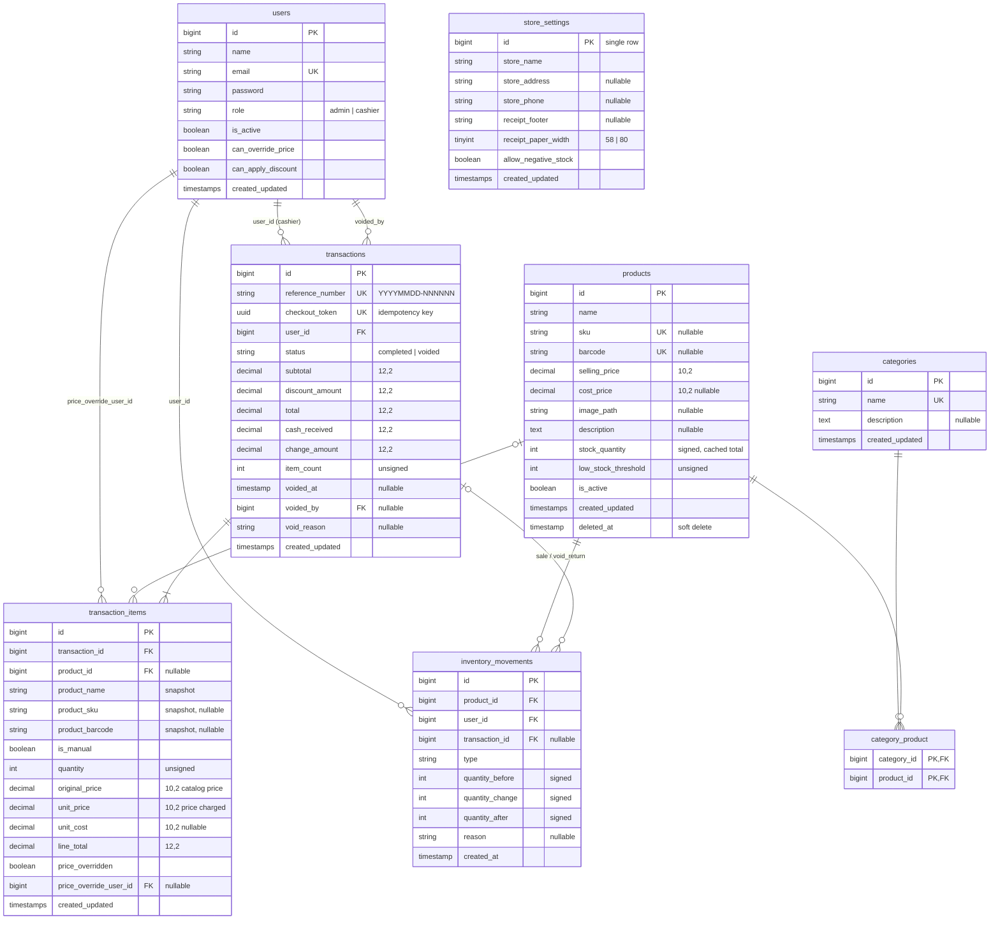

# K6 Tindahan — Database Design

Canonical schema for the Sari-Sari Store POS. The migrations in [implementation-plan.md](implementation-plan.md) (Task 2.3) implement exactly this document.

**Engine:** MySQL 8.0 (InnoDB, `utf8mb4_unicode_ci`). **App timezone:** `Asia/Manila`; the MySQL session is pinned to `+08:00`.

---

## 1. Design principles

1. **The ledger is the truth.** `inventory_movements` is append-only. `products.stock_quantity` is a cached running total that must always equal `SUM(quantity_change)` for that product.
2. **Sales are snapshots.** `transaction_items` copies the product's name, SKU, barcode, price and cost at the moment of sale. Receipts and reports never read the live product.
3. **Nothing financial is deleted.** Transactions, items and movements have no delete path. Products are soft-deleted. Users are deactivated.
4. **Money is `DECIMAL`, never `FLOAT`.** PHP does arithmetic in integer centavos and writes two-decimal strings.
5. **Only what is needed.** Eight business tables. No roles/permissions tables, no key-value settings, no polymorphism.

---

## 2. Entity-relationship diagram



---

## 3. Tables

### 3.1 `users` (existing table, four columns added)

| Column | Type | Null | Default | Notes |
|--------|------|:----:|---------|-------|
| `role` | `VARCHAR(20)` | no | `cashier` | `admin` or `cashier`; cast to `App\Enums\UserRole`. Indexed. |
| `is_active` | `BOOLEAN` | no | `true` | Inactive users cannot log in or use the POS. |
| `can_override_price` | `BOOLEAN` | no | `false` | Cashier may change an item's price at the POS. Admins always may. |
| `can_apply_discount` | `BOOLEAN` | no | `false` | Cashier may apply a sale discount. Admins always may. |

Existing columns (`id`, `name`, `email` unique, `email_verified_at`, `password`, `remember_token`, timestamps) are unchanged.

**Why not a permissions package:** two fixed roles and two switches. A string column with an enum cast is easier to read, test and seed than five extra tables.

### 3.2 `categories`

| Column | Type | Null | Notes |
|--------|------|:----:|-------|
| `id` | `BIGINT UNSIGNED` | no | PK |
| `name` | `VARCHAR(100)` | no | Unique |
| `description` | `TEXT` | yes | |
| `created_at`, `updated_at` | `TIMESTAMP` | yes | |

### 3.3 `products`

| Column | Type | Null | Default | Notes |
|--------|------|:----:|---------|-------|
| `id` | `BIGINT UNSIGNED` | no | | PK |
| `name` | `VARCHAR(150)` | no | | |
| `sku` | `VARCHAR(64)` | yes | | Unique when present |
| `barcode` | `VARCHAR(64)` | yes | | Unique when present. String, so leading zeros survive. |
| `selling_price` | `DECIMAL(10,2)` | no | | |
| `cost_price` | `DECIMAL(10,2)` | yes | | |
| `image_path` | `VARCHAR(255)` | yes | | Path on the `public` disk |
| `description` | `TEXT` | yes | | |
| `stock_quantity` | `INT` (signed) | no | `0` | Written only by `InventoryService` |
| `low_stock_threshold` | `INT UNSIGNED` | no | `5` | Low when `stock_quantity <= low_stock_threshold` |
| `is_active` | `BOOLEAN` | no | `true` | Inactive products are hidden from the POS |
| `created_at`, `updated_at` | `TIMESTAMP` | yes | | |
| `deleted_at` | `TIMESTAMP` | yes | | Soft delete |

**Optional unique barcode.** MySQL unique indexes allow any number of `NULL`s, so many products can have no barcode while two can never share one. The model converts empty or whitespace-only input to `NULL`; without that, two blank barcodes would collide as `''`.

**Why `stock_quantity` is signed.** The brief asks for unsigned stock "where appropriate" and for negative stock to be prevented "unless explicitly permitted by business rules". The store setting `allow_negative_stock` is that permission. When it is off (the default), `InventoryService` refuses any deduction that would go below zero, so the column never holds a negative value. When the owner turns it on, a sale of an item the system thinks is out of stock is recorded honestly as negative stock until a count corrects it. An unsigned column would make that setting impossible. If the owner rejects decision D1 in the plan, change the column to `unsignedInteger` and remove the setting.

**Why soft delete.** A deleted product must still be reachable from old sales (for void and for drill-down). The barcode of a soft-deleted product stays reserved; the admin restores the product or changes its barcode to reuse the code.

### 3.4 `category_product`

| Column | Type | Notes |
|--------|------|-------|
| `category_id` | `BIGINT UNSIGNED` | FK → `categories.id`, cascade on delete |
| `product_id` | `BIGINT UNSIGNED` | FK → `products.id`, cascade on delete |

Primary key `(category_id, product_id)` prevents duplicates and serves "products in a category". A second index on `product_id` serves "categories of a product". A product with no rows here is simply uncategorized.

### 3.5 `store_settings`

One row, created by the migration.

| Column | Type | Null | Default |
|--------|------|:----:|---------|
| `id` | `BIGINT UNSIGNED` | no | |
| `store_name` | `VARCHAR(100)` | no | `My Sari-Sari Store` |
| `store_address` | `VARCHAR(255)` | yes | |
| `store_phone` | `VARCHAR(50)` | yes | |
| `receipt_footer` | `VARCHAR(255)` | yes | |
| `receipt_paper_width` | `TINYINT UNSIGNED` | no | `58` |
| `allow_negative_stock` | `BOOLEAN` | no | `false` |
| `created_at`, `updated_at` | `TIMESTAMP` | yes | |

**Why typed columns instead of key/value:** six settings, each with a real type and default. The schema validates them and Eloquent casts them with no extra layer.

### 3.6 `transactions`

| Column | Type | Null | Default | Notes |
|--------|------|:----:|---------|-------|
| `id` | `BIGINT UNSIGNED` | no | | PK |
| `reference_number` | `VARCHAR(32)` | yes | | Unique. `YYYYMMDD-` + zero-padded id, e.g. `20261117-000042`. |
| `checkout_token` | `CHAR(36)` | no | | Unique. One UUID per POS cart. |
| `user_id` | `BIGINT UNSIGNED` | no | | FK → `users.id`, restrict. The cashier. |
| `status` | `VARCHAR(20)` | no | `completed` | `completed` or `voided` |
| `subtotal` | `DECIMAL(12,2)` | no | | Sum of line totals |
| `discount_amount` | `DECIMAL(12,2)` | no | `0.00` | Whole-sale discount in pesos |
| `total` | `DECIMAL(12,2)` | no | | `subtotal − discount_amount` |
| `cash_received` | `DECIMAL(12,2)` | no | | |
| `change_amount` | `DECIMAL(12,2)` | no | | `cash_received − total` |
| `item_count` | `INT UNSIGNED` | no | | Sum of quantities; saves a join on the history list |
| `voided_at` | `TIMESTAMP` | yes | | |
| `voided_by` | `BIGINT UNSIGNED` | yes | | FK → `users.id`, restrict |
| `void_reason` | `VARCHAR(255)` | yes | | |
| `created_at`, `updated_at` | `TIMESTAMP` | yes | | `created_at` is the sale time |

**`reference_number` is nullable on purpose.** It is built from the auto-increment id, so the row is inserted first and the number is set one statement later, inside the same database transaction. No other connection can ever observe the `NULL`. This avoids a counter table and its lock while still giving a short, readable, unique number.

**`checkout_token` makes checkout idempotent.** The POS generates a UUID when a cart starts and sends it with the sale. A second request with the same token finds the existing sale; if two requests race, the unique index rejects the second insert and the service returns the first sale.

**Voiding changes four columns** (`status`, `voided_at`, `voided_by`, `void_reason`). The amounts and items are never altered.

### 3.7 `transaction_items`

| Column | Type | Null | Default | Notes |
|--------|------|:----:|---------|-------|
| `id` | `BIGINT UNSIGNED` | no | | PK |
| `transaction_id` | `BIGINT UNSIGNED` | no | | FK → `transactions.id`, cascade |
| `product_id` | `BIGINT UNSIGNED` | yes | | FK → `products.id`, set null. `NULL` for manual items. |
| `product_name` | `VARCHAR(150)` | no | | Snapshot |
| `product_sku` | `VARCHAR(64)` | yes | | Snapshot |
| `product_barcode` | `VARCHAR(64)` | yes | | Snapshot |
| `is_manual` | `BOOLEAN` | no | `false` | Entered by hand at the POS; no inventory effect |
| `quantity` | `INT UNSIGNED` | no | | |
| `original_price` | `DECIMAL(10,2)` | no | | Catalog price when sold (for manual items: the entered price) |
| `unit_price` | `DECIMAL(10,2)` | no | | Price actually charged |
| `unit_cost` | `DECIMAL(10,2)` | yes | | Snapshot of `cost_price`, for future profit reports |
| `line_total` | `DECIMAL(12,2)` | no | | `unit_price × quantity` |
| `price_overridden` | `BOOLEAN` | no | `false` | `unit_price ≠ original_price` |
| `price_override_user_id` | `BIGINT UNSIGNED` | yes | | FK → `users.id`, restrict. Who changed the price. |
| `created_at`, `updated_at` | `TIMESTAMP` | yes | | |

**Manual items** are rows with `product_id = NULL` and `is_manual = true`. They never create a product and never create a movement.

**Price override audit.** `original_price` and `unit_price` are both stored, so the difference is always visible; `price_override_user_id` names who did it. Today that is the cashier ringing the sale; a separate column leaves room for supervisor approval later.

**`unit_cost`** cannot be reconstructed after the fact, because `cost_price` changes over time. Capturing it now costs one column.

### 3.8 `inventory_movements`

| Column | Type | Null | Notes |
|--------|------|:----:|-------|
| `id` | `BIGINT UNSIGNED` | no | PK |
| `product_id` | `BIGINT UNSIGNED` | no | FK → `products.id`, restrict |
| `user_id` | `BIGINT UNSIGNED` | no | FK → `users.id`, restrict. Who performed it. |
| `transaction_id` | `BIGINT UNSIGNED` | yes | FK → `transactions.id`, set null. Set for `sale` and `void_return`. |
| `type` | `VARCHAR(20)` | no | See below |
| `quantity_before` | `INT` | no | Stock before |
| `quantity_change` | `INT` | no | Signed: negative removes stock |
| `quantity_after` | `INT` | no | Stock after |
| `reason` | `VARCHAR(255)` | yes | Notes |
| `created_at` | `TIMESTAMP` | no | Defaults to now. There is no `updated_at`: rows are never edited. |

Movement types (`App\Enums\StockMovementType`):

| Value | Direction | Created by |
|-------|-----------|------------|
| `initial` | + | Opening stock on product creation |
| `restock` | + | Admin: delivery received |
| `sale` | − | `CheckoutService` |
| `void_return` | + | `TransactionService::void()` |
| `damaged` | − | Admin |
| `expired` | − | Admin |
| `lost` | − | Admin |
| `correction` | ± | Admin: stock count; change = counted − current |

This covers every field the brief requires for a stock adjustment: product, previous quantity, adjustment quantity, new quantity, type, reason, user, date and time.

---

## 4. Indexes

| Table | Index | Serves |
|-------|-------|--------|
| `users` | `email` unique (existing); `role` | Login; role filters |
| `categories` | `name` unique | Duplicate prevention |
| `products` | `barcode` unique | Scan lookup — the hottest query in the system |
| `products` | `sku` unique | SKU lookup |
| `products` | `(is_active, name)` | POS grid: active products ordered by name |
| `category_product` | PK `(category_id, product_id)`; `product_id` | Both directions of the many-to-many |
| `transactions` | `reference_number` unique | Search by transaction number |
| `transactions` | `checkout_token` unique | Idempotency |
| `transactions` | `(status, created_at)` | Dashboard and every report |
| `transactions` | `(user_id, created_at)` | Cashier's own history; sales by cashier |
| `transactions` | `voided_by` (from FK) | — |
| `transaction_items` | `transaction_id` (from FK) | Items of a sale |
| `transaction_items` | `product_id` | Sales by product; product drill-down |
| `inventory_movements` | `(product_id, created_at)` | A product's history |
| `inventory_movements` | `(type, created_at)` | Filter by type |
| `inventory_movements` | `transaction_id`, `user_id` (from FKs) | Movements of a sale |

Name search uses `LIKE '%term%'`, which cannot use an index. At sari-sari scale (hundreds to a few thousand products) a scan is instant. Beyond that, add a FULLTEXT index on `products.name`.

---

## 5. Deletion strategy

| When this is deleted | Effect | Mechanism |
|----------------------|--------|-----------|
| Category | Pivot rows removed; products untouched | `category_product.category_id` cascade |
| Product (normal delete) | Hidden everywhere; history intact; can be restored | Soft delete (`deleted_at`) |
| Product (force delete) | Not offered by the app. Blocked by the database if any movement exists. | `inventory_movements.product_id` restrict; `transaction_items.product_id` set null as a last-resort backstop |
| User | Not offered by the app; blocked by the database if they have sales or movements | Policies return `false`; FKs restrict. Deactivate with `is_active = false`. |
| Transaction | Not offered by the app. Void instead. | Policies return `false`; no route |
| Inventory movement | Not offered by the app | Policies return `false`; no route |

---

## 6. Migration sequence

Order matters because of foreign keys.

| # | File | Depends on |
|---|------|------------|
| 1 | `2026_11_17_000001_add_pos_fields_to_users_table` | `users` (existing) |
| 2 | `2026_11_17_000002_create_categories_table` | — |
| 3 | `2026_11_17_000003_create_products_table` | — |
| 4 | `2026_11_17_000004_create_category_product_table` | categories, products |
| 5 | `2026_11_17_000005_create_store_settings_table` | — (inserts the single row) |
| 6 | `2026_11_17_000006_create_transactions_table` | users |
| 7 | `2026_11_17_000007_create_transaction_items_table` | transactions, products, users |
| 8 | `2026_11_17_000008_create_inventory_movements_table` | products, users, transactions |

The framework's existing migrations (users, cache, jobs) stay as they are.

---

## 7. Invariants

These must hold at all times. Each has a test.

| # | Invariant | Enforced by | Test |
|---|-----------|-------------|------|
| I1 | `products.stock_quantity = SUM(inventory_movements.quantity_change)` | Only `InventoryService::adjust()` writes stock, and always with a movement in the same DB transaction | `InventoryServiceTest`, `VoidTransactionTest` |
| I2 | For each movement, `quantity_after = quantity_before + quantity_change` | Computed under a row lock | `InventoryServiceTest` |
| I3 | `transactions.total = subtotal − discount_amount` and `change_amount = cash_received − total ≥ 0` | `CheckoutService` | `CheckoutServiceTest` |
| I4 | `transactions.subtotal = SUM(items.line_total)` and `line_total = unit_price × quantity` | `CheckoutService` | `CheckoutServiceTest` |
| I5 | A completed sale has at least one item | Empty carts are refused | `CheckoutServiceTest` |
| I6 | Each catalog item on a completed sale has exactly one `sale` movement; each on a voided sale also has exactly one `void_return` | `CheckoutService`, `TransactionService` | `CheckoutServiceTest`, `VoidTransactionTest` |
| I7 | Manual items have no movements | `product_id IS NULL` is skipped | `CheckoutServiceTest`, `VoidTransactionTest` |
| I8 | One sale per `checkout_token` | Unique index + pre-check | `CheckoutServiceTest`, `PosTest` |
| I9 | With `allow_negative_stock = false`, no product has negative stock | `InventoryService` refuses | `InventoryServiceTest`, `CheckoutServiceTest` |

A reconciliation query for I1, safe to run at any time:

```sql
SELECT p.id, p.name, p.stock_quantity, COALESCE(SUM(m.quantity_change), 0) AS ledger_total
FROM products p
LEFT JOIN inventory_movements m ON m.product_id = p.id
GROUP BY p.id, p.name, p.stock_quantity
HAVING p.stock_quantity <> ledger_total;
```

It must return no rows.

---

## 8. Concurrency

| Scenario | What happens |
|----------|--------------|
| Two tills sell the last unit | Both transactions request `SELECT … FOR UPDATE` on the product row. The first commits and stock becomes 0. The second then reads 0 and is refused. |
| Two tills sell overlapping multi-item carts | Both lock products in ascending `id` order, so neither can hold a row the other needs while waiting. If MySQL still reports a deadlock, the transaction is retried up to three times. |
| Admin adjusts stock during a sale | `InventoryService::adjust()` takes the same row lock; the operations run one after the other and both movements record correct before/after values. |
| The same sale is submitted twice | Same `checkout_token`: the second call returns the first sale. |
| Two admins void the same sale | The transaction row is locked; the second sees `voided` and is refused. |
| Admin saves the product form during a sale | The form does not write `stock_quantity`, so the sale's deduction is not overwritten. |

All locks are row locks held for the few milliseconds of one sale. With one or two tills there is no measurable contention.

---

## 9. Requirement check

| Business rule (brief §5) | Supported by |
|--------------------------|--------------|
| 1. Products can exist without categories | No required pivot row |
| 2. Products can belong to multiple categories | `category_product` |
| 3. Products can exist without barcodes | `barcode` nullable |
| 4. Barcodes unique when provided | Unique index; blanks stored as `NULL` |
| 5. Sell registered and manual products | `transaction_items.product_id` nullable + `is_manual` |
| 6. Manual products do not affect inventory | No movement without a `product_id` |
| 7. Custom prices do not change the product price | Price lives on the item (`unit_price`); product untouched |
| 8. Every completed sale has a transaction and items | Written together in one DB transaction |
| 9. Inventory deducted only after successful checkout | Deduction is inside the same DB transaction as the sale |
| 10. Voided sales restore inventory | `void_return` movements |
| 11. History accurate after product edits or deletes | Item snapshots; soft-deleted products |
| 12. Cashiers have no admin access | `users.role` + policies |
