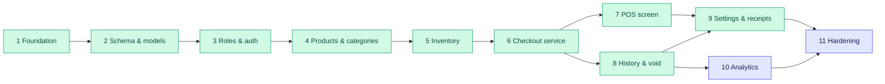

# K6 Tindahan — Development Roadmap

Phase-by-phase roadmap for the Sari-Sari Store POS. Task-level steps and code are in [implementation-plan.md](implementation-plan.md); the schema is in [database-design.md](database-design.md); cashier behaviour is in [pos-workflow.md](pos-workflow.md).

**Status:** planning complete, awaiting approval. No application code has been written and nothing has been installed.

---

## 1. Starting point

| Item | State on 2026-11-16 |
|------|---------------------|
| Framework | Laravel **13.42** skeleton (the brief says 12 — see below) |
| PHP / Composer | 8.5.2 / 2.9.3 |
| Filament, Livewire | Not installed. Filament 4.16 + Livewire 3.8 resolve cleanly against Laravel 13 (dry run). |
| Database | MySQL 8.0.33, database `k6_tindahan`, default migrations only |
| Frontend | Tailwind 4.3, Vite 8.3. Active Node is 18; Vite 8 needs Node 20.19+ (20.x is available in Herd). |
| Tests | Pest 5, currently pointed at SQLite |
| Git | Not a repository yet |

**Stack decision:** stay on Laravel 13. It is what is installed, the requested Filament 4 and Livewire 3 support it, and a downgrade would only add risk.

---

## 2. Phase order

The brief's suggested order is kept with three changes, each because of a real dependency:

| Change | Reason |
|--------|--------|
| Roles and permissions move from phase 9 to **phase 3** | Stock adjustment, price override and void all need the permission checks to exist first. |
| Checkout service (**6**) comes before the POS screen (**7**) | The screen is a caller of the service. Building and testing the core first keeps business rules out of the UI. |
| Receipts (**9**) come before analytics (**10**) | A till needs receipts to go live; it does not need charts. |

Green = needed to open the till (MVP). Blue = second release.

Phases 7 and 8 both depend only on 6 and can be built in parallel. Phase 10 can start as soon as 8 is done.

| Brief's phase | This roadmap |
|---------------|--------------|
| 1 Inspection and architecture | Done (this planning stage) + Phase 1 tooling |
| 2 Database | Phase 2 |
| 3 Products and categories | Phase 4 |
| 4 Inventory | Phase 5 |
| 5 POS interface | Phase 7 |
| 6 Checkout | Phase 6 |
| 7 Transaction history | Phase 8 |
| 8 Analytics | Phase 10 |
| 9 Users and permissions | Phase 3 |
| 10 Receipts | Phase 9 |
| 11 Testing and polish | Phase 11 (tests are written inside every phase, not saved for the end) |

---

## 3. Phases

Sizes are relative effort for one developer or agent: **S** ≈ half a day, **M** ≈ one day, **L** ≈ two days. They are estimates for planning, not commitments.

### Phase 1 — Foundation and tooling · S

| | |
|---|---|
| **Objectives** | A committed baseline with the right tools and configuration. |
| **Features** | Git repository; Node 20; Laravel Boost (required by `CLAUDE.md`); Filament 4 panel at `/admin`; Manila timezone; MySQL test database; storage link; panel branding. |
| **Files** | Create `.nvmrc`, `app/Providers/Filament/AdminPanelProvider.php` (installer). Modify `config/app.php`, `config/database.php`, `.env`, `.env.example`, `phpunit.xml`, `tests/Pest.php`, `tests/Feature/ExampleTest.php`. |
| **Dependencies** | None. Adds `filament/filament ^4.0` (brings `livewire/livewire ^3`) and `laravel/boost` (dev). |
| **Database** | Creates empty database `k6_tindahan_testing`. |
| **Acceptance** | Filament v4.x, Livewire v3.x, Laravel still v13.x · `npm run build` succeeds on Node 20 · `/admin/login` renders · tests pass on MySQL · timezone is `Asia/Manila` · `public/storage` linked. |
| **Tests** | Smoke test: login page renders. |

### Phase 2 — Database schema and domain models · M

| | |
|---|---|
| **Objectives** | The full schema, enums, models, factories and the money helper. |
| **Features** | Eight migrations; `UserRole`, `TransactionStatus`, `StockMovementType`; seven models with relationships and scopes; `Money` (centavo arithmetic); default admin and cashier accounts. |
| **Files** | `database/migrations/*` (8), `app/Enums/*` (3), `app/Models/*` (6 new, `User` modified), `app/Support/Money.php`, `database/factories/*`, `database/seeders/DatabaseSeeder.php`, `tests/Pest.php`. |
| **Dependencies** | Phase 1. |
| **Database** | `users` +4 columns; new `categories`, `products`, `category_product`, `store_settings`, `transactions`, `transaction_items`, `inventory_movements`. |
| **Acceptance** | `migrate:fresh` succeeds · products work with 0, 1 or many categories · duplicate barcodes rejected, blank barcodes stored as `NULL` · stock is not mass-assignable · money conversions exact. |
| **Tests** | `MoneyTest`, `ProductModelTest`. |

### Phase 3 — Users, roles and authorization · M

| | |
|---|---|
| **Objectives** | Every permission enforced and tested before the features that rely on it. |
| **Features** | Policies for all models; gates `access-pos`, `override-price`, `apply-discount`, `view-reports`; user management (create, edit, activate/deactivate, per-cashier price-override and discount switches). |
| **Files** | `app/Policies/*` (7), `app/Providers/AppServiceProvider.php`, `app/Filament/Resources/Users/*`. |
| **Dependencies** | Phase 2. |
| **Database** | None. |
| **Acceptance** | Inactive users blocked · cashiers get 403 on admin pages · override and discount follow the per-user switches · nobody can delete users, sales or movements · an admin cannot demote or deactivate themselves · passwords stored hashed. |
| **Tests** | `AuthorizationTest`. |

### Phase 4 — Product and category management · M

| | |
|---|---|
| **Objectives** | The catalog back office. |
| **Features** | Product CRUD with image upload, optional barcode/SKU, multiple categories, soft delete and restore; search by name/SKU/barcode; filters for category, low stock, active, deleted; low-stock badge. Category CRUD. |
| **Files** | `app/Filament/Resources/Products/*`, `app/Filament/Resources/Categories/*`. |
| **Dependencies** | Phase 3. |
| **Database** | None. |
| **Acceptance** | Products save with no barcode, SKU, image or category · duplicate barcode shows a form error · list searches and filters correctly · scanning into the barcode field does not submit the form · no editable stock field. |
| **Tests** | `CatalogResourceTest`. |

### Phase 5 — Inventory and stock management · M

| | |
|---|---|
| **Objectives** | One audited path for every stock change. |
| **Features** | `InventoryService`; "Adjust stock" (restock, damaged, expired, lost, count correction) with required reasons; opening stock on product creation; read-only movement history with filters. |
| **Files** | `app/Services/InventoryService.php`, `app/Exceptions/InsufficientStockException.php`, `app/Filament/Resources/Products/Actions/AdjustStockAction.php`, `app/Filament/Resources/InventoryMovements/*`; modify product resource and pages. |
| **Dependencies** | Phase 4. |
| **Database** | None. |
| **Acceptance** | Each change writes one complete movement · write-offs above stock refused · correction sets stock to the counted number · stock always equals the sum of movements · cashiers have no access. |
| **Tests** | `InventoryServiceTest`, `StockAdjustmentUiTest`. |

### Phase 6 — Checkout and transaction processing · L

| | |
|---|---|
| **Objectives** | The atomic, idempotent sale. The most important code in the system. |
| **Features** | `Cart` (pure PHP); `CheckoutService`: permission checks, row locks, price and stock re-validation, item snapshots, stock deduction, reference numbers, idempotency token; readable refusal reasons. |
| **Files** | `app/Pos/Cart.php`, `app/Services/CheckoutService.php`, `app/Exceptions/CheckoutException.php`, `tests/Pest.php`. |
| **Dependencies** | Phase 5. |
| **Database** | None. |
| **Acceptance** | A sale saves completely or not at all · manual items never touch stock · overrides store both prices and the user, and require permission · insufficient stock refused with a list · same token → same sale, stock deducted once · short cash refused · changed prices detected · history survives product edits and deletes. |
| **Tests** | `CartTest`, `CheckoutServiceTest`. |

### Phase 7 — POS cashier interface · L

| | |
|---|---|
| **Objectives** | The cashier screen described in [pos-workflow.md](pos-workflow.md). |
| **Features** | `/pos` full-page Livewire component and layout; scanner focus handling; scan, search, category filter, product grid; cart controls; price override form; manual item form; payment panel with bill shortcuts; sale-complete panel; role-based landing after login; "Open POS" link in the admin panel. |
| **Files** | `app/Livewire/Pos.php`, `resources/views/livewire/pos.blade.php`, `resources/views/components/layouts/pos.blade.php`, `app/Http/Responses/LoginResponse.php`; modify `routes/web.php`, `bootstrap/app.php`, `resources/css/app.css`, both providers. |
| **Dependencies** | Phase 6. |
| **Database** | None. |
| **Acceptance** | Barcode field focused on open and after every action · known scans add or increment, unknown scans offer manual entry · search, categories and tap-to-add work · quantity controls work, stock limit respected · price editing only with permission · totals and change update live · double submit creates one sale · reload keeps the cart · the browser cannot write the cart · cashiers land on `/pos`, admins on `/admin`. |
| **Tests** | `PosTest`; manual script with a real scanner. |

### Phase 8 — Transaction history and voiding · M

| | |
|---|---|
| **Objectives** | Find any sale; void with a full audit trail. |
| **Features** | Transaction list (search by number; filter by date, cashier, status); detail page (items, regular vs. sold price, who changed a price, manual items, payment, void details); void with reason (admin only); cashiers limited to their own sales. |
| **Files** | `app/Services/TransactionService.php`, `app/Exceptions/TransactionAlreadyVoidedException.php`, `app/Filament/Resources/Transactions/*`. |
| **Dependencies** | Phase 6. |
| **Database** | None. |
| **Acceptance** | Search and filters work · detail shows everything listed · other cashiers' sales return 404 · void restores stock through new movements and leaves the original records untouched · no double void · void works after the product was deleted. |
| **Tests** | `VoidTransactionTest`, `TransactionResourceTest`. |

### Phase 9 — Store settings and receipt printing · M

| | |
|---|---|
| **Objectives** | Configurable store details and a printable receipt. |
| **Features** | Store settings (name, address, phone, footer, paper width, negative-stock rule); receipt page for 58 mm and 80 mm; print from the POS; reprint from history; VOIDED mark. |
| **Files** | `app/Filament/Resources/StoreSettings/*`, `app/Http/Controllers/ReceiptController.php`, `resources/views/receipts/show.blade.php`; modify `routes/web.php`, POS view, transaction resource. |
| **Dependencies** | Phases 7 and 8. |
| **Database** | None. |
| **Acceptance** | Admin-only settings · receipt carries every field in the brief · correct width for each paper size, no browser margins · reprint available · cashiers cannot open others' receipts. |
| **Tests** | `StoreSettingsTest`, `ReceiptTest`; manual print on both paper sizes. |

### Phase 10 — Sales analytics and dashboard · M

| | |
|---|---|
| **Objectives** | Today at a glance; breakdowns for any date range. |
| **Features** | Dashboard: today's sales, transaction count, average sale, product count, low-stock count, 30-day chart, best sellers, low-stock list. Sales Reports: date range, daily/weekly/monthly chart, sales by product, by category, by cashier. |
| **Files** | `app/Services/SalesReportService.php`, `app/Support/ReportRange.php`, `app/Filament/Widgets/*` (8), `app/Filament/Pages/Dashboard.php`, `app/Filament/Pages/SalesReports.php`; modify panel provider. |
| **Dependencies** | Phase 8. |
| **Database** | None (indexes exist since Phase 2). |
| **Acceptance** | All listed figures present · voided sales excluded everywhere · past reports unaffected by product edits · manual items identified · cashiers see no figures. |
| **Tests** | `SalesReportServiceTest`, `DashboardAccessTest`. |

### Phase 11 — Hardening, optimization and polish · M

| | |
|---|---|
| **Objectives** | Prove the guarantees on real MySQL; leave the store able to run and recover. |
| **Features** | Demo catalog seeder; two-process race check; `EXPLAIN` and timing with 2,000 products and 50,000 sales; README (setup, scanner, printer, backup and restore); production settings. |
| **Files** | `database/seeders/DemoCatalogSeeder.php`, `README.md`. |
| **Dependencies** | All phases. |
| **Database** | An index only if the query check shows a full scan. |
| **Acceptance** | Full suite passes, style clean · last-unit race: exactly one sale, every run · hot queries use indexes · POS and dashboard under one second with volume data · backup and restore documented. |
| **Tests** | Full suite; manual race and load checks. |

---

## 4. Milestones

| Milestone | After phase | What works |
|-----------|-------------|------------|
| **M1 — Back office** | 5 | Owner can enter the whole catalog and opening stock, and manage users. Good moment to start loading real products. |
| **M2 — First sale** | 7 | A cashier can scan and complete a real sale; stock moves. |
| **M3 — MVP: open the till** | 9 | History, void, settings and receipts. The store can trade on it. |
| **M4 — Insight** | 10 | Dashboard and reports. |
| **M5 — Go-live ready** | 11 | Concurrency and load proven; backups documented. |

Even if M3 is the practical cut, run the Phase 11 race check (Task 11.2) and set up backups before real money goes through the system.

---

## 5. MVP and postponed features

**MVP (Phases 1–9):** products, categories, stock with audit trail, POS with scanning, manual items and price override, atomic checkout, history, void, receipts, users and roles, store settings.

**Second release (Phases 10–11):** dashboard, reports, hardening.

**Postponed** — none of these blocks the MVP, and the schema already leaves room for each:

| Feature | Note |
|---------|------|
| Utang (customer credit) | The most-requested sari-sari feature after basic sales; a module of its own. |
| GCash and other payment methods | One column on `transactions`. |
| Profit reports | Cost is already snapshotted on each item. |
| Fractional quantities (per-kilo goods) | For now, sell pre-packed units. |
| Parked sales | — |
| Supervisor PIN for overrides and voids | Approver columns already exist. |
| Cash drawer count / end-of-day report | — |
| Barcode label printing, suppliers, purchase orders, expiry tracking | — |
| Offline mode | Would need a different architecture. |

---

## 6. Decisions needed from the owner

Each has a default the plan proceeds with. Changing one is cheap before the phase shown.

| # | Question | Default | Decide before |
|---|----------|---------|---------------|
| D1 | The system shows 0 stock but the item is on the counter. Block the sale, or allow it and fix the count later? | Block; an admin setting can allow it | Phase 2 |
| D2 | Whole-number quantities only? | Yes | Phase 2 |
| D3 | May cashiers see each other's sales? | No, only their own | Phase 8 |
| D4 | Who may void, and for how long after the sale? | Admins only, any time, reason required | Phase 8 |
| D5 | Receipt roll width? | 58 mm, switchable to 80 mm | Phase 9 |
| D6 | Are official (BIR) receipts required? | No. Receipts state they are not official receipts. | Before go-live |

---

## 7. Main risks

| Risk | Mitigation |
|------|------------|
| Overselling when two tills sell the same item | Row locks inside the sale transaction; verified with two real processes (Phase 11). |
| A double click creates two sales | Idempotency token with a unique index, plus a disabled button. |
| A cashier lowers prices through a crafted request | Cart is locked server-side; checkout re-reads prices and re-checks permission. |
| Manual items used to bypass price control | Flagged on every sale and separated in reports for the owner to review. |
| Scanner input lands in the wrong place | Focus rules in [pos-workflow.md](pos-workflow.md) §3.1; tested with real hardware. |
| Filament class names differ from the plan (it could not be installed during planning) | Verification table in the plan (Part A); only names may change, not the design. |
| One computer, no backup | Daily dump and off-machine copy documented in Phase 11. |

The full list of 20 risks and edge cases is in [implementation-plan.md](implementation-plan.md), Part E.

---

## 8. Working agreement for implementation

- One task at a time, test first, commit after each task.
- Business rules go in services; Livewire and Filament only call them.
- A phase is done when its acceptance criteria pass, not when its code is written.
- No dependency is added beyond Filament 4 and Laravel Boost without a written reason.
- Implementation starts only after this plan is approved.
