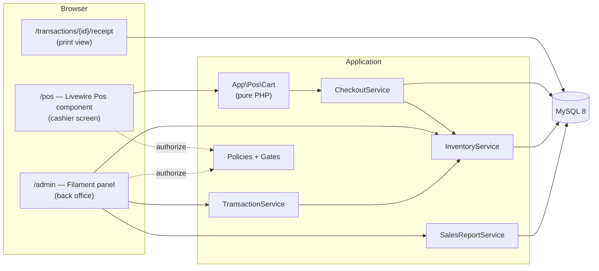
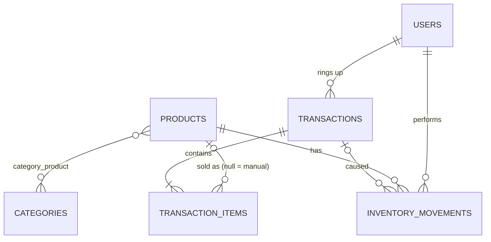
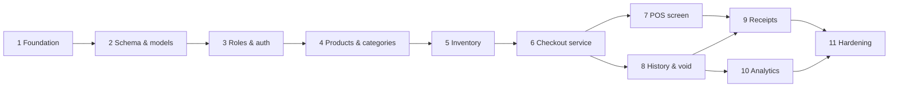

# K6 Tindahan — Sari-Sari Store POS Implementation Plan

> **For agentic workers:** REQUIRED SUB-SKILL: Use superpowers:subagent-driven-development (recommended) or superpowers:executing-plans to implement this plan task-by-task. Steps use checkbox (`- [ ]`) syntax for tracking.

**Goal:** Build a fast, simple cashier/POS system for a Filipino sari-sari store: barcode checkout, product and stock management, an auditable sales ledger, receipts, and basic analytics.

**Architecture:** One Laravel monolith. A Filament 4 admin panel (`/admin`) handles back-office CRUD, history and reports; a single full-page Livewire 3 component (`/pos`) is the cashier screen. All money- and stock-changing logic lives in four service classes that run inside database transactions with row locks; Livewire and Filament are thin callers.

**Tech Stack:** Laravel 13.42 (installed — see finding F1), PHP 8.5, Filament 4.16, Livewire 3.8, MySQL 8.0, Tailwind CSS 4, Vite 8, Pest 5.

**Companion documents:**
[database-design.md](database-design.md) (canonical schema + ERD) ·
[pos-workflow.md](pos-workflow.md) (cashier flows, focus rules, error states) ·
[development-roadmap.md](development-roadmap.md) (phase order, MVP cut, acceptance criteria)

---

## Part A — Findings from the existing project

Inspected on 2026-11-16. Nothing was installed or modified.

| # | Finding | Evidence | Consequence for the plan |
|---|---------|----------|--------------------------|
| F1 | **Laravel 13.42 is installed, not Laravel 12.** | `composer.lock`, `php artisan about` | Stay on 13. Downgrading a fresh skeleton to 12 has no benefit and would also force Pest 5 → 4 and PHPUnit 13 → 12. Filament 4 supports 13 (F2). |
| F2 | Filament and Livewire are **not installed**. A dry run in a scratch copy resolves `filament/filament ^4.0` to **v4.16.4** with **livewire v3.8.11**, leaving `laravel/framework` at v13.42.0. | `composer require "filament/filament:^4.0" --dry-run` on a copy of `composer.json`/`composer.lock` | The requested stack (Filament 4 + Livewire 3) works on Laravel 13 with no upgrades. Do **not** install Livewire 4 or Filament 5. |
| F3 | Active Node is **18.20.8**; Vite 8.3.8 and laravel-vite-plugin 3.2.1 require `^20.19.0 \|\| >=22.12.0`. Node 20.19.2 and 20.20.2 are available in Herd's nvm. | `node -v`, `node_modules/vite/package.json` engines | Phase 1 adds `.nvmrc` and switches to Node 20 before any `npm run build`. |
| F4 | MySQL **8.0.33** is reachable; database `k6_tindahan` exists with only the three default migrations run. | `php artisan db:show`, `migrate:status` | No data to preserve. |
| F5 | Tests are configured for **SQLite in-memory**. | `phpunit.xml` | Switch tests to a MySQL database (`k6_tindahan_testing`). SQLite ignores `lockForUpdate`, stores decimals as floats, and would hide the exact class of bugs a POS must not have. |
| F6 | App timezone is hardcoded to **UTC**. | `config/app.php:68` | Change to `Asia/Manila`; otherwise "today's sales" rolls over at 8 AM. |
| F7 | `public/storage` is **not linked**; default disk is `local`. | `php artisan about` | Product images use the `public` disk explicitly; Phase 1 runs `storage:link`. |
| F8 | `APP_URL=http://k6-tindahan.test:8000`. Herd serves the site without a port. | `.env` | Image URLs are built from `APP_URL`. Phase 1 sets it to the URL actually used. |
| F9 | The directory is **not a git repository**. | no `.git` | Phase 1 runs `git init` so every task can commit. |
| F10 | `CLAUDE.md`/`AGENTS.md` require installing **Laravel Boost** before application changes. | file contents (identical) | Deferred to Phase 1, Task 1.2, because this planning stage forbids installs. Boost rewrites those files with generated guidelines — re-read them afterwards. |
| F11 | The skeleton `User` model uses Laravel 13 **PHP attributes** (`#[Fillable]`, `#[Hidden]`). | `app/Models/User.php` | New models follow the same style. |
| F12 | Session, cache and queue all use the `database` driver. No queue work is planned. | `.env` | Nothing to change. `SESSION_LIFETIME` is raised so an idle till does not expire mid-shift. |

### Filament API verification rule

Filament could not be installed during planning, so the Filament class code in this plan was written from knowledge of the v4 API, not checked against the installed package. The business logic (services, models, migrations, cart, tests) does not depend on Filament and is unaffected.

Before writing Filament code in any phase, confirm these names against `vendor/filament` and adjust **names only** — never the architecture:

| Used in plan | Verify with |
|--------------|-------------|
| `Filament\Auth\Http\Responses\Contracts\LoginResponse` | `grep -rn "interface LoginResponse" vendor/filament/filament/src` |
| `Table::recordActions()`, `Table::toolbarActions()`, `Table::records()` | `grep -n "function recordActions\|function toolbarActions\|function records" -r vendor/filament/tables/src` |
| `Filament\Schemas\Components\Utilities\Get` | `ls vendor/filament/schemas/src/Components/Utilities/` |
| `ImageColumn::imageSize()` | `grep -rn "function imageSize" vendor/filament/tables/src` |
| `InteractsWithPageFilters::$pageFilters` | `grep -rn "pageFilters" vendor/filament/widgets/src` |
| `Action::schema()` for modal forms | `grep -n "function schema" -r vendor/filament/actions/src` |
| `Filament\Support\Icons\Heroicon` cases | `grep -n "case Outlined" vendor/filament/support/src/Icons/Heroicon.php \| head -40` |

If a name differs, use what the installed package provides and note the change in the commit message.

---

## Part B — Architecture

### B1. Overview



**Rules that hold everywhere**

1. `products.stock_quantity` is written **only** by `InventoryService::adjust()`. It is not mass-assignable and no form writes it.
2. Every stock change creates one `inventory_movements` row in the same database transaction. Invariant: `stock_quantity = SUM(quantity_change)` per product.
3. A sale is written **only** by `CheckoutService::checkout()`; a void **only** by `TransactionService::void()`.
4. Money is computed in **integer centavos** in PHP and stored as `DECIMAL`. Floats are never added or compared.
5. Transaction items are **snapshots** (name, SKU, barcode, original price, charged price, cost). Reports and receipts read snapshots, never the live product.
6. The server never trusts the cart for prices. At checkout the service re-reads each product under lock.

### B2. Where the plan departs from the brief, and why

| Brief | Plan | Reason |
|-------|------|--------|
| Laravel 12 | Laravel 13.42 | Already installed; Filament 4 + Livewire 3 resolve cleanly (F1, F2). |
| Role/permission package | `users.role` enum + two boolean flags + policies | Two fixed roles. A package adds five tables and a cache layer for nothing. |
| `store_settings` (unspecified shape) | One typed row, not key/value | Typed columns are validated by the schema and need no casting layer. |
| `ReceiptService` | Dropped — an invokable controller and a Blade view | There is no logic to hold: load a transaction, render it. |
| `TransactionService` | Kept, but it only does voiding | Creation belongs to `CheckoutService`; a second writer invites drift. |
| Cart logic in Livewire | `App\Pos\Cart` pure PHP class | Unit-testable without a browser or Livewire. |
| Unsigned stock column | **Signed** `INT` + `allow_negative_stock` setting (default off) | See decision D1. |
| Cashier price override "configurable permission" | Per-user flags `can_override_price`, `can_apply_discount` | An owner trusts a family member but not a new helper; a global switch cannot express that. Same cost: one boolean. |
| Phase order 5 (POS UI) → 6 (checkout) | Checkout service first, then the UI | The UI is a caller of the service. Building the tested core first avoids logic leaking into Livewire. |
| Phase 9 (users/roles) near the end | Phase 3 | Inventory adjustments, price overrides and voids all need the gates to exist. |
| SQLite tests | MySQL tests | F5. |

### B3. Decisions that need the owner's confirmation

These have a default the plan proceeds with; each is cheap to flip before the phase that implements it.

| # | Decision | Default in plan | Alternative |
|---|----------|-----------------|-------------|
| D1 | What happens when the system says 0 in stock but the cashier is holding the item? | Block the sale. An admin setting `allow_negative_stock` (off by default) lets stock go negative so counts can be fixed later. | Hard-block always: make the column unsigned and remove the setting. |
| D2 | Quantities | Whole numbers only. Sell weighed goods as pre-packed products ("Sugar ¼ kg"). | Decimal quantities — touches schema, cart and UI; postponed. |
| D3 | Which transactions can a cashier see? | Only their own. | All transactions. One line in `TransactionResource`. |
| D4 | Who can void, and when? | Admin only, any time, reason required. | Same-day limit, or cashier voids with admin PIN (postponed). |
| D5 | Receipt paper | 58 mm default, switchable to 80 mm in Store Settings. | — |
| D6 | Legal status of receipts | Receipts are plain sales slips. This is **not** a BIR-accredited POS and does not issue official receipts. | BIR accreditation is a separate project. |

### B4. Models and relationships

| Model | Relationships | Notes |
|-------|---------------|-------|
| `User` | `hasMany(Transaction)` | `role` cast to `UserRole`; implements `FilamentUser`. Never deleted — deactivated. |
| `Category` | `belongsToMany(Product)` | Hard delete; pivot rows cascade. |
| `Product` | `belongsToMany(Category)`, `hasMany(InventoryMovement)`, `hasMany(TransactionItem)` | `SoftDeletes`. `stock_quantity` not fillable. Scopes: `active`, `lowStock`, `search`. |
| `StoreSetting` | — | Single row; `StoreSetting::current()`. |
| `Transaction` | `belongsTo(User, 'user_id')` as `cashier`, `belongsTo(User, 'voided_by')` as `voidedBy`, `hasMany(TransactionItem)` as `items`, `hasMany(InventoryMovement)` | Never updated except by void; never deleted. |
| `TransactionItem` | `belongsTo(Transaction)`, `belongsTo(Product)->withTrashed()`, `belongsTo(User, 'price_override_user_id')` as `priceOverrideUser` | Snapshot row. `product_id` null = manual item. |
| `InventoryMovement` | `belongsTo(Product)->withTrashed()`, `belongsTo(User)`, `belongsTo(Transaction)` | Append-only; no `updated_at`. |

Relationship diagram (columns are in [database-design.md](database-design.md)):



### B5. Service classes

```php
// App\Services\InventoryService — the only writer of products.stock_quantity
adjust(Product $product, int $change, StockMovementType $type, User $user,
       ?string $reason = null, ?Transaction $transaction = null,
       bool $allowNegative = false): InventoryMovement
applyManual(Product $product, StockMovementType $type, int $quantity, User $user,
            ?string $reason = null): InventoryMovement

// App\Services\CheckoutService — the only writer of new transactions
checkout(User $cashier, Cart $cart, int $discountCents, int $cashReceivedCents,
         string $checkoutToken): Transaction

// App\Services\TransactionService
void(Transaction $transaction, User $user, string $reason): Transaction

// App\Services\SalesReportService — read-only
summary($from, $to): array
salesByDay($from, $to): Collection
salesByPeriod($from, $to, string $period): Collection   // 'day' | 'week' | 'month'
salesByProduct($from, $to): Collection
salesByCategory($from, $to): Collection
salesByCashier($from, $to): Collection
bestSellers($from, $to, int $limit = 10): Collection
```

Supporting classes: `App\Pos\Cart`, `App\Support\Money`, `App\Exceptions\CheckoutException`, `App\Exceptions\InsufficientStockException`, `App\Exceptions\TransactionAlreadyVoidedException`.

### B6. Filament structure

Panel `admin` at `/admin`, light theme only, login enabled, no registration.

| Navigation | Class | Pages | Who |
|------------|-------|-------|-----|
| Open POS (link) | `NavigationItem` → `/pos` | — | all |
| Dashboard | `App\Filament\Pages\Dashboard` | stats, 30-day chart, best sellers, low stock | all (widgets admin-only) |
| Sales → Transactions | `Transactions\TransactionResource` | List, View | admin: all; cashier: own |
| Sales → Sales Reports | `App\Filament\Pages\SalesReports` | filtered dashboard | admin |
| Catalog → Products | `Products\ProductResource` | List, Create, Edit | admin |
| Catalog → Categories | `Categories\CategoryResource` | Manage (modal) | admin |
| Inventory → Stock Movements | `InventoryMovements\InventoryMovementResource` | List (read-only) | admin |
| Settings → Users | `Users\UserResource` | List, Create, Edit | admin |
| Settings → Store Settings | `StoreSettings\StoreSettingResource` | Edit single row | admin |

### B7. Livewire POS component

One full-page component, `App\Livewire\Pos`, with its own layout (`components.layouts.pos`). Not split into child components: the screen has one piece of state (the cart) and splitting it would add event plumbing without removing any complexity.

| Public state | Purpose |
|--------------|---------|
| `barcode`, `search`, `categoryId` | left-side inputs |
| `lines` (`#[Locked]`, `#[Session]`) | cart, keyed `p{productId}` or `m{random}` |
| `checkoutToken` (`#[Locked]`, `#[Session]`) | idempotency key for the current sale |
| `discount`, `cashReceived` | payment inputs (strings) |
| `notFoundCode` | last unknown barcode |
| `showManualModal`, `manualName`, `manualQuantity`, `manualPrice` | manual item modal |
| `editingPriceKey`, `newPrice` | price override modal |
| `completedTransactionId` (`#[Locked]`) | drives the "sale complete" overlay |

Actions: `scan`, `submitSearch`, `selectCategory`, `addProduct`, `increment`, `decrement`, `setQuantity`, `remove`, `openPriceEditor`, `savePrice`, `resetPrice`, `closePriceEditor`, `openManualEntry`, `addManualItem`, `closeManualEntry`, `setCash`, `exactCash`, `clearCart`, `completeSale`, `newSale`.

### B8. Routes

| Method | URI | Handler | Middleware | Name |
|--------|-----|---------|------------|------|
| GET | `/` | closure: guest → login, cashier → `/pos`, admin → `/admin` | web | — |
| GET | `/pos` | `App\Livewire\Pos` | `auth`, `can:access-pos` | `pos` |
| GET | `/transactions/{transaction}/receipt` | `ReceiptController` | `auth` (+ policy `view`) | `receipt` |
| * | `/admin/**` | Filament | panel auth | `filament.admin.*` |

Guests hitting an `auth` route are sent to `filament.admin.auth.login`. After login, a custom `LoginResponse` sends cashiers to `/pos` and admins to `/admin`.

### B9. Roles and permissions matrix

| Capability | Admin | Cashier | Enforced by |
|------------|:-----:|:-------:|-------------|
| Log in (active users only) | ✔ | ✔ | `User::canAccessPanel`, gate `access-pos` |
| Use POS, process sales | ✔ | ✔ | gate `access-pos` |
| Add manual (non-catalog) items | ✔ | ✔ | — (flagged in history; see risk R6) |
| Override an item price | ✔ | flag `can_override_price` | gate `override-price`, re-checked in `CheckoutService` |
| Apply a discount | ✔ | flag `can_apply_discount` | gate `apply-discount`, re-checked in `CheckoutService` |
| View transactions | all | own only | `TransactionPolicy::view` + resource query scope |
| Reprint receipt | all | own only | `TransactionPolicy::view` |
| Void a transaction | ✔ | ✘ | `TransactionPolicy::void`, re-checked in `TransactionService` |
| Manage products / categories | ✔ | ✘ | `ProductPolicy`, `CategoryPolicy` |
| Adjust stock, view movements | ✔ | ✘ | `ProductPolicy::adjustStock`, `InventoryMovementPolicy` |
| Dashboard figures, reports | ✔ | ✘ | gate `view-reports` |
| Manage users | ✔ | ✘ | `UserPolicy` |
| Store settings | ✔ | ✘ | `StoreSettingPolicy` |
| Delete a transaction or movement | ✘ | ✘ | policies return `false`; no route exists |
| Delete a user | ✘ | ✘ | `UserPolicy::delete` returns `false`; deactivate instead |

There is deliberately **no** `Gate::before` super-admin shortcut: it would let an admin bypass the "never delete a transaction" rules.

### B10. File map

```
app/
  Enums/                UserRole, TransactionStatus, StockMovementType
  Exceptions/           CheckoutException, InsufficientStockException, TransactionAlreadyVoidedException
  Filament/
    Pages/              Dashboard, SalesReports
    Resources/
      Categories/       CategoryResource, Pages/ManageCategories
      InventoryMovements/ InventoryMovementResource, Pages/ListInventoryMovements
      Products/         ProductResource, Pages/{ListProducts,CreateProduct,EditProduct}, Actions/AdjustStockAction
      StoreSettings/    StoreSettingResource, Pages/{ListStoreSettings,EditStoreSetting}
      Transactions/     TransactionResource, Pages/{ListTransactions,ViewTransaction}
      Users/            UserResource, Pages/{ListUsers,CreateUser,EditUser}
    Widgets/            TodayStatsOverview, SalesTrendChart, BestSellersTable, LowStockTable,
                        SalesByProductTable, SalesByCategoryTable, SalesByCashierTable
  Http/
    Controllers/        ReceiptController
    Responses/          LoginResponse
  Livewire/             Pos
  Models/               User, Category, Product, StoreSetting, Transaction, TransactionItem, InventoryMovement
  Policies/             AdminOnlyPolicy, ProductPolicy, CategoryPolicy, UserPolicy, StoreSettingPolicy,
                        TransactionPolicy, InventoryMovementPolicy
  Pos/                  Cart
  Providers/            AppServiceProvider (gates), Filament/AdminPanelProvider
  Services/             InventoryService, CheckoutService, TransactionService, SalesReportService
  Support/              Money
database/
  factories/            UserFactory (modified), CategoryFactory, ProductFactory
  migrations/           8 new files (Phase 2)
  seeders/              DatabaseSeeder (modified), DemoCatalogSeeder
resources/views/
  components/layouts/pos.blade.php
  livewire/pos.blade.php
  receipts/show.blade.php
routes/web.php
tests/
  Pest.php (helpers)
  Unit/                 MoneyTest, CartTest
  Feature/              Models/, Auth/, Catalog/, Inventory/, Checkout/, Pos/, Transactions/, Receipts/, Reports/
```

---

## Part C — Implementation phases

Phase order and dependencies:



**Conventions for every task**

- Run a single test file with `php artisan test --filter=<TestFileName>`; run everything with `php artisan test`.
- Tests are Pest. Helpers `admin()`, `cashier()`, `cartOf()` and `checkout()` are defined in `tests/Pest.php` (Task 2.8, extended in 6.2).
- Commit after each task. Run `vendor/bin/pint --dirty` before committing.
- Use Node 20 (`nvm use`) for every `npm` command.

---

## Phase 1 — Foundation and tooling

**Objectives:** A committed baseline with Filament installed, correct timezone, a MySQL test database, and a working build.
**Dependencies:** none. **Database changes:** none (creates the empty test database).

**Acceptance criteria**
- `git log` shows a baseline commit.
- `composer show filament/filament` reports v4.x; `composer show livewire/livewire` reports v3.x; `laravel/framework` still v13.x.
- `node -v` reports v20.x and `npm run build` succeeds.
- `/admin/login` renders.
- `php artisan test` passes against MySQL database `k6_tindahan_testing`.
- `php artisan about` shows timezone `Asia/Manila` and `public/storage` linked.

### Task 1.1: Git baseline and Node version

**Files:** Create: `.nvmrc`

- [ ] **Step 1: Initialise git and commit the untouched skeleton**

```bash
git init
git add -A
git commit -m "chore: laravel 13 skeleton baseline"
```

- [ ] **Step 2: Pin Node 20**

Create `.nvmrc`:

```
20
```

- [ ] **Step 3: Switch and verify the build**

```bash
nvm use
node -v          # expected: v20.x
npm install
npm run build    # expected: "✓ built in ..." with no engine warnings
```

- [ ] **Step 4: Commit**

```bash
git add .nvmrc package-lock.json
git commit -m "chore: pin node 20 for vite 8"
```

### Task 1.2: Laravel Boost (required by CLAUDE.md)

- [ ] **Step 1: Install**

```bash
composer require laravel/boost --dev
php artisan boost:install
```

- [ ] **Step 2: Re-read `AGENTS.md` and `CLAUDE.md`.** Boost replaces them with generated guidelines. Follow them for code style. If a guideline contradicts an architectural rule in Part B of this plan, the plan wins; note the conflict in the commit message.

- [ ] **Step 3: Commit**

```bash
git add -A
git commit -m "chore: install laravel boost"
```

### Task 1.3: Install Filament 4

**Files:** Created by installer: `app/Providers/Filament/AdminPanelProvider.php`; Modified by installer: `bootstrap/providers.php`, `composer.json`

- [ ] **Step 1: Require Filament 4**

```bash
composer require filament/filament:"^4.0"
```

Expected: installs `filament/filament v4.x` and `livewire/livewire v3.x`. **Stop and report** if Composer proposes `livewire/livewire v4`, `filament/filament v5`, or any change to `laravel/framework`.

- [ ] **Step 2: Create the panel**

```bash
php artisan filament:install --panels --no-interaction
```

Expected: `app/Providers/Filament/AdminPanelProvider.php` exists with `->id('admin')->path('admin')`.

- [ ] **Step 3: Verify versions**

```bash
composer show filament/filament | grep versions   # expected: * v4.
composer show livewire/livewire | grep versions   # expected: * v3.
composer show laravel/framework | grep versions   # expected: * v13.
```

- [ ] **Step 4: Run the verification greps from "Filament API verification rule" (Part A)** and record any name that differs.

- [ ] **Step 5: Commit**

```bash
git add -A
git commit -m "chore: install filament 4 admin panel"
```

### Task 1.4: Application configuration

**Files:** Modify: `config/app.php:68`, `config/database.php` (mysql connection), `.env`, `.env.example`

- [ ] **Step 1: Set the timezone.** In `config/app.php` replace

```php
    'timezone' => 'UTC',
```

with

```php
    'timezone' => 'Asia/Manila',
```

- [ ] **Step 2: Pin the MySQL session timezone.** In `config/database.php`, inside the `'mysql' => [` connection array, add after the `'strict' => true,` line:

```php
            'timezone' => '+08:00',
```

- [ ] **Step 3: Update `.env` and `.env.example`** (same edits in both; `.env` keeps its real password):

```dotenv
APP_NAME="K6 Tindahan"
APP_URL=http://k6-tindahan.test
SESSION_LIFETIME=720
```

If the site is actually served on another URL (for example `php artisan serve`), set `APP_URL` to that URL instead — product image links are built from it.

- [ ] **Step 4: Link storage and verify**

```bash
php artisan storage:link
php artisan about | grep -E "Timezone|public/storage"
```

Expected: `Timezone .. Asia/Manila` and `public/storage .. LINKED`.

- [ ] **Step 5: Commit**

```bash
git add config/app.php config/database.php .env.example
git commit -m "chore: manila timezone, app url, session lifetime"
```

### Task 1.5: MySQL test database and Pest setup

**Files:** Modify: `phpunit.xml`, `tests/Pest.php`, `tests/Feature/ExampleTest.php`

- [ ] **Step 1: Create the test database**

```bash
php artisan tinker --execute="DB::statement('CREATE DATABASE IF NOT EXISTS k6_tindahan_testing CHARACTER SET utf8mb4 COLLATE utf8mb4_unicode_ci');"
```

- [ ] **Step 2: Point tests at MySQL.** In `phpunit.xml` replace the two lines

```xml
        <env name="DB_CONNECTION" value="sqlite"/>
        <env name="DB_DATABASE" value=":memory:"/>
```

with

```xml
        <env name="DB_CONNECTION" value="mysql"/>
        <env name="DB_DATABASE" value="k6_tindahan_testing"/>
```

- [ ] **Step 3: Replace `tests/Pest.php`**

```php
<?php

use Illuminate\Foundation\Testing\RefreshDatabase;
use Tests\TestCase;

pest()->extend(TestCase::class)->use(RefreshDatabase::class)->in('Feature');
pest()->extend(TestCase::class)->in('Unit');
```

- [ ] **Step 4: Replace `tests/Feature/ExampleTest.php` with a smoke test**

```php
<?php

it('renders the admin login page', function () {
    $this->get('/admin/login')->assertOk();
});
```

- [ ] **Step 5: Run**

```bash
php artisan test
```

Expected: all tests pass; no "database file does not exist" or SQLite messages.

- [ ] **Step 6: Commit**

```bash
git add phpunit.xml tests
git commit -m "test: run the suite against mysql"
```

### Task 1.6: Panel branding

**Files:** Modify: `app/Providers/Filament/AdminPanelProvider.php`

- [ ] **Step 1: In the `panel()` method chain, add these calls after `->login()`** and remove `FilamentInfoWidget::class` from the `->widgets([...])` array (keep `AccountWidget::class`):

```php
            ->brandName('K6 Tindahan')
            ->darkMode(false)
            ->colors(['primary' => \Filament\Support\Colors\Color::Emerald])
            ->navigationGroups(['Sales', 'Catalog', 'Inventory', 'Settings'])
```

- [ ] **Step 2: Verify** — `php artisan test --filter=ExampleTest` passes, and `/admin/login` shows "K6 Tindahan".

- [ ] **Step 3: Commit**

```bash
git add app/Providers/Filament/AdminPanelProvider.php
git commit -m "feat: brand the admin panel"
```

---

## Phase 2 — Database schema and domain models

**Objectives:** All tables, enums, models, factories and the `Money` helper exist and are tested.
**Dependencies:** Phase 1. **Database changes:** 8 migrations (full rationale in [database-design.md](database-design.md)).

**Acceptance criteria**
- `php artisan migrate:fresh` succeeds on MySQL.
- A product can have zero, one or many categories.
- Two products cannot share a barcode; any number can have no barcode; an empty-string barcode is stored as `NULL`.
- Soft-deleting a product leaves its transaction items and movements intact.
- `Money` converts to and from centavos without float drift.

### Task 2.1: Money helper

**Files:** Create: `app/Support/Money.php`; Test: `tests/Unit/MoneyTest.php`

- [ ] **Step 1: Write the failing test**

```php
<?php

use App\Support\Money;

it('converts decimal strings to centavos', function (mixed $input, int $expected) {
    expect(Money::toCents($input))->toBe($expected);
})->with([
    ['12.50', 1250],
    ['19.99', 1999],
    ['0.07', 7],
    [75, 7500],
    [0.1 + 0.2, 30],
    ['1,250.00', 125000],
    ['', 0],
    [null, 0],
    ['abc', 0],
]);

it('converts centavos back to a decimal string', function () {
    expect(Money::fromCents(1250))->toBe('12.50')
        ->and(Money::fromCents(7))->toBe('0.07')
        ->and(Money::fromCents(0))->toBe('0.00');
});

it('formats centavos as pesos', function () {
    expect(Money::format(123450))->toBe('₱1,234.50');
});
```

- [ ] **Step 2: Run** `php artisan test --filter=MoneyTest` — expected: FAIL, class `App\Support\Money` not found.

- [ ] **Step 3: Implement `app/Support/Money.php`**

```php
<?php

namespace App\Support;

final class Money
{
    public static function toCents(int|float|string|null $amount): int
    {
        if ($amount === null || $amount === '') {
            return 0;
        }

        $normalized = str_replace(',', '', (string) $amount);

        if (! is_numeric($normalized)) {
            return 0;
        }

        return (int) round(((float) $normalized) * 100);
    }

    public static function fromCents(int $cents): string
    {
        return number_format($cents / 100, 2, '.', '');
    }

    public static function format(int $cents): string
    {
        return '₱'.number_format($cents / 100, 2);
    }
}
```

- [ ] **Step 4: Run** `php artisan test --filter=MoneyTest` — expected: PASS.

- [ ] **Step 5: Commit**

```bash
git add app/Support tests/Unit/MoneyTest.php
git commit -m "feat: money helper working in integer centavos"
```

### Task 2.2: Enums

**Files:** Create: `app/Enums/UserRole.php`, `app/Enums/TransactionStatus.php`, `app/Enums/StockMovementType.php`

- [ ] **Step 1: Create `app/Enums/UserRole.php`**

```php
<?php

namespace App\Enums;

use Filament\Support\Contracts\HasLabel;

enum UserRole: string implements HasLabel
{
    case Admin = 'admin';
    case Cashier = 'cashier';

    public function getLabel(): string
    {
        return match ($this) {
            self::Admin => 'Admin',
            self::Cashier => 'Cashier',
        };
    }
}
```

- [ ] **Step 2: Create `app/Enums/TransactionStatus.php`**

```php
<?php

namespace App\Enums;

use Filament\Support\Contracts\HasColor;
use Filament\Support\Contracts\HasLabel;

enum TransactionStatus: string implements HasColor, HasLabel
{
    case Completed = 'completed';
    case Voided = 'voided';

    public function getLabel(): string
    {
        return match ($this) {
            self::Completed => 'Completed',
            self::Voided => 'Voided',
        };
    }

    public function getColor(): string
    {
        return match ($this) {
            self::Completed => 'success',
            self::Voided => 'danger',
        };
    }
}
```

- [ ] **Step 3: Create `app/Enums/StockMovementType.php`**

```php
<?php

namespace App\Enums;

use Filament\Support\Contracts\HasLabel;

enum StockMovementType: string implements HasLabel
{
    case Initial = 'initial';
    case Restock = 'restock';
    case Sale = 'sale';
    case VoidReturn = 'void_return';
    case Damaged = 'damaged';
    case Expired = 'expired';
    case Lost = 'lost';
    case Correction = 'correction';

    public function getLabel(): string
    {
        return match ($this) {
            self::Initial => 'Opening stock',
            self::Restock => 'Restock',
            self::Sale => 'Sale',
            self::VoidReturn => 'Void return',
            self::Damaged => 'Damaged',
            self::Expired => 'Expired',
            self::Lost => 'Lost / missing',
            self::Correction => 'Stock count correction',
        };
    }

    /** +1 adds stock, -1 removes stock, 0 means "set to a counted quantity". */
    public function sign(): int
    {
        return match ($this) {
            self::Initial, self::Restock, self::VoidReturn => 1,
            self::Sale, self::Damaged, self::Expired, self::Lost => -1,
            self::Correction => 0,
        };
    }

    /** Types an admin may choose by hand. Sale, VoidReturn and Initial are system-only. */
    public function isManual(): bool
    {
        return in_array($this, [self::Restock, self::Damaged, self::Expired, self::Lost, self::Correction], true);
    }

    /** @return array<string, string> */
    public static function manualOptions(): array
    {
        $options = [];

        foreach (self::cases() as $case) {
            if ($case->isManual()) {
                $options[$case->value] = $case->getLabel();
            }
        }

        return $options;
    }
}
```

- [ ] **Step 4: Commit**

```bash
git add app/Enums
git commit -m "feat: role, transaction status and stock movement enums"
```

### Task 2.3: Migrations

**Files:** Create eight files in `database/migrations/` named exactly as the headings below.

Every file uses this wrapper; only the `up()`/`down()` bodies differ:

```php
<?php

use Illuminate\Database\Migrations\Migration;
use Illuminate\Database\Schema\Blueprint;
use Illuminate\Support\Facades\DB;
use Illuminate\Support\Facades\Schema;

return new class extends Migration
{
    public function up(): void
    {
        // body
    }

    public function down(): void
    {
        // body
    }
};
```

- [ ] **Step 1: `2026_11_17_000001_add_pos_fields_to_users_table.php`**

```php
    public function up(): void
    {
        Schema::table('users', function (Blueprint $table) {
            $table->string('role', 20)->default('cashier')->after('password')->index();
            $table->boolean('is_active')->default(true)->after('role');
            $table->boolean('can_override_price')->default(false)->after('is_active');
            $table->boolean('can_apply_discount')->default(false)->after('can_override_price');
        });
    }

    public function down(): void
    {
        Schema::table('users', function (Blueprint $table) {
            $table->dropColumn(['role', 'is_active', 'can_override_price', 'can_apply_discount']);
        });
    }
```

- [ ] **Step 2: `2026_11_17_000002_create_categories_table.php`**

```php
    public function up(): void
    {
        Schema::create('categories', function (Blueprint $table) {
            $table->id();
            $table->string('name', 100)->unique();
            $table->text('description')->nullable();
            $table->timestamps();
        });
    }

    public function down(): void
    {
        Schema::dropIfExists('categories');
    }
```

- [ ] **Step 3: `2026_11_17_000003_create_products_table.php`**

```php
    public function up(): void
    {
        Schema::create('products', function (Blueprint $table) {
            $table->id();
            $table->string('name', 150);
            $table->string('sku', 64)->nullable()->unique();
            $table->string('barcode', 64)->nullable()->unique();
            $table->decimal('selling_price', 10, 2);
            $table->decimal('cost_price', 10, 2)->nullable();
            $table->string('image_path')->nullable();
            $table->text('description')->nullable();
            $table->integer('stock_quantity')->default(0); // signed on purpose: see decision D1
            $table->unsignedInteger('low_stock_threshold')->default(5);
            $table->boolean('is_active')->default(true);
            $table->timestamps();
            $table->softDeletes();

            $table->index(['is_active', 'name']);
        });
    }

    public function down(): void
    {
        Schema::dropIfExists('products');
    }
```

- [ ] **Step 4: `2026_11_17_000004_create_category_product_table.php`**

```php
    public function up(): void
    {
        Schema::create('category_product', function (Blueprint $table) {
            $table->foreignId('category_id')->constrained()->cascadeOnDelete();
            $table->foreignId('product_id')->constrained()->cascadeOnDelete();

            $table->primary(['category_id', 'product_id']);
            $table->index('product_id');
        });
    }

    public function down(): void
    {
        Schema::dropIfExists('category_product');
    }
```

- [ ] **Step 5: `2026_11_17_000005_create_store_settings_table.php`**

```php
    public function up(): void
    {
        Schema::create('store_settings', function (Blueprint $table) {
            $table->id();
            $table->string('store_name', 100)->default('My Sari-Sari Store');
            $table->string('store_address')->nullable();
            $table->string('store_phone', 50)->nullable();
            $table->string('receipt_footer')->nullable();
            $table->unsignedTinyInteger('receipt_paper_width')->default(58); // 58 or 80 (mm)
            $table->boolean('allow_negative_stock')->default(false);
            $table->timestamps();
        });

        DB::table('store_settings')->insert([
            'store_name' => 'My Sari-Sari Store',
            'receipt_footer' => 'Salamat po! Balik kayo.',
            'created_at' => now(),
            'updated_at' => now(),
        ]);
    }

    public function down(): void
    {
        Schema::dropIfExists('store_settings');
    }
```

- [ ] **Step 6: `2026_11_17_000006_create_transactions_table.php`**

```php
    public function up(): void
    {
        Schema::create('transactions', function (Blueprint $table) {
            $table->id();
            // Set immediately after insert, inside the same DB transaction (needs the id).
            $table->string('reference_number', 32)->nullable()->unique();
            $table->uuid('checkout_token')->unique(); // idempotency key: one sale per POS cart
            $table->foreignId('user_id')->constrained()->restrictOnDelete();
            $table->string('status', 20)->default('completed');
            $table->decimal('subtotal', 12, 2);
            $table->decimal('discount_amount', 12, 2)->default(0);
            $table->decimal('total', 12, 2);
            $table->decimal('cash_received', 12, 2);
            $table->decimal('change_amount', 12, 2);
            $table->unsignedInteger('item_count');
            $table->timestamp('voided_at')->nullable();
            $table->foreignId('voided_by')->nullable()->constrained('users')->restrictOnDelete();
            $table->string('void_reason')->nullable();
            $table->timestamps();

            $table->index(['status', 'created_at']);
            $table->index(['user_id', 'created_at']);
        });
    }

    public function down(): void
    {
        Schema::dropIfExists('transactions');
    }
```

- [ ] **Step 7: `2026_11_17_000007_create_transaction_items_table.php`**

```php
    public function up(): void
    {
        Schema::create('transaction_items', function (Blueprint $table) {
            $table->id();
            $table->foreignId('transaction_id')->constrained()->cascadeOnDelete();
            $table->foreignId('product_id')->nullable()->constrained()->nullOnDelete();
            $table->string('product_name', 150);          // snapshot
            $table->string('product_sku', 64)->nullable();     // snapshot
            $table->string('product_barcode', 64)->nullable(); // snapshot
            $table->boolean('is_manual')->default(false);
            $table->unsignedInteger('quantity');
            $table->decimal('original_price', 10, 2);     // catalog price at sale time
            $table->decimal('unit_price', 10, 2);         // price actually charged
            $table->decimal('unit_cost', 10, 2)->nullable(); // snapshot of cost_price
            $table->decimal('line_total', 12, 2);
            $table->boolean('price_overridden')->default(false);
            $table->foreignId('price_override_user_id')->nullable()->constrained('users')->restrictOnDelete();
            $table->timestamps();

            $table->index('product_id');
        });
    }

    public function down(): void
    {
        Schema::dropIfExists('transaction_items');
    }
```

- [ ] **Step 8: `2026_11_17_000008_create_inventory_movements_table.php`**

```php
    public function up(): void
    {
        Schema::create('inventory_movements', function (Blueprint $table) {
            $table->id();
            $table->foreignId('product_id')->constrained()->restrictOnDelete();
            $table->foreignId('user_id')->constrained()->restrictOnDelete();
            $table->foreignId('transaction_id')->nullable()->constrained()->nullOnDelete();
            $table->string('type', 20);
            $table->integer('quantity_before');
            $table->integer('quantity_change');
            $table->integer('quantity_after');
            $table->string('reason')->nullable();
            $table->timestamp('created_at')->useCurrent();

            $table->index(['product_id', 'created_at']);
            $table->index(['type', 'created_at']);
        });
    }

    public function down(): void
    {
        Schema::dropIfExists('inventory_movements');
    }
```

- [ ] **Step 9: Run and verify**

```bash
php artisan migrate
php artisan migrate:status
```

Expected: all eight new migrations show `Ran`.

- [ ] **Step 10: Commit**

```bash
git add database/migrations
git commit -m "feat: pos database schema"
```

### Task 2.4: User model and factory

**Files:** Modify: `app/Models/User.php`, `database/factories/UserFactory.php`

- [ ] **Step 1: Replace `app/Models/User.php`**

```php
<?php

namespace App\Models;

use App\Enums\UserRole;
use Database\Factories\UserFactory;
use Filament\Models\Contracts\FilamentUser;
use Filament\Panel;
use Illuminate\Database\Eloquent\Attributes\Fillable;
use Illuminate\Database\Eloquent\Attributes\Hidden;
use Illuminate\Database\Eloquent\Factories\HasFactory;
use Illuminate\Database\Eloquent\Relations\HasMany;
use Illuminate\Foundation\Auth\User as Authenticatable;
use Illuminate\Notifications\Notifiable;

#[Fillable(['name', 'email', 'password', 'role', 'is_active', 'can_override_price', 'can_apply_discount'])]
#[Hidden(['password', 'remember_token'])]
class User extends Authenticatable implements FilamentUser
{
    /** @use HasFactory<UserFactory> */
    use HasFactory, Notifiable;

    /**
     * @return array<string, string>
     */
    protected function casts(): array
    {
        return [
            'email_verified_at' => 'datetime',
            'password' => 'hashed',
            'role' => UserRole::class,
            'is_active' => 'boolean',
            'can_override_price' => 'boolean',
            'can_apply_discount' => 'boolean',
        ];
    }

    public function isAdmin(): bool
    {
        return $this->role === UserRole::Admin;
    }

    public function canAccessPanel(Panel $panel): bool
    {
        return (bool) $this->is_active;
    }

    public function transactions(): HasMany
    {
        return $this->hasMany(Transaction::class);
    }
}
```

- [ ] **Step 2: In `database/factories/UserFactory.php`, add the import `use App\Enums\UserRole;`, add these four keys to the array returned by `definition()`**

```php
            'role' => UserRole::Cashier,
            'is_active' => true,
            'can_override_price' => false,
            'can_apply_discount' => false,
```

**and add these methods to the class:**

```php
    public function admin(): static
    {
        return $this->state(fn (array $attributes) => ['role' => UserRole::Admin]);
    }

    public function cashier(): static
    {
        return $this->state(fn (array $attributes) => ['role' => UserRole::Cashier]);
    }

    public function inactive(): static
    {
        return $this->state(fn (array $attributes) => ['is_active' => false]);
    }
```

- [ ] **Step 3: Commit**

```bash
git add app/Models/User.php database/factories/UserFactory.php
git commit -m "feat: user roles and filament panel access"
```

### Task 2.5: Category, Product and StoreSetting models

**Files:** Create: `app/Models/Category.php`, `app/Models/Product.php`, `app/Models/StoreSetting.php`, `database/factories/CategoryFactory.php`, `database/factories/ProductFactory.php`

- [ ] **Step 1: Create `app/Models/Category.php`**

```php
<?php

namespace App\Models;

use Database\Factories\CategoryFactory;
use Illuminate\Database\Eloquent\Attributes\Fillable;
use Illuminate\Database\Eloquent\Factories\HasFactory;
use Illuminate\Database\Eloquent\Model;
use Illuminate\Database\Eloquent\Relations\BelongsToMany;

#[Fillable(['name', 'description'])]
class Category extends Model
{
    /** @use HasFactory<CategoryFactory> */
    use HasFactory;

    public function products(): BelongsToMany
    {
        return $this->belongsToMany(Product::class);
    }
}
```

- [ ] **Step 2: Create `app/Models/Product.php`**

```php
<?php

namespace App\Models;

use App\Support\Money;
use Database\Factories\ProductFactory;
use Illuminate\Database\Eloquent\Attributes\Fillable;
use Illuminate\Database\Eloquent\Builder;
use Illuminate\Database\Eloquent\Casts\Attribute;
use Illuminate\Database\Eloquent\Factories\HasFactory;
use Illuminate\Database\Eloquent\Model;
use Illuminate\Database\Eloquent\Relations\BelongsToMany;
use Illuminate\Database\Eloquent\Relations\HasMany;
use Illuminate\Database\Eloquent\SoftDeletes;
use Illuminate\Support\Facades\Storage;

// stock_quantity is intentionally NOT fillable: only InventoryService writes it.
#[Fillable(['name', 'sku', 'barcode', 'selling_price', 'cost_price', 'image_path', 'description', 'low_stock_threshold', 'is_active'])]
class Product extends Model
{
    /** @use HasFactory<ProductFactory> */
    use HasFactory, SoftDeletes;

    /**
     * @return array<string, string>
     */
    protected function casts(): array
    {
        return [
            'selling_price' => 'decimal:2',
            'cost_price' => 'decimal:2',
            'stock_quantity' => 'integer',
            'low_stock_threshold' => 'integer',
            'is_active' => 'boolean',
        ];
    }

    public function categories(): BelongsToMany
    {
        return $this->belongsToMany(Category::class);
    }

    public function inventoryMovements(): HasMany
    {
        return $this->hasMany(InventoryMovement::class);
    }

    public function transactionItems(): HasMany
    {
        return $this->hasMany(TransactionItem::class);
    }

    /** Empty or whitespace-only barcodes are stored as NULL so the unique index allows many "no barcode" products. */
    protected function barcode(): Attribute
    {
        return Attribute::make(set: fn (?string $value) => self::blankToNull($value));
    }

    protected function sku(): Attribute
    {
        return Attribute::make(set: fn (?string $value) => self::blankToNull($value));
    }

    private static function blankToNull(?string $value): ?string
    {
        $trimmed = trim((string) $value);

        return $trimmed === '' ? null : $trimmed;
    }

    public function scopeActive(Builder $query): Builder
    {
        return $query->where('is_active', true);
    }

    public function scopeLowStock(Builder $query): Builder
    {
        return $query->whereColumn('stock_quantity', '<=', 'low_stock_threshold');
    }

    public function scopeSearch(Builder $query, ?string $term): Builder
    {
        $term = trim((string) $term);

        if ($term === '') {
            return $query;
        }

        $like = '%'.addcslashes($term, '%_\\').'%';

        return $query->where(fn (Builder $inner) => $inner
            ->where('name', 'like', $like)
            ->orWhere('sku', 'like', $like)
            ->orWhere('barcode', 'like', $like));
    }

    public function isLowStock(): bool
    {
        return $this->stock_quantity <= $this->low_stock_threshold;
    }

    public function sellingPriceCents(): int
    {
        return Money::toCents($this->selling_price);
    }

    public function imageUrl(): ?string
    {
        return $this->image_path ? Storage::disk('public')->url($this->image_path) : null;
    }
}
```

- [ ] **Step 3: Create `app/Models/StoreSetting.php`**

```php
<?php

namespace App\Models;

use Illuminate\Database\Eloquent\Attributes\Fillable;
use Illuminate\Database\Eloquent\Model;

#[Fillable(['store_name', 'store_address', 'store_phone', 'receipt_footer', 'receipt_paper_width', 'allow_negative_stock'])]
class StoreSetting extends Model
{
    /**
     * @return array<string, string>
     */
    protected function casts(): array
    {
        return [
            'receipt_paper_width' => 'integer',
            'allow_negative_stock' => 'boolean',
        ];
    }

    /** The single settings row. The migration inserts it; the fallback covers a truncated table. */
    public static function current(): self
    {
        return self::query()->first() ?? self::query()->create()->refresh();
    }
}
```

- [ ] **Step 4: Create `database/factories/CategoryFactory.php`**

```php
<?php

namespace Database\Factories;

use App\Models\Category;
use Illuminate\Database\Eloquent\Factories\Factory;

/**
 * @extends Factory<Category>
 */
class CategoryFactory extends Factory
{
    public function definition(): array
    {
        return [
            'name' => ucfirst(fake()->unique()->words(2, true)),
            'description' => null,
        ];
    }
}
```

- [ ] **Step 5: Create `database/factories/ProductFactory.php`**

```php
<?php

namespace Database\Factories;

use App\Models\Product;
use Illuminate\Database\Eloquent\Factories\Factory;

/**
 * @extends Factory<Product>
 */
class ProductFactory extends Factory
{
    public function definition(): array
    {
        return [
            'name' => ucfirst(fake()->unique()->words(3, true)),
            'sku' => null,
            'barcode' => fake()->unique()->ean13(),
            'selling_price' => fake()->randomFloat(2, 5, 200),
            'cost_price' => null,
            'stock_quantity' => 50, // factories bypass $fillable; app code must use InventoryService
            'low_stock_threshold' => 5,
            'is_active' => true,
        ];
    }

    public function inactive(): static
    {
        return $this->state(fn (array $attributes) => ['is_active' => false]);
    }
}
```

- [ ] **Step 6: Commit**

```bash
git add app/Models database/factories
git commit -m "feat: category, product and store setting models"
```

### Task 2.6: Transaction, TransactionItem and InventoryMovement models

**Files:** Create: `app/Models/Transaction.php`, `app/Models/TransactionItem.php`, `app/Models/InventoryMovement.php`

- [ ] **Step 1: Create `app/Models/Transaction.php`**

```php
<?php

namespace App\Models;

use App\Enums\TransactionStatus;
use Illuminate\Database\Eloquent\Attributes\Fillable;
use Illuminate\Database\Eloquent\Model;
use Illuminate\Database\Eloquent\Relations\BelongsTo;
use Illuminate\Database\Eloquent\Relations\HasMany;

#[Fillable([
    'reference_number', 'checkout_token', 'user_id', 'status', 'subtotal', 'discount_amount', 'total',
    'cash_received', 'change_amount', 'item_count', 'voided_at', 'voided_by', 'void_reason',
])]
class Transaction extends Model
{
    /**
     * @return array<string, string>
     */
    protected function casts(): array
    {
        return [
            'status' => TransactionStatus::class,
            'subtotal' => 'decimal:2',
            'discount_amount' => 'decimal:2',
            'total' => 'decimal:2',
            'cash_received' => 'decimal:2',
            'change_amount' => 'decimal:2',
            'item_count' => 'integer',
            'voided_at' => 'datetime',
        ];
    }

    public function cashier(): BelongsTo
    {
        return $this->belongsTo(User::class, 'user_id');
    }

    public function voidedBy(): BelongsTo
    {
        return $this->belongsTo(User::class, 'voided_by');
    }

    public function items(): HasMany
    {
        return $this->hasMany(TransactionItem::class);
    }

    public function inventoryMovements(): HasMany
    {
        return $this->hasMany(InventoryMovement::class);
    }

    public function isVoided(): bool
    {
        return $this->status === TransactionStatus::Voided;
    }
}
```

- [ ] **Step 2: Create `app/Models/TransactionItem.php`**

```php
<?php

namespace App\Models;

use Illuminate\Database\Eloquent\Attributes\Fillable;
use Illuminate\Database\Eloquent\Model;
use Illuminate\Database\Eloquent\Relations\BelongsTo;

#[Fillable([
    'transaction_id', 'product_id', 'product_name', 'product_sku', 'product_barcode', 'is_manual', 'quantity',
    'original_price', 'unit_price', 'unit_cost', 'line_total', 'price_overridden', 'price_override_user_id',
])]
class TransactionItem extends Model
{
    /**
     * @return array<string, string>
     */
    protected function casts(): array
    {
        return [
            'is_manual' => 'boolean',
            'quantity' => 'integer',
            'original_price' => 'decimal:2',
            'unit_price' => 'decimal:2',
            'unit_cost' => 'decimal:2',
            'line_total' => 'decimal:2',
            'price_overridden' => 'boolean',
        ];
    }

    public function transaction(): BelongsTo
    {
        return $this->belongsTo(Transaction::class);
    }

    public function product(): BelongsTo
    {
        return $this->belongsTo(Product::class)->withTrashed();
    }

    public function priceOverrideUser(): BelongsTo
    {
        return $this->belongsTo(User::class, 'price_override_user_id');
    }
}
```

- [ ] **Step 3: Create `app/Models/InventoryMovement.php`**

```php
<?php

namespace App\Models;

use App\Enums\StockMovementType;
use Illuminate\Database\Eloquent\Attributes\Fillable;
use Illuminate\Database\Eloquent\Model;
use Illuminate\Database\Eloquent\Relations\BelongsTo;

#[Fillable(['product_id', 'user_id', 'transaction_id', 'type', 'quantity_before', 'quantity_change', 'quantity_after', 'reason'])]
class InventoryMovement extends Model
{
    public const UPDATED_AT = null; // append-only ledger

    /**
     * @return array<string, string>
     */
    protected function casts(): array
    {
        return [
            'type' => StockMovementType::class,
            'quantity_before' => 'integer',
            'quantity_change' => 'integer',
            'quantity_after' => 'integer',
        ];
    }

    public function product(): BelongsTo
    {
        return $this->belongsTo(Product::class)->withTrashed();
    }

    public function user(): BelongsTo
    {
        return $this->belongsTo(User::class);
    }

    public function transaction(): BelongsTo
    {
        return $this->belongsTo(Transaction::class);
    }
}
```

- [ ] **Step 4: Commit**

```bash
git add app/Models
git commit -m "feat: transaction, item and inventory movement models"
```

### Task 2.7: Model behaviour tests

**Files:** Test: `tests/Feature/Models/ProductModelTest.php`

- [ ] **Step 1: Write the tests**

```php
<?php

use App\Models\Category;
use App\Models\Product;
use App\Models\StoreSetting;
use Illuminate\Database\UniqueConstraintViolationException;

it('allows a product with no categories and with several categories', function () {
    $plain = Product::factory()->create();
    $tagged = Product::factory()->create();
    $tagged->categories()->attach(Category::factory()->count(2)->create());

    expect($plain->categories)->toHaveCount(0)
        ->and($tagged->categories)->toHaveCount(2);
});

it('stores blank barcodes and skus as null so many products can have none', function () {
    $a = Product::factory()->create(['barcode' => '', 'sku' => '   ']);
    $b = Product::factory()->create(['barcode' => null, 'sku' => null]);

    expect($a->fresh()->barcode)->toBeNull()
        ->and($a->fresh()->sku)->toBeNull()
        ->and($b->fresh()->barcode)->toBeNull();
});

it('rejects a duplicate barcode at the database level', function () {
    Product::factory()->create(['barcode' => '4800016644801']);

    Product::factory()->create(['barcode' => '4800016644801']);
})->throws(UniqueConstraintViolationException::class);

it('trims barcodes', function () {
    $product = Product::factory()->create(['barcode' => " 4800016644801\n"]);

    expect($product->barcode)->toBe('4800016644801');
});

it('does not mass-assign stock quantity', function () {
    $product = Product::factory()->create(['stock_quantity' => 10]);

    $product->fill(['stock_quantity' => 999]);

    expect($product->stock_quantity)->toBe(10);
});

it('finds low-stock products', function () {
    $low = Product::factory()->create(['stock_quantity' => 5, 'low_stock_threshold' => 5]);
    $fine = Product::factory()->create(['stock_quantity' => 6, 'low_stock_threshold' => 5]);

    expect(Product::lowStock()->pluck('id')->all())->toBe([$low->id])
        ->and($low->isLowStock())->toBeTrue()
        ->and($fine->isLowStock())->toBeFalse();
});

it('searches by name, sku and barcode', function () {
    $coke = Product::factory()->create(['name' => 'Coke Mismo', 'sku' => 'BEV-001', 'barcode' => '4801981118502']);
    Product::factory()->create(['name' => 'Skyflakes', 'sku' => 'BIS-001', 'barcode' => '4800016644801']);

    expect(Product::search('mismo')->pluck('id')->all())->toBe([$coke->id])
        ->and(Product::search('BEV')->pluck('id')->all())->toBe([$coke->id])
        ->and(Product::search('48019811')->pluck('id')->all())->toBe([$coke->id])
        ->and(Product::search('')->count())->toBe(2);
});

it('removes pivot rows when a category is deleted but keeps the product', function () {
    $product = Product::factory()->create();
    $category = Category::factory()->create();
    $product->categories()->attach($category);

    $category->delete();

    expect($product->fresh())->not->toBeNull()
        ->and($product->categories()->count())->toBe(0);
});

it('always has one store settings row', function () {
    expect(StoreSetting::current()->store_name)->toBe('My Sari-Sari Store')
        ->and(StoreSetting::current()->allow_negative_stock)->toBeFalse()
        ->and(StoreSetting::count())->toBe(1);
});
```

- [ ] **Step 2: Run** `php artisan test --filter=ProductModelTest` — expected: PASS (9 tests).

- [ ] **Step 3: Commit**

```bash
git add tests/Feature/Models
git commit -m "test: product, category and settings model behaviour"
```

### Task 2.8: Test helpers and seeders

**Files:** Modify: `tests/Pest.php`, `database/seeders/DatabaseSeeder.php`

- [ ] **Step 1: Append to `tests/Pest.php`**

```php

use App\Models\User;

function admin(array $attributes = []): User
{
    return User::factory()->admin()->create($attributes);
}

function cashier(array $attributes = []): User
{
    return User::factory()->cashier()->create($attributes);
}
```

- [ ] **Step 2: Replace `database/seeders/DatabaseSeeder.php`**

```php
<?php

namespace Database\Seeders;

use App\Enums\UserRole;
use App\Models\User;
use Illuminate\Database\Seeder;

class DatabaseSeeder extends Seeder
{
    public function run(): void
    {
        User::query()->updateOrCreate(
            ['email' => 'admin@k6tindahan.test'],
            ['name' => 'Store Owner', 'password' => 'password', 'role' => UserRole::Admin, 'is_active' => true],
        );

        User::query()->updateOrCreate(
            ['email' => 'cashier@k6tindahan.test'],
            ['name' => 'Cashier', 'password' => 'password', 'role' => UserRole::Cashier, 'is_active' => true],
        );
    }
}
```

- [ ] **Step 3: Run** `php artisan db:seed && php artisan test` — expected: seeding completes; all tests pass. Log in at `/admin/login` as `admin@k6tindahan.test` / `password`.

- [ ] **Step 4: Commit**

```bash
git add tests/Pest.php database/seeders
git commit -m "chore: test helpers and default users"
```

---

## Phase 3 — Users, roles and authorization

**Objectives:** Every permission in matrix B9 is enforced by a gate or policy and covered by a test, before any feature that depends on it is built. Admins can manage users.
**Dependencies:** Phase 2. **Database changes:** none.

**Acceptance criteria**
- Inactive users get 403 on `/admin`.
- A cashier gets 403 on `/admin/users`; an admin gets 200.
- `override-price` / `apply-discount` are true for admins and for cashiers with the matching flag only.
- No one can delete a user, a transaction or an inventory movement.
- An admin cannot deactivate or demote their own account (the fields are disabled and not saved).
- Passwords entered in the user form are stored hashed; leaving the field blank on edit keeps the old password.

### Task 3.1: Policies

**Files:** Create: `app/Policies/AdminOnlyPolicy.php`, `ProductPolicy.php`, `CategoryPolicy.php`, `UserPolicy.php`, `StoreSettingPolicy.php`, `InventoryMovementPolicy.php`, `TransactionPolicy.php`

Laravel discovers these by name (`App\Models\Product` → `App\Policies\ProductPolicy`); no registration is needed. Filament treats a **missing** policy method as "allowed", so every method Filament may ask about is declared explicitly.

- [ ] **Step 1: Create `app/Policies/AdminOnlyPolicy.php`**

```php
<?php

namespace App\Policies;

use App\Models\User;
use Illuminate\Database\Eloquent\Model;

abstract class AdminOnlyPolicy
{
    public function viewAny(User $user): bool
    {
        return $user->isAdmin();
    }

    public function view(User $user, Model $model): bool
    {
        return $user->isAdmin();
    }

    public function create(User $user): bool
    {
        return $user->isAdmin();
    }

    public function update(User $user, Model $model): bool
    {
        return $user->isAdmin();
    }

    public function delete(User $user, Model $model): bool
    {
        return $user->isAdmin();
    }

    public function deleteAny(User $user): bool
    {
        return $user->isAdmin();
    }

    public function restore(User $user, Model $model): bool
    {
        return $user->isAdmin();
    }

    public function restoreAny(User $user): bool
    {
        return $user->isAdmin();
    }

    public function forceDelete(User $user, Model $model): bool
    {
        return false;
    }

    public function forceDeleteAny(User $user): bool
    {
        return false;
    }
}
```

- [ ] **Step 2: Create `app/Policies/ProductPolicy.php`**

```php
<?php

namespace App\Policies;

use App\Models\Product;
use App\Models\User;

class ProductPolicy extends AdminOnlyPolicy
{
    public function adjustStock(User $user, Product $product): bool
    {
        return $user->isAdmin();
    }
}
```

- [ ] **Step 3: Create `app/Policies/CategoryPolicy.php`**

```php
<?php

namespace App\Policies;

class CategoryPolicy extends AdminOnlyPolicy {}
```

- [ ] **Step 4: Create `app/Policies/UserPolicy.php`** — users are deactivated, never deleted (their sales reference them).

```php
<?php

namespace App\Policies;

use App\Models\User;
use Illuminate\Database\Eloquent\Model;

class UserPolicy extends AdminOnlyPolicy
{
    public function delete(User $user, Model $model): bool
    {
        return false;
    }

    public function deleteAny(User $user): bool
    {
        return false;
    }
}
```

- [ ] **Step 5: Create `app/Policies/StoreSettingPolicy.php`**

```php
<?php

namespace App\Policies;

use App\Models\User;
use Illuminate\Database\Eloquent\Model;

class StoreSettingPolicy extends AdminOnlyPolicy
{
    public function create(User $user): bool
    {
        return false;
    }

    public function delete(User $user, Model $model): bool
    {
        return false;
    }

    public function deleteAny(User $user): bool
    {
        return false;
    }
}
```

- [ ] **Step 6: Create `app/Policies/InventoryMovementPolicy.php`** — the ledger is read-only.

```php
<?php

namespace App\Policies;

use App\Models\User;
use Illuminate\Database\Eloquent\Model;

class InventoryMovementPolicy extends AdminOnlyPolicy
{
    public function create(User $user): bool
    {
        return false;
    }

    public function update(User $user, Model $model): bool
    {
        return false;
    }

    public function delete(User $user, Model $model): bool
    {
        return false;
    }

    public function deleteAny(User $user): bool
    {
        return false;
    }

    public function restore(User $user, Model $model): bool
    {
        return false;
    }

    public function restoreAny(User $user): bool
    {
        return false;
    }
}
```

- [ ] **Step 7: Create `app/Policies/TransactionPolicy.php`**

```php
<?php

namespace App\Policies;

use App\Models\Transaction;
use App\Models\User;

class TransactionPolicy
{
    public function viewAny(User $user): bool
    {
        return (bool) $user->is_active;
    }

    public function view(User $user, Transaction $transaction): bool
    {
        return $user->isAdmin() || $transaction->user_id === $user->id;
    }

    public function void(User $user, Transaction $transaction): bool
    {
        return $user->isAdmin() && ! $transaction->isVoided();
    }

    public function create(User $user): bool
    {
        return false; // sales are created only by CheckoutService
    }

    public function update(User $user, Transaction $transaction): bool
    {
        return false;
    }

    public function delete(User $user, Transaction $transaction): bool
    {
        return false;
    }

    public function deleteAny(User $user): bool
    {
        return false;
    }

    public function restore(User $user, Transaction $transaction): bool
    {
        return false;
    }

    public function restoreAny(User $user): bool
    {
        return false;
    }

    public function forceDelete(User $user, Transaction $transaction): bool
    {
        return false;
    }

    public function forceDeleteAny(User $user): bool
    {
        return false;
    }
}
```

- [ ] **Step 8: Commit**

```bash
git add app/Policies
git commit -m "feat: policies for every model"
```

### Task 3.2: Gates

**Files:** Modify: `app/Providers/AppServiceProvider.php`

- [ ] **Step 1: Replace `app/Providers/AppServiceProvider.php`**

```php
<?php

namespace App\Providers;

use App\Models\User;
use Illuminate\Support\Facades\Gate;
use Illuminate\Support\ServiceProvider;

class AppServiceProvider extends ServiceProvider
{
    public function register(): void
    {
        //
    }

    public function boot(): void
    {
        Gate::define('access-pos', fn (User $user): bool => (bool) $user->is_active);

        Gate::define('override-price', fn (User $user): bool => $user->is_active
            && ($user->isAdmin() || $user->can_override_price));

        Gate::define('apply-discount', fn (User $user): bool => $user->is_active
            && ($user->isAdmin() || $user->can_apply_discount));

        Gate::define('view-reports', fn (User $user): bool => $user->is_active && $user->isAdmin());
    }
}
```

- [ ] **Step 2: Commit**

```bash
git add app/Providers/AppServiceProvider.php
git commit -m "feat: pos, price override, discount and report gates"
```

### Task 3.3: User management resource

**Files:** Create: `app/Filament/Resources/Users/UserResource.php`, `app/Filament/Resources/Users/Pages/ListUsers.php`, `CreateUser.php`, `EditUser.php`

- [ ] **Step 1: Create `app/Filament/Resources/Users/UserResource.php`**

```php
<?php

namespace App\Filament\Resources\Users;

use App\Enums\UserRole;
use App\Filament\Resources\Users\Pages\CreateUser;
use App\Filament\Resources\Users\Pages\EditUser;
use App\Filament\Resources\Users\Pages\ListUsers;
use App\Models\User;
use BackedEnum;
use Filament\Actions\EditAction;
use Filament\Forms\Components\Select;
use Filament\Forms\Components\TextInput;
use Filament\Forms\Components\Toggle;
use Filament\Resources\Resource;
use Filament\Schemas\Components\Section;
use Filament\Schemas\Components\Utilities\Get;
use Filament\Schemas\Schema;
use Filament\Support\Icons\Heroicon;
use Filament\Tables\Columns\IconColumn;
use Filament\Tables\Columns\TextColumn;
use Filament\Tables\Table;
use UnitEnum;

class UserResource extends Resource
{
    protected static ?string $model = User::class;

    protected static string|BackedEnum|null $navigationIcon = Heroicon::OutlinedUsers;

    protected static string|UnitEnum|null $navigationGroup = 'Settings';

    protected static ?int $navigationSort = 1;

    public static function form(Schema $schema): Schema
    {
        $isSelf = fn (?User $record): bool => $record !== null && $record->is(auth()->user());
        $isCashier = fn (Get $get): bool => self::toRole($get('role')) === UserRole::Cashier;

        return $schema->components([
            Section::make('Account')->columns(2)->columnSpanFull()->schema([
                TextInput::make('name')->required()->maxLength(255),
                TextInput::make('email')->email()->required()->maxLength(255)->unique(ignoreRecord: true),
                TextInput::make('password')
                    ->password()
                    ->revealable()
                    ->minLength(8)
                    ->required(fn (string $operation): bool => $operation === 'create')
                    ->dehydrated(fn (?string $state): bool => filled($state)) // the model's "hashed" cast hashes it
                    ->helperText(fn (string $operation): ?string => $operation === 'edit'
                        ? 'Leave blank to keep the current password.'
                        : null),
            ]),
            Section::make('Access')->columns(2)->columnSpanFull()->schema([
                Select::make('role')
                    ->options(UserRole::class)
                    ->default(UserRole::Cashier->value)
                    ->required()
                    ->live()
                    ->disabled($isSelf), // disabled fields are not saved: you cannot demote yourself
                Toggle::make('is_active')
                    ->label('Active (can log in)')
                    ->default(true)
                    ->inline(false)
                    ->disabled($isSelf),
                Toggle::make('can_override_price')
                    ->label('May change item prices at the POS')
                    ->inline(false)
                    ->visible($isCashier),
                Toggle::make('can_apply_discount')
                    ->label('May apply discounts at the POS')
                    ->inline(false)
                    ->visible($isCashier),
            ]),
        ]);
    }

    public static function table(Table $table): Table
    {
        return $table
            ->columns([
                TextColumn::make('name')->searchable()->sortable(),
                TextColumn::make('email')->searchable(),
                TextColumn::make('role')->badge(),
                IconColumn::make('is_active')->label('Active')->boolean(),
                IconColumn::make('can_override_price')->label('Price override')->boolean(),
                IconColumn::make('can_apply_discount')->label('Discounts')->boolean(),
            ])
            ->recordActions([
                EditAction::make(),
            ])
            ->defaultSort('name');
    }

    public static function getPages(): array
    {
        return [
            'index' => ListUsers::route('/'),
            'create' => CreateUser::route('/create'),
            'edit' => EditUser::route('/{record}/edit'),
        ];
    }

    private static function toRole(mixed $value): ?UserRole
    {
        return $value instanceof UserRole ? $value : UserRole::tryFrom((string) $value);
    }
}
```

- [ ] **Step 2: Create `app/Filament/Resources/Users/Pages/ListUsers.php`**

```php
<?php

namespace App\Filament\Resources\Users\Pages;

use App\Filament\Resources\Users\UserResource;
use Filament\Actions\CreateAction;
use Filament\Resources\Pages\ListRecords;

class ListUsers extends ListRecords
{
    protected static string $resource = UserResource::class;

    protected function getHeaderActions(): array
    {
        return [CreateAction::make()];
    }
}
```

- [ ] **Step 3: Create `app/Filament/Resources/Users/Pages/CreateUser.php`**

```php
<?php

namespace App\Filament\Resources\Users\Pages;

use App\Filament\Resources\Users\UserResource;
use Filament\Resources\Pages\CreateRecord;

class CreateUser extends CreateRecord
{
    protected static string $resource = UserResource::class;
}
```

- [ ] **Step 4: Create `app/Filament/Resources/Users/Pages/EditUser.php`** — no delete action on purpose.

```php
<?php

namespace App\Filament\Resources\Users\Pages;

use App\Filament\Resources\Users\UserResource;
use Filament\Resources\Pages\EditRecord;

class EditUser extends EditRecord
{
    protected static string $resource = UserResource::class;

    protected function getHeaderActions(): array
    {
        return [];
    }
}
```

- [ ] **Step 5: Commit**

```bash
git add app/Filament/Resources/Users
git commit -m "feat: user management for admins"
```

### Task 3.4: Authorization tests

**Files:** Test: `tests/Feature/Auth/AuthorizationTest.php`

- [ ] **Step 1: Write the tests**

```php
<?php

use App\Enums\TransactionStatus;
use App\Enums\UserRole;
use App\Filament\Resources\Users\Pages\CreateUser;
use App\Filament\Resources\Users\Pages\EditUser;
use App\Models\InventoryMovement;
use App\Models\Product;
use App\Models\Transaction;
use App\Models\User;
use Illuminate\Support\Facades\Hash;
use Livewire\Livewire;

it('lets active users into the panel and blocks inactive users', function () {
    $this->actingAs(cashier())->get('/admin')->assertOk();
    $this->actingAs(cashier(['is_active' => false]))->get('/admin')->assertForbidden();
});

it('keeps cashiers out of user management', function () {
    $this->actingAs(cashier())->get('/admin/users')->assertForbidden();
    $this->actingAs(admin())->get('/admin/users')->assertOk();
});

it('grants price override and discount by role or flag', function () {
    expect(admin()->can('override-price'))->toBeTrue()
        ->and(admin()->can('apply-discount'))->toBeTrue()
        ->and(cashier()->can('override-price'))->toBeFalse()
        ->and(cashier()->can('apply-discount'))->toBeFalse()
        ->and(cashier(['can_override_price' => true])->can('override-price'))->toBeTrue()
        ->and(cashier(['can_apply_discount' => true])->can('apply-discount'))->toBeTrue()
        ->and(cashier(['can_override_price' => true, 'is_active' => false])->can('override-price'))->toBeFalse();
});

it('reserves catalog, stock and reports for admins', function () {
    $product = Product::factory()->create();

    expect(admin()->can('update', $product))->toBeTrue()
        ->and(admin()->can('adjustStock', $product))->toBeTrue()
        ->and(admin()->can('view-reports'))->toBeTrue()
        ->and(cashier()->can('viewAny', Product::class))->toBeFalse()
        ->and(cashier()->can('adjustStock', $product))->toBeFalse()
        ->and(cashier()->can('view-reports'))->toBeFalse();
});

it('lets cashiers view only their own transactions and never void', function () {
    $owner = cashier();
    $other = cashier();
    $sale = new Transaction(['user_id' => $owner->id, 'status' => TransactionStatus::Completed]);

    expect($owner->can('view', $sale))->toBeTrue()
        ->and($other->can('view', $sale))->toBeFalse()
        ->and(admin()->can('view', $sale))->toBeTrue()
        ->and($owner->can('void', $sale))->toBeFalse()
        ->and(admin()->can('void', $sale))->toBeTrue();
});

it('does not allow voiding twice', function () {
    $sale = new Transaction(['user_id' => cashier()->id, 'status' => TransactionStatus::Voided]);

    expect(admin()->can('void', $sale))->toBeFalse();
});

it('never allows deleting users, transactions or movements, even for admins', function () {
    $admin = admin();

    expect($admin->can('delete', cashier()))->toBeFalse()
        ->and($admin->can('delete', new Transaction))->toBeFalse()
        ->and($admin->can('update', new Transaction))->toBeFalse()
        ->and($admin->can('delete', new InventoryMovement))->toBeFalse()
        ->and($admin->can('update', new InventoryMovement))->toBeFalse()
        ->and($admin->can('forceDelete', Product::factory()->create()))->toBeFalse();
});

it('creates a cashier with a hashed password', function () {
    Livewire::actingAs(admin())
        ->test(CreateUser::class)
        ->fillForm([
            'name' => 'Ana Reyes',
            'email' => 'ana@example.com',
            'password' => 'secret-pass',
            'role' => UserRole::Cashier->value,
            'is_active' => true,
            'can_override_price' => true,
        ])
        ->call('create')
        ->assertHasNoFormErrors();

    $user = User::query()->where('email', 'ana@example.com')->sole();

    expect($user->role)->toBe(UserRole::Cashier)
        ->and($user->can_override_price)->toBeTrue()
        ->and($user->password)->not->toBe('secret-pass')
        ->and(Hash::check('secret-pass', $user->password))->toBeTrue();
});

it('keeps the old password when the field is left blank on edit', function () {
    $user = cashier(['password' => 'original-pass']);

    Livewire::actingAs(admin())
        ->test(EditUser::class, ['record' => $user->getRouteKey()])
        ->fillForm(['name' => 'Renamed'])
        ->call('save')
        ->assertHasNoFormErrors();

    expect($user->fresh()->name)->toBe('Renamed')
        ->and(Hash::check('original-pass', $user->fresh()->password))->toBeTrue();
});

it('does not let an admin demote or deactivate their own account', function () {
    $admin = admin();

    Livewire::actingAs($admin)
        ->test(EditUser::class, ['record' => $admin->getRouteKey()])
        ->fillForm(['role' => UserRole::Cashier->value, 'is_active' => false])
        ->call('save');

    expect($admin->fresh()->role)->toBe(UserRole::Admin)
        ->and($admin->fresh()->is_active)->toBeTrue();
});
```

- [ ] **Step 2: Run** `php artisan test --filter=AuthorizationTest` — expected: PASS (10 tests).

- [ ] **Step 3: Commit**

```bash
git add tests/Feature/Auth
git commit -m "test: role and permission matrix"
```

---

## Phase 4 — Product and category management

**Objectives:** Admins manage the catalog in Filament: products with optional barcode, SKU, image and any number of categories; categories with a description.
**Dependencies:** Phase 3. **Database changes:** none.

**Acceptance criteria**
- Create, edit, soft-delete and restore a product; create, edit and delete a category.
- A product saves with no barcode, no SKU, no image and no categories.
- A duplicate barcode shows a form error instead of a database exception.
- The product list searches by name, SKU and barcode, filters by category, low stock, active and deleted, and marks low-stock rows.
- Scanning a barcode into the barcode field does not submit the form.
- The product form has **no** editable stock field (stock arrives in Phase 5).

### Task 4.1: Category resource

**Files:** Create: `app/Filament/Resources/Categories/CategoryResource.php`, `app/Filament/Resources/Categories/Pages/ManageCategories.php`

- [ ] **Step 1: Create `app/Filament/Resources/Categories/CategoryResource.php`**

```php
<?php

namespace App\Filament\Resources\Categories;

use App\Filament\Resources\Categories\Pages\ManageCategories;
use App\Models\Category;
use BackedEnum;
use Filament\Actions\DeleteAction;
use Filament\Actions\EditAction;
use Filament\Forms\Components\Textarea;
use Filament\Forms\Components\TextInput;
use Filament\Resources\Resource;
use Filament\Schemas\Schema;
use Filament\Support\Icons\Heroicon;
use Filament\Tables\Columns\TextColumn;
use Filament\Tables\Table;
use UnitEnum;

class CategoryResource extends Resource
{
    protected static ?string $model = Category::class;

    protected static string|BackedEnum|null $navigationIcon = Heroicon::OutlinedTag;

    protected static string|UnitEnum|null $navigationGroup = 'Catalog';

    protected static ?int $navigationSort = 2;

    public static function form(Schema $schema): Schema
    {
        return $schema->components([
            TextInput::make('name')->required()->maxLength(100)->unique(ignoreRecord: true)->columnSpanFull(),
            Textarea::make('description')->rows(3)->columnSpanFull(),
        ]);
    }

    public static function table(Table $table): Table
    {
        return $table
            ->columns([
                TextColumn::make('name')->searchable()->sortable(),
                TextColumn::make('products_count')->counts('products')->label('Products')->sortable(),
                TextColumn::make('description')->limit(60)->toggleable(),
            ])
            ->recordActions([
                EditAction::make(),
                DeleteAction::make()
                    ->modalDescription('Products in this category are kept; they just lose this category.'),
            ])
            ->defaultSort('name');
    }

    public static function getPages(): array
    {
        return [
            'index' => ManageCategories::route('/'),
        ];
    }
}
```

- [ ] **Step 2: Create `app/Filament/Resources/Categories/Pages/ManageCategories.php`**

```php
<?php

namespace App\Filament\Resources\Categories\Pages;

use App\Filament\Resources\Categories\CategoryResource;
use Filament\Actions\CreateAction;
use Filament\Resources\Pages\ManageRecords;

class ManageCategories extends ManageRecords
{
    protected static string $resource = CategoryResource::class;

    protected function getHeaderActions(): array
    {
        return [CreateAction::make()];
    }
}
```

- [ ] **Step 3: Commit**

```bash
git add app/Filament/Resources/Categories
git commit -m "feat: category management"
```

### Task 4.2: Product resource

**Files:** Create: `app/Filament/Resources/Products/ProductResource.php`, `app/Filament/Resources/Products/Pages/ListProducts.php`, `CreateProduct.php`, `EditProduct.php`

- [ ] **Step 1: Create `app/Filament/Resources/Products/ProductResource.php`**

```php
<?php

namespace App\Filament\Resources\Products;

use App\Filament\Resources\Products\Pages\CreateProduct;
use App\Filament\Resources\Products\Pages\EditProduct;
use App\Filament\Resources\Products\Pages\ListProducts;
use App\Models\Product;
use BackedEnum;
use Filament\Actions\DeleteAction;
use Filament\Actions\EditAction;
use Filament\Actions\RestoreAction;
use Filament\Forms\Components\FileUpload;
use Filament\Forms\Components\Select;
use Filament\Forms\Components\Textarea;
use Filament\Forms\Components\TextInput;
use Filament\Forms\Components\Toggle;
use Filament\Resources\Resource;
use Filament\Schemas\Components\Section;
use Filament\Schemas\Schema;
use Filament\Support\Icons\Heroicon;
use Filament\Tables\Columns\IconColumn;
use Filament\Tables\Columns\ImageColumn;
use Filament\Tables\Columns\TextColumn;
use Filament\Tables\Filters\Filter;
use Filament\Tables\Filters\SelectFilter;
use Filament\Tables\Filters\TernaryFilter;
use Filament\Tables\Filters\TrashedFilter;
use Filament\Tables\Table;
use Illuminate\Database\Eloquent\Builder;
use Illuminate\Database\Eloquent\SoftDeletingScope;
use UnitEnum;

class ProductResource extends Resource
{
    protected static ?string $model = Product::class;

    protected static string|BackedEnum|null $navigationIcon = Heroicon::OutlinedCube;

    protected static string|UnitEnum|null $navigationGroup = 'Catalog';

    protected static ?int $navigationSort = 1;

    protected static ?string $recordTitleAttribute = 'name';

    public static function form(Schema $schema): Schema
    {
        return $schema->components([
            Section::make('Product details')->columns(2)->columnSpanFull()->schema([
                TextInput::make('name')->required()->maxLength(150)->columnSpanFull(),
                TextInput::make('barcode')
                    ->maxLength(64)
                    ->unique(ignoreRecord: true)
                    ->helperText('Optional. Click here and scan the item to fill it in.')
                    // USB scanners send Enter after the code; do not let that submit the form.
                    ->extraInputAttributes(['x-on:keydown.enter.prevent' => '']),
                TextInput::make('sku')->label('SKU')->maxLength(64)->unique(ignoreRecord: true),
                TextInput::make('selling_price')
                    ->required()->numeric()->minValue(0)->maxValue(99999999.99)->step('0.01')->prefix('₱'),
                TextInput::make('cost_price')
                    ->numeric()->minValue(0)->maxValue(99999999.99)->step('0.01')->prefix('₱'),
                Select::make('categories')
                    ->relationship('categories', 'name')
                    ->multiple()->preload()->searchable()
                    ->columnSpanFull(),
                Textarea::make('description')->label('Description / notes')->rows(3)->columnSpanFull(),
            ]),
            Section::make('Stock and status')->columns(2)->columnSpanFull()->schema([
                TextInput::make('low_stock_threshold')
                    ->label('Low-stock warning at or below')
                    ->required()->integer()->minValue(0)->default(5),
                Toggle::make('is_active')->label('Active (shown in the POS)')->default(true)->inline(false),
            ]),
            Section::make('Image')->columnSpanFull()->schema([
                FileUpload::make('image_path')
                    ->label('Product image')
                    ->image()
                    ->disk('public')
                    ->directory('products')
                    ->visibility('public')
                    ->maxSize(2048),
            ]),
        ]);
    }

    public static function table(Table $table): Table
    {
        return $table
            ->columns([
                ImageColumn::make('image_path')->label('')->disk('public')->visibility('public')->imageSize(40),
                TextColumn::make('name')->searchable()->sortable(),
                TextColumn::make('barcode')->searchable()->toggleable(),
                TextColumn::make('sku')->label('SKU')->searchable()->toggleable(isToggledHiddenByDefault: true),
                TextColumn::make('categories.name')->badge()->toggleable(),
                TextColumn::make('selling_price')->money('PHP')->sortable(),
                TextColumn::make('stock_quantity')
                    ->label('Stock')
                    ->numeric()
                    ->sortable()
                    ->badge()
                    ->color(fn (Product $record): string => $record->isLowStock() ? 'danger' : 'success'),
                IconColumn::make('is_active')->label('Active')->boolean(),
            ])
            ->filters([
                SelectFilter::make('categories')->relationship('categories', 'name')->preload(),
                Filter::make('low_stock')->label('Low stock')->query(fn (Builder $query): Builder => $query->lowStock()),
                TernaryFilter::make('is_active')->label('Active'),
                TrashedFilter::make(),
            ])
            ->recordActions([
                EditAction::make(),
                DeleteAction::make(),
                RestoreAction::make(),
            ])
            ->defaultSort('name');
    }

    /** Lets admins open and restore soft-deleted products. */
    public static function getRecordRouteBindingEloquentQuery(): Builder
    {
        return parent::getRecordRouteBindingEloquentQuery()->withoutGlobalScopes([SoftDeletingScope::class]);
    }

    public static function getPages(): array
    {
        return [
            'index' => ListProducts::route('/'),
            'create' => CreateProduct::route('/create'),
            'edit' => EditProduct::route('/{record}/edit'),
        ];
    }
}
```

- [ ] **Step 2: Create `app/Filament/Resources/Products/Pages/ListProducts.php`**

```php
<?php

namespace App\Filament\Resources\Products\Pages;

use App\Filament\Resources\Products\ProductResource;
use Filament\Actions\CreateAction;
use Filament\Resources\Pages\ListRecords;

class ListProducts extends ListRecords
{
    protected static string $resource = ProductResource::class;

    protected function getHeaderActions(): array
    {
        return [CreateAction::make()];
    }
}
```

- [ ] **Step 3: Create `app/Filament/Resources/Products/Pages/CreateProduct.php`**

```php
<?php

namespace App\Filament\Resources\Products\Pages;

use App\Filament\Resources\Products\ProductResource;
use Filament\Resources\Pages\CreateRecord;

class CreateProduct extends CreateRecord
{
    protected static string $resource = ProductResource::class;
}
```

- [ ] **Step 4: Create `app/Filament/Resources/Products/Pages/EditProduct.php`**

```php
<?php

namespace App\Filament\Resources\Products\Pages;

use App\Filament\Resources\Products\ProductResource;
use Filament\Actions\DeleteAction;
use Filament\Actions\RestoreAction;
use Filament\Resources\Pages\EditRecord;

class EditProduct extends EditRecord
{
    protected static string $resource = ProductResource::class;

    protected function getHeaderActions(): array
    {
        return [
            DeleteAction::make(),
            RestoreAction::make(),
        ];
    }
}
```

- [ ] **Step 5: Commit**

```bash
git add app/Filament/Resources/Products
git commit -m "feat: product management"
```

### Task 4.3: Catalog tests

**Files:** Test: `tests/Feature/Catalog/CatalogResourceTest.php`

- [ ] **Step 1: Write the tests**

```php
<?php

use App\Filament\Resources\Categories\Pages\ManageCategories;
use App\Filament\Resources\Products\Pages\CreateProduct;
use App\Filament\Resources\Products\Pages\EditProduct;
use App\Filament\Resources\Products\Pages\ListProducts;
use App\Models\Category;
use App\Models\Product;
use Livewire\Livewire;

it('shows the catalog to admins only', function () {
    $this->actingAs(admin())->get('/admin/products')->assertOk();
    $this->actingAs(admin())->get('/admin/categories')->assertOk();
    $this->actingAs(cashier())->get('/admin/products')->assertForbidden();
    $this->actingAs(cashier())->get('/admin/categories')->assertForbidden();
});

it('creates a product with several categories', function () {
    $categories = Category::factory()->count(2)->create();

    Livewire::actingAs(admin())
        ->test(CreateProduct::class)
        ->fillForm([
            'name' => 'Coke 1.5L',
            'barcode' => '4801981118502',
            'selling_price' => 75,
            'cost_price' => 68.5,
            'low_stock_threshold' => 6,
            'is_active' => true,
            'categories' => $categories->pluck('id')->all(),
        ])
        ->call('create')
        ->assertHasNoFormErrors();

    $product = Product::query()->where('barcode', '4801981118502')->sole();

    expect($product->name)->toBe('Coke 1.5L')
        ->and($product->selling_price)->toBe('75.00')
        ->and($product->cost_price)->toBe('68.50')
        ->and($product->stock_quantity)->toBe(0)
        ->and($product->categories)->toHaveCount(2);
});

it('creates a product with no barcode, sku or categories', function () {
    Livewire::actingAs(admin())
        ->test(CreateProduct::class)
        ->fillForm(['name' => 'Ice candy', 'selling_price' => 5, 'low_stock_threshold' => 0, 'is_active' => true])
        ->call('create')
        ->assertHasNoFormErrors();

    $product = Product::query()->where('name', 'Ice candy')->sole();

    expect($product->barcode)->toBeNull()
        ->and($product->sku)->toBeNull()
        ->and($product->categories)->toHaveCount(0);
});

it('rejects a duplicate barcode with a form error', function () {
    Product::factory()->create(['barcode' => '4800016644801']);

    Livewire::actingAs(admin())
        ->test(CreateProduct::class)
        ->fillForm(['name' => 'Copy', 'barcode' => '4800016644801', 'selling_price' => 10, 'low_stock_threshold' => 0])
        ->call('create')
        ->assertHasFormErrors(['barcode']);
});

it('updates a product without touching its stock', function () {
    $product = Product::factory()->create(['selling_price' => '10.00', 'stock_quantity' => 12]);

    Livewire::actingAs(admin())
        ->test(EditProduct::class, ['record' => $product->getRouteKey()])
        ->fillForm(['name' => 'Renamed', 'selling_price' => 12.5])
        ->call('save')
        ->assertHasNoFormErrors();

    expect($product->fresh()->name)->toBe('Renamed')
        ->and($product->fresh()->selling_price)->toBe('12.50')
        ->and($product->fresh()->stock_quantity)->toBe(12);
});

it('searches the product table by barcode and filters low stock', function () {
    $low = Product::factory()->create(['barcode' => '1111111111116', 'stock_quantity' => 1, 'low_stock_threshold' => 5]);
    $fine = Product::factory()->create(['barcode' => '2222222222222', 'stock_quantity' => 50]);

    Livewire::actingAs(admin())
        ->test(ListProducts::class)
        ->searchTable('1111111111116')
        ->assertCanSeeTableRecords([$low])
        ->assertCanNotSeeTableRecords([$fine])
        ->searchTable('')
        ->filterTable('low_stock')
        ->assertCanSeeTableRecords([$low])
        ->assertCanNotSeeTableRecords([$fine]);
});

it('soft-deletes products', function () {
    $product = Product::factory()->create();

    $product->delete();

    expect(Product::query()->find($product->id))->toBeNull()
        ->and(Product::withTrashed()->find($product->id))->not->toBeNull();
});

it('creates a category from the manage page', function () {
    Livewire::actingAs(admin())
        ->test(ManageCategories::class)
        ->callAction('create', ['name' => 'Drinks', 'description' => 'Softdrinks and juice'])
        ->assertHasNoActionErrors();

    expect(Category::query()->where('name', 'Drinks')->exists())->toBeTrue();
});
```

- [ ] **Step 2: Run** `php artisan test --filter=CatalogResourceTest` — expected: PASS (8 tests).

- [ ] **Step 3: Manual check** — in `/admin/products/create`, click the barcode field and scan (or type a code and press Enter): the form must not submit. Upload an image and confirm the thumbnail appears in the list.

- [ ] **Step 4: Commit**

```bash
git add tests/Feature/Catalog
git commit -m "test: catalog management"
```

---

## Phase 5 — Inventory and stock management

**Objectives:** One service owns every stock change and writes the audit ledger. Admins restock, write off and correct stock from the product list and see the full movement history.
**Dependencies:** Phase 4. **Database changes:** none.

**Acceptance criteria**
- Every stock change writes one movement with product, before, change, after, type, reason, user and time.
- Write-offs larger than the stock on hand are rejected and nothing is written.
- "Stock count correction" sets stock to the counted number and records the difference.
- Opening stock entered on the create form produces an `initial` movement.
- For any product, `stock_quantity` equals the sum of its movements' `quantity_change`.
- Cashiers cannot adjust stock or see movements.

### Task 5.1: InventoryService

**Files:** Create: `app/Exceptions/InsufficientStockException.php`, `app/Services/InventoryService.php`; Test: `tests/Feature/Inventory/InventoryServiceTest.php`

- [ ] **Step 1: Write the failing tests**

```php
<?php

use App\Enums\StockMovementType;
use App\Exceptions\InsufficientStockException;
use App\Models\InventoryMovement;
use App\Models\Product;
use App\Services\InventoryService;

beforeEach(function () {
    $this->inventory = app(InventoryService::class);
    $this->admin = admin();
});

it('restocks and records a complete movement', function () {
    $product = Product::factory()->create(['stock_quantity' => 10]);

    $movement = $this->inventory->applyManual($product, StockMovementType::Restock, 24, $this->admin, 'Delivery from Puregold');

    expect($product->fresh()->stock_quantity)->toBe(34)
        ->and($movement->product_id)->toBe($product->id)
        ->and($movement->user_id)->toBe($this->admin->id)
        ->and($movement->type)->toBe(StockMovementType::Restock)
        ->and($movement->quantity_before)->toBe(10)
        ->and($movement->quantity_change)->toBe(24)
        ->and($movement->quantity_after)->toBe(34)
        ->and($movement->reason)->toBe('Delivery from Puregold')
        ->and($movement->created_at)->not->toBeNull();
});

it('deducts damaged, expired and lost stock', function (StockMovementType $type) {
    $product = Product::factory()->create(['stock_quantity' => 10]);

    $movement = $this->inventory->applyManual($product, $type, 3, $this->admin, 'Write-off');

    expect($product->fresh()->stock_quantity)->toBe(7)
        ->and($movement->quantity_change)->toBe(-3);
})->with([StockMovementType::Damaged, StockMovementType::Expired, StockMovementType::Lost]);

it('refuses to write off more than is in stock and records nothing', function () {
    $product = Product::factory()->create(['stock_quantity' => 2]);

    expect(fn () => $this->inventory->applyManual($product, StockMovementType::Damaged, 3, $this->admin, 'Dropped'))
        ->toThrow(InsufficientStockException::class);

    expect($product->fresh()->stock_quantity)->toBe(2)
        ->and(InventoryMovement::count())->toBe(0);
});

it('sets stock to a counted quantity and records the difference', function () {
    $product = Product::factory()->create(['stock_quantity' => 10]);

    $down = $this->inventory->applyManual($product, StockMovementType::Correction, 7, $this->admin, 'Monthly count');
    $up = $this->inventory->applyManual($product, StockMovementType::Correction, 9, $this->admin, 'Found two more');
    $same = $this->inventory->applyManual($product, StockMovementType::Correction, 9, $this->admin, 'Recount');

    expect($down->quantity_change)->toBe(-3)
        ->and($up->quantity_change)->toBe(2)
        ->and($same->quantity_change)->toBe(0)
        ->and($product->fresh()->stock_quantity)->toBe(9);
});

it('corrects negative stock back to a real count', function () {
    $product = Product::factory()->create(['stock_quantity' => -4]);

    $movement = $this->inventory->applyManual($product, StockMovementType::Correction, 6, $this->admin, 'Count after overselling');

    expect($movement->quantity_change)->toBe(10)
        ->and($product->fresh()->stock_quantity)->toBe(6);
});

it('rejects system-only types and zero quantities from manual adjustments', function () {
    $product = Product::factory()->create(['stock_quantity' => 10]);

    expect(fn () => $this->inventory->applyManual($product, StockMovementType::Sale, 1, $this->admin))
        ->toThrow(InvalidArgumentException::class)
        ->and(fn () => $this->inventory->applyManual($product, StockMovementType::Restock, 0, $this->admin))
        ->toThrow(InvalidArgumentException::class)
        ->and(fn () => $this->inventory->applyManual($product, StockMovementType::Restock, -5, $this->admin))
        ->toThrow(InvalidArgumentException::class);
});

it('lets stock go negative only when the caller allows it', function () {
    $product = Product::factory()->create(['stock_quantity' => 1]);

    expect(fn () => $this->inventory->adjust($product, -2, StockMovementType::Sale, $this->admin))
        ->toThrow(InsufficientStockException::class);

    $movement = $this->inventory->adjust($product, -2, StockMovementType::Sale, $this->admin, allowNegative: true);

    expect($movement->quantity_after)->toBe(-1)
        ->and($product->fresh()->stock_quantity)->toBe(-1);
});

it('keeps the passed-in product instance in sync', function () {
    $product = Product::factory()->create(['stock_quantity' => 10]);

    $this->inventory->adjust($product, -4, StockMovementType::Sale, $this->admin);

    expect($product->stock_quantity)->toBe(6)
        ->and($product->isDirty())->toBeFalse();
});

it('keeps stock equal to the sum of its movements', function () {
    $product = Product::factory()->create(['stock_quantity' => 0]);

    $this->inventory->adjust($product, 20, StockMovementType::Initial, $this->admin);
    $this->inventory->applyManual($product, StockMovementType::Restock, 12, $this->admin);
    $this->inventory->adjust($product, -5, StockMovementType::Sale, $this->admin);
    $this->inventory->applyManual($product, StockMovementType::Expired, 2, $this->admin, 'Past date');
    $this->inventory->applyManual($product, StockMovementType::Correction, 24, $this->admin, 'Count');

    expect($product->fresh()->stock_quantity)->toBe(24)
        ->and((int) InventoryMovement::where('product_id', $product->id)->sum('quantity_change'))->toBe(24);
});
```

- [ ] **Step 2: Run** `php artisan test --filter=InventoryServiceTest` — expected: FAIL, class `App\Services\InventoryService` not found.

- [ ] **Step 3: Create `app/Exceptions/InsufficientStockException.php`**

```php
<?php

namespace App\Exceptions;

use RuntimeException;

class InsufficientStockException extends RuntimeException
{
    public function __construct(
        public readonly string $productName,
        public readonly int $available,
        public readonly int $requested,
    ) {
        parent::__construct("Not enough stock for {$productName}: {$available} available, {$requested} requested.");
    }
}
```

- [ ] **Step 4: Create `app/Services/InventoryService.php`**

```php
<?php

namespace App\Services;

use App\Enums\StockMovementType;
use App\Exceptions\InsufficientStockException;
use App\Models\InventoryMovement;
use App\Models\Product;
use App\Models\Transaction;
use App\Models\User;
use Illuminate\Support\Facades\DB;
use InvalidArgumentException;

/**
 * The only code allowed to change products.stock_quantity.
 * Every change locks the product row and writes one inventory_movements row in the same DB transaction.
 */
final class InventoryService
{
    public function adjust(
        Product $product,
        int $change,
        StockMovementType $type,
        User $user,
        ?string $reason = null,
        ?Transaction $transaction = null,
        bool $allowNegative = false,
    ): InventoryMovement {
        if ($change === 0 && $type !== StockMovementType::Correction) {
            throw new InvalidArgumentException('Stock change cannot be zero.');
        }

        return DB::transaction(function () use ($product, $change, $type, $user, $reason, $transaction, $allowNegative) {
            $locked = Product::withTrashed()->whereKey($product->getKey())->lockForUpdate()->firstOrFail();

            $before = $locked->stock_quantity;
            $after = $before + $change;

            if ($change < 0 && $after < 0 && ! $allowNegative) {
                throw new InsufficientStockException($locked->name, max(0, $before), abs($change));
            }

            $locked->stock_quantity = $after;
            $locked->save();

            $product->setAttribute('stock_quantity', $after);
            $product->syncOriginalAttribute('stock_quantity');

            return InventoryMovement::create([
                'product_id' => $locked->id,
                'user_id' => $user->id,
                'transaction_id' => $transaction?->id,
                'type' => $type,
                'quantity_before' => $before,
                'quantity_change' => $change,
                'quantity_after' => $after,
                'reason' => $reason,
            ]);
        });
    }

    /**
     * A hand-entered adjustment from the admin panel.
     * For Correction, $quantity is the counted quantity on the shelf; otherwise it is the amount to add or remove.
     */
    public function applyManual(
        Product $product,
        StockMovementType $type,
        int $quantity,
        User $user,
        ?string $reason = null,
    ): InventoryMovement {
        if (! $type->isManual()) {
            throw new InvalidArgumentException("{$type->getLabel()} movements cannot be entered by hand.");
        }

        if ($quantity < 0 || ($quantity === 0 && $type !== StockMovementType::Correction)) {
            throw new InvalidArgumentException('Quantity must be greater than zero.');
        }

        return DB::transaction(function () use ($product, $type, $quantity, $user, $reason) {
            $current = Product::withTrashed()->whereKey($product->getKey())->lockForUpdate()->firstOrFail()->stock_quantity;

            $change = $type === StockMovementType::Correction
                ? $quantity - $current
                : $type->sign() * $quantity;

            return $this->adjust($product, $change, $type, $user, $reason);
        });
    }
}
```

- [ ] **Step 5: Run** `php artisan test --filter=InventoryServiceTest` — expected: PASS (11 tests, counting dataset rows).

- [ ] **Step 6: Commit**

```bash
git add app/Exceptions/InsufficientStockException.php app/Services/InventoryService.php tests/Feature/Inventory
git commit -m "feat: inventory service with locked, audited stock changes"
```

### Task 5.2: Adjust-stock action and opening stock

**Files:** Create: `app/Filament/Resources/Products/Actions/AdjustStockAction.php`; Modify: `app/Filament/Resources/Products/ProductResource.php`, `app/Filament/Resources/Products/Pages/CreateProduct.php`, `app/Filament/Resources/Products/Pages/EditProduct.php`; Test: `tests/Feature/Inventory/StockAdjustmentUiTest.php`

- [ ] **Step 1: Write the failing tests**

```php
<?php

use App\Enums\StockMovementType;
use App\Filament\Resources\Products\Pages\CreateProduct;
use App\Filament\Resources\Products\Pages\ListProducts;
use App\Models\InventoryMovement;
use App\Models\Product;
use Livewire\Livewire;

it('records opening stock entered on the create form', function () {
    $admin = admin();

    Livewire::actingAs($admin)
        ->test(CreateProduct::class)
        ->fillForm([
            'name' => 'Lucky Me Pancit Canton',
            'selling_price' => 18,
            'low_stock_threshold' => 10,
            'is_active' => true,
            'initial_stock' => 48,
        ])
        ->call('create')
        ->assertHasNoFormErrors();

    $product = Product::query()->where('name', 'Lucky Me Pancit Canton')->sole();
    $movement = InventoryMovement::query()->where('product_id', $product->id)->sole();

    expect($product->stock_quantity)->toBe(48)
        ->and($movement->type)->toBe(StockMovementType::Initial)
        ->and($movement->quantity_before)->toBe(0)
        ->and($movement->quantity_after)->toBe(48)
        ->and($movement->user_id)->toBe($admin->id);
});

it('creates no movement when opening stock is zero', function () {
    Livewire::actingAs(admin())
        ->test(CreateProduct::class)
        ->fillForm(['name' => 'Empty shelf', 'selling_price' => 5, 'low_stock_threshold' => 0, 'initial_stock' => 0])
        ->call('create')
        ->assertHasNoFormErrors();

    expect(InventoryMovement::count())->toBe(0);
});

it('adjusts stock from the product table', function () {
    $product = Product::factory()->create(['stock_quantity' => 10]);

    Livewire::actingAs(admin())
        ->test(ListProducts::class)
        ->callTableAction('adjustStock', $product, data: [
            'type' => StockMovementType::Expired->value,
            'quantity' => 4,
            'reason' => 'Past best-before date',
        ])
        ->assertHasNoTableActionErrors();

    expect($product->fresh()->stock_quantity)->toBe(6)
        ->and(InventoryMovement::query()->where('product_id', $product->id)->sole()->reason)->toBe('Past best-before date');
});

it('shows stock movements to admins only', function () {
    $this->actingAs(admin())->get('/admin/inventory-movements')->assertOk();
    $this->actingAs(cashier())->get('/admin/inventory-movements')->assertForbidden();
});
```

If `callTableAction` is not available in the installed Filament version, use the v4 form instead: `->callAction(\Filament\Actions\Testing\TestAction::make('adjustStock')->table($product), data: [...])` followed by `->assertHasNoFormErrors()`.

- [ ] **Step 2: Run** `php artisan test --filter=StockAdjustmentUiTest` — expected: FAIL (no `initial_stock` field, no `adjustStock` action, no movements route).

- [ ] **Step 3: Create `app/Filament/Resources/Products/Actions/AdjustStockAction.php`**

```php
<?php

namespace App\Filament\Resources\Products\Actions;

use App\Enums\StockMovementType;
use App\Exceptions\InsufficientStockException;
use App\Models\Product;
use App\Services\InventoryService;
use Filament\Actions\Action;
use Filament\Forms\Components\Select;
use Filament\Forms\Components\Textarea;
use Filament\Forms\Components\TextInput;
use Filament\Notifications\Notification;
use Filament\Schemas\Components\Utilities\Get;
use Filament\Support\Icons\Heroicon;
use InvalidArgumentException;

class AdjustStockAction
{
    public static function make(): Action
    {
        return Action::make('adjustStock')
            ->label('Adjust stock')
            ->icon(Heroicon::OutlinedArrowsUpDown)
            ->color('gray')
            ->visible(fn (Product $record): bool => ! $record->trashed() && auth()->user()->can('adjustStock', $record))
            ->modalHeading(fn (Product $record): string => "Adjust stock — {$record->name}")
            ->modalDescription(fn (Product $record): string => "Current stock: {$record->stock_quantity}")
            ->modalSubmitActionLabel('Save adjustment')
            ->schema([
                Select::make('type')
                    ->label('What happened?')
                    ->options(StockMovementType::manualOptions())
                    ->default(StockMovementType::Restock->value)
                    ->required()
                    ->live(),
                TextInput::make('quantity')
                    ->label(fn (Get $get): string => $get('type') === StockMovementType::Correction->value
                        ? 'Counted quantity on the shelf'
                        : 'Quantity')
                    ->integer()
                    ->minValue(0)
                    ->required(),
                Textarea::make('reason')
                    ->label('Reason / notes')
                    ->rows(2)
                    ->maxLength(255)
                    ->required(fn (Get $get): bool => $get('type') !== StockMovementType::Restock->value),
            ])
            ->action(function (Product $record, array $data): void {
                abort_unless(auth()->user()->can('adjustStock', $record), 403);

                try {
                    $movement = app(InventoryService::class)->applyManual(
                        $record,
                        StockMovementType::from($data['type']),
                        (int) $data['quantity'],
                        auth()->user(),
                        $data['reason'] ?? null,
                    );
                } catch (InsufficientStockException|InvalidArgumentException $exception) {
                    Notification::make()->danger()->title('Stock was not changed')->body($exception->getMessage())->send();

                    return;
                }

                Notification::make()->success()->title("Stock is now {$movement->quantity_after}")->send();
            });
    }
}
```

- [ ] **Step 4: Wire the action and stock fields into `ProductResource`.** Add the import `use App\Filament\Resources\Products\Actions\AdjustStockAction;`. In `table()`, change `recordActions` to:

```php
            ->recordActions([
                AdjustStockAction::make(),
                EditAction::make(),
                DeleteAction::make(),
                RestoreAction::make(),
            ])
```

In `form()`, replace the `Section::make('Stock and status')` block with:

```php
            Section::make('Stock and status')->columns(2)->columnSpanFull()->schema([
                TextInput::make('initial_stock')
                    ->label('Opening stock')
                    ->helperText('How many are on the shelf right now.')
                    ->integer()->minValue(0)->default(0)
                    ->visibleOn('create'),
                TextInput::make('stock_quantity')
                    ->label('Current stock')
                    ->helperText('Use "Adjust stock" to change this.')
                    ->disabled()
                    ->dehydrated(false) // never saved from this form
                    ->visibleOn('edit'),
                TextInput::make('low_stock_threshold')
                    ->label('Low-stock warning at or below')
                    ->required()->integer()->minValue(0)->default(5),
                Toggle::make('is_active')->label('Active (shown in the POS)')->default(true)->inline(false),
            ]),
```

- [ ] **Step 5: Replace `app/Filament/Resources/Products/Pages/CreateProduct.php`**

```php
<?php

namespace App\Filament\Resources\Products\Pages;

use App\Enums\StockMovementType;
use App\Filament\Resources\Products\ProductResource;
use App\Services\InventoryService;
use Filament\Resources\Pages\CreateRecord;

class CreateProduct extends CreateRecord
{
    protected static string $resource = ProductResource::class;

    private int $initialStock = 0;

    protected function mutateFormDataBeforeCreate(array $data): array
    {
        $this->initialStock = (int) ($data['initial_stock'] ?? 0);
        unset($data['initial_stock']);

        return $data;
    }

    protected function afterCreate(): void
    {
        if ($this->initialStock > 0) {
            app(InventoryService::class)->adjust(
                $this->record,
                $this->initialStock,
                StockMovementType::Initial,
                auth()->user(),
                'Opening stock',
            );
        }
    }
}
```

- [ ] **Step 6: Add the action to the edit page header.** In `EditProduct.php` add `use App\Filament\Resources\Products\Actions\AdjustStockAction;` and change `getHeaderActions()` to:

```php
    protected function getHeaderActions(): array
    {
        return [
            AdjustStockAction::make()->after(fn () => $this->refreshFormData(['stock_quantity'])),
            DeleteAction::make(),
            RestoreAction::make(),
        ];
    }
```

- [ ] **Step 7: Commit** (tests pass after Task 5.3 adds the movements resource)

```bash
git add app/Filament/Resources/Products
git commit -m "feat: adjust stock action and opening stock"
```

### Task 5.3: Stock movement history

**Files:** Create: `app/Filament/Resources/InventoryMovements/InventoryMovementResource.php`, `app/Filament/Resources/InventoryMovements/Pages/ListInventoryMovements.php`

- [ ] **Step 1: Create `app/Filament/Resources/InventoryMovements/InventoryMovementResource.php`**

```php
<?php

namespace App\Filament\Resources\InventoryMovements;

use App\Enums\StockMovementType;
use App\Filament\Resources\InventoryMovements\Pages\ListInventoryMovements;
use App\Models\InventoryMovement;
use BackedEnum;
use Filament\Resources\Resource;
use Filament\Support\Icons\Heroicon;
use Filament\Tables\Columns\TextColumn;
use Filament\Tables\Filters\SelectFilter;
use Filament\Tables\Table;
use Illuminate\Database\Eloquent\Builder;
use UnitEnum;

class InventoryMovementResource extends Resource
{
    protected static ?string $model = InventoryMovement::class;

    protected static string|BackedEnum|null $navigationIcon = Heroicon::OutlinedArrowsRightLeft;

    protected static string|UnitEnum|null $navigationGroup = 'Inventory';

    protected static ?string $navigationLabel = 'Stock Movements';

    protected static ?string $modelLabel = 'stock movement';

    public static function table(Table $table): Table
    {
        return $table
            ->modifyQueryUsing(fn (Builder $query): Builder => $query->with(['product', 'user', 'transaction']))
            ->columns([
                TextColumn::make('created_at')->label('When')->dateTime('M j, Y g:i A')->sortable(),
                TextColumn::make('product.name')->label('Product')->searchable(),
                TextColumn::make('type')->badge(),
                TextColumn::make('quantity_before')->label('Before')->numeric(),
                TextColumn::make('quantity_change')
                    ->label('Change')
                    ->formatStateUsing(fn (int $state): string => $state > 0 ? "+{$state}" : (string) $state)
                    ->color(fn (int $state): string => $state < 0 ? 'danger' : 'success')
                    ->weight('bold'),
                TextColumn::make('quantity_after')->label('After')->numeric(),
                TextColumn::make('user.name')->label('By'),
                TextColumn::make('transaction.reference_number')->label('Sale')->placeholder('—')->toggleable(),
                TextColumn::make('reason')->placeholder('—')->wrap()->toggleable(),
            ])
            ->filters([
                SelectFilter::make('type')->options(StockMovementType::class),
                SelectFilter::make('product')->relationship('product', 'name')->searchable()->preload(),
            ])
            ->defaultSort('id', 'desc');
    }

    public static function getPages(): array
    {
        return [
            'index' => ListInventoryMovements::route('/'),
        ];
    }
}
```

- [ ] **Step 2: Create `app/Filament/Resources/InventoryMovements/Pages/ListInventoryMovements.php`**

```php
<?php

namespace App\Filament\Resources\InventoryMovements\Pages;

use App\Filament\Resources\InventoryMovements\InventoryMovementResource;
use Filament\Resources\Pages\ListRecords;

class ListInventoryMovements extends ListRecords
{
    protected static string $resource = InventoryMovementResource::class;
}
```

- [ ] **Step 3: Run** `php artisan test --filter=StockAdjustmentUiTest` — expected: PASS (4 tests). Then `php artisan test` — expected: everything passes.

- [ ] **Step 4: Commit**

```bash
git add app/Filament/Resources/InventoryMovements tests/Feature/Inventory/StockAdjustmentUiTest.php
git commit -m "feat: stock movement history"
```

---

## Phase 6 — Checkout and transaction processing

**Objectives:** A tested, UI-independent core that turns a cart into a transaction atomically: validates permissions and prices, locks stock, writes snapshots, deducts inventory, and is safe to call twice.
**Dependencies:** Phase 5. **Database changes:** none.

**Acceptance criteria**
- A sale writes one transaction, one item per cart line, and one `sale` movement per catalog line — or nothing at all.
- Reference numbers look like `20261117-000042` and are unique.
- Manual items are saved with `is_manual = true`, no `product_id`, and no stock movement.
- An overridden price stores both `original_price` and `unit_price`, records the user, and leaves `products.selling_price` unchanged. Without the gate, the sale is refused.
- A sale that needs more stock than exists is refused and lists every short item (unless `allow_negative_stock` is on).
- Calling checkout twice with the same token returns the same transaction and deducts stock once.
- Cash below the total is refused; change is `cash − total`.
- If a catalog price changed after the item was added, the sale is refused and the new prices are returned.
- Items keep their name and prices after the product is renamed, repriced or deleted.

### Task 6.1: Cart

**Files:** Create: `app/Pos/Cart.php`; Test: `tests/Unit/CartTest.php`

- [ ] **Step 1: Write the failing tests**

```php
<?php

use App\Models\Product;
use App\Pos\Cart;

function cartProduct(int $id, string $price, string $name = 'Item'): Product
{
    return Product::factory()->make(['id' => $id, 'name' => $name, 'selling_price' => $price]);
}

it('adds a product and increases quantity when added again', function () {
    $cart = new Cart;
    $coke = cartProduct(1, '25.00', 'Coke');

    $key = $cart->addProduct($coke);
    $cart->addProduct($coke);

    expect($key)->toBe('p1')
        ->and($cart->lines())->toHaveCount(1)
        ->and($cart->line('p1'))->toMatchArray([
            'key' => 'p1',
            'product_id' => 1,
            'name' => 'Coke',
            'unit_price_cents' => 2500,
            'original_price_cents' => 2500,
            'quantity' => 2,
            'is_manual' => false,
            'price_overridden' => false,
        ])
        ->and($cart->subtotalCents())->toBe(5000)
        ->and($cart->itemCount())->toBe(2)
        ->and($cart->quantityOf(1))->toBe(2);
});

it('adds manual items that are never merged', function () {
    $cart = new Cart;

    $first = $cart->addManual('Ice', 2, 500);
    $second = $cart->addManual('Ice', 1, 500);

    expect($first)->not->toBe($second)
        ->and($cart->lines())->toHaveCount(2)
        ->and($cart->line($first))->toMatchArray(['product_id' => null, 'is_manual' => true, 'quantity' => 2])
        ->and($cart->subtotalCents())->toBe(1500)
        ->and($cart->productIds())->toBe([]);
});

it('increments, decrements and removes lines', function () {
    $cart = new Cart;
    $cart->addProduct(cartProduct(1, '10.00'));

    $cart->increment('p1');
    $cart->increment('p1');
    $cart->decrement('p1');
    expect($cart->line('p1')['quantity'])->toBe(2);

    $cart->setQuantity('p1', 7);
    expect($cart->line('p1')['quantity'])->toBe(7);

    $cart->setQuantity('p1', 0);
    expect($cart->isEmpty())->toBeTrue();

    $cart->addProduct(cartProduct(2, '10.00'));
    $cart->decrement('p2');
    expect($cart->isEmpty())->toBeTrue();

    $cart->addProduct(cartProduct(3, '10.00'));
    $cart->remove('p3');
    expect($cart->isEmpty())->toBeTrue();
});

it('overrides and resets a price without losing the original', function () {
    $cart = new Cart;
    $cart->addProduct(cartProduct(1, '25.00'));

    $cart->overridePrice('p1', 2000);
    expect($cart->line('p1'))->toMatchArray([
        'unit_price_cents' => 2000, 'original_price_cents' => 2500, 'price_overridden' => true,
    ]);

    $cart->overridePrice('p1', 2500);
    expect($cart->line('p1')['price_overridden'])->toBeFalse();

    $cart->overridePrice('p1', 1000);
    $cart->resetPrice('p1');
    expect($cart->line('p1'))->toMatchArray(['unit_price_cents' => 2500, 'price_overridden' => false]);
});

it('syncs a changed catalog price but keeps an override', function () {
    $cart = new Cart;
    $cart->addProduct(cartProduct(1, '25.00'));
    $cart->addProduct(cartProduct(2, '10.00'));
    $cart->overridePrice('p2', 800);

    $cart->syncPrice('p1', 2700);
    $cart->syncPrice('p2', 1200);

    expect($cart->line('p1'))->toMatchArray(['unit_price_cents' => 2700, 'original_price_cents' => 2700])
        ->and($cart->line('p2'))->toMatchArray(['unit_price_cents' => 800, 'original_price_cents' => 1200, 'price_overridden' => true]);
});

it('round-trips through an array', function () {
    $cart = new Cart;
    $cart->addProduct(cartProduct(1, '12.50'), 3);
    $cart->addManual('Load', 1, 5000);

    $copy = Cart::fromArray($cart->toArray());

    expect($copy->toArray())->toBe($cart->toArray())
        ->and($copy->subtotalCents())->toBe(8750)
        ->and($copy->productIds())->toBe([1]);
});

it('ignores unknown keys', function () {
    $cart = new Cart;

    $cart->increment('p99');
    $cart->remove('p99');
    $cart->overridePrice('p99', 100);

    expect($cart->isEmpty())->toBeTrue()->and($cart->line('p99'))->toBeNull();
});
```

- [ ] **Step 2: Run** `php artisan test --filter=CartTest` — expected: FAIL, class `App\Pos\Cart` not found.

- [ ] **Step 3: Create `app/Pos/Cart.php`**

```php
<?php

namespace App\Pos;

use App\Models\Product;

/**
 * The POS cart. Pure PHP: no database, no session, no Livewire.
 * Lines are keyed "p{productId}" for catalog products and "m{random}" for manual items.
 * All prices are integer centavos.
 */
final class Cart
{
    /** @param array<string, array<string, mixed>> $lines */
    public function __construct(private array $lines = []) {}

    /** @param array<string, array<string, mixed>> $lines */
    public static function fromArray(array $lines): self
    {
        return new self($lines);
    }

    /** @return array<string, array<string, mixed>> */
    public function toArray(): array
    {
        return $this->lines;
    }

    /** @return list<array<string, mixed>> */
    public function lines(): array
    {
        return array_values($this->lines);
    }

    /** @return array<string, mixed>|null */
    public function line(string $key): ?array
    {
        return $this->lines[$key] ?? null;
    }

    public function isEmpty(): bool
    {
        return $this->lines === [];
    }

    public function addProduct(Product $product, int $quantity = 1): string
    {
        $key = 'p'.$product->id;

        if (isset($this->lines[$key])) {
            $this->lines[$key]['quantity'] += $quantity;

            return $key;
        }

        $cents = $product->sellingPriceCents();

        $this->lines[$key] = [
            'key' => $key,
            'product_id' => $product->id,
            'name' => $product->name,
            'unit_price_cents' => $cents,
            'original_price_cents' => $cents,
            'quantity' => $quantity,
            'is_manual' => false,
            'price_overridden' => false,
        ];

        return $key;
    }

    public function addManual(string $name, int $quantity, int $unitPriceCents): string
    {
        $key = 'm'.bin2hex(random_bytes(4));

        $this->lines[$key] = [
            'key' => $key,
            'product_id' => null,
            'name' => $name,
            'unit_price_cents' => $unitPriceCents,
            'original_price_cents' => $unitPriceCents,
            'quantity' => $quantity,
            'is_manual' => true,
            'price_overridden' => false,
        ];

        return $key;
    }

    public function setQuantity(string $key, int $quantity): void
    {
        if (! isset($this->lines[$key])) {
            return;
        }

        if ($quantity <= 0) {
            unset($this->lines[$key]);

            return;
        }

        $this->lines[$key]['quantity'] = $quantity;
    }

    public function increment(string $key): void
    {
        $this->setQuantity($key, ($this->lines[$key]['quantity'] ?? 0) + 1);
    }

    public function decrement(string $key): void
    {
        $this->setQuantity($key, ($this->lines[$key]['quantity'] ?? 0) - 1);
    }

    public function remove(string $key): void
    {
        unset($this->lines[$key]);
    }

    public function overridePrice(string $key, int $unitPriceCents): void
    {
        if (! isset($this->lines[$key]) || $this->lines[$key]['is_manual']) {
            return;
        }

        $this->lines[$key]['unit_price_cents'] = $unitPriceCents;
        $this->lines[$key]['price_overridden'] = $unitPriceCents !== $this->lines[$key]['original_price_cents'];
    }

    public function resetPrice(string $key): void
    {
        if (isset($this->lines[$key])) {
            $this->overridePrice($key, $this->lines[$key]['original_price_cents']);
        }
    }

    /** The catalog price changed since the line was added. An active override keeps its charged price. */
    public function syncPrice(string $key, int $catalogPriceCents): void
    {
        if (! isset($this->lines[$key])) {
            return;
        }

        $this->lines[$key]['original_price_cents'] = $catalogPriceCents;

        if (! $this->lines[$key]['price_overridden']) {
            $this->lines[$key]['unit_price_cents'] = $catalogPriceCents;
        }
    }

    public function quantityOf(int $productId): int
    {
        return $this->lines['p'.$productId]['quantity'] ?? 0;
    }

    /** @return list<int> */
    public function productIds(): array
    {
        return array_values(array_filter(array_column($this->lines, 'product_id')));
    }

    public function subtotalCents(): int
    {
        $sum = 0;

        foreach ($this->lines as $line) {
            $sum += $line['unit_price_cents'] * $line['quantity'];
        }

        return $sum;
    }

    public function itemCount(): int
    {
        return array_sum(array_column($this->lines, 'quantity'));
    }
}
```

- [ ] **Step 4: Run** `php artisan test --filter=CartTest` — expected: PASS (7 tests).

- [ ] **Step 5: Commit**

```bash
git add app/Pos tests/Unit/CartTest.php
git commit -m "feat: pure php pos cart"
```

### Task 6.2: CheckoutService

**Files:** Create: `app/Exceptions/CheckoutException.php`, `app/Services/CheckoutService.php`; Modify: `tests/Pest.php`; Test: `tests/Feature/Checkout/CheckoutServiceTest.php`

- [ ] **Step 1: Append checkout helpers to `tests/Pest.php`**

```php

use App\Models\Transaction;
use App\Pos\Cart;
use App\Services\CheckoutService;
use Illuminate\Support\Str;

/** @param list<array{0: App\Models\Product, 1: int}> $items */
function cartOf(array $items): Cart
{
    $cart = new Cart;

    foreach ($items as [$product, $quantity]) {
        $cart->addProduct($product, $quantity);
    }

    return $cart;
}

function checkout(User $user, Cart $cart, int $cashCents, int $discountCents = 0, ?string $token = null): Transaction
{
    return app(CheckoutService::class)->checkout($user, $cart, $discountCents, $cashCents, $token ?? (string) Str::uuid());
}
```

Move the new `use` lines to the top of the file with the existing imports.

- [ ] **Step 2: Write the failing tests**

```php
<?php

use App\Enums\StockMovementType;
use App\Enums\TransactionStatus;
use App\Exceptions\CheckoutException;
use App\Models\InventoryMovement;
use App\Models\Product;
use App\Models\StoreSetting;
use App\Models\Transaction;
use App\Models\TransactionItem;
use App\Pos\Cart;
use Illuminate\Support\Str;

it('completes a sale: transaction, items, stock and change', function () {
    $cashier = cashier();
    $coke = Product::factory()->create(['name' => 'Coke', 'selling_price' => '25.00', 'cost_price' => '20.00', 'stock_quantity' => 10]);
    $chips = Product::factory()->create(['name' => 'Chips', 'selling_price' => '12.50', 'stock_quantity' => 5]);

    $transaction = checkout($cashier, cartOf([[$coke, 2], [$chips, 1]]), cashCents: 10000);

    expect($transaction->status)->toBe(TransactionStatus::Completed)
        ->and($transaction->user_id)->toBe($cashier->id)
        ->and($transaction->reference_number)->toMatch('/^\d{8}-\d{6}$/')
        ->and($transaction->subtotal)->toBe('62.50')
        ->and($transaction->discount_amount)->toBe('0.00')
        ->and($transaction->total)->toBe('62.50')
        ->and($transaction->cash_received)->toBe('100.00')
        ->and($transaction->change_amount)->toBe('37.50')
        ->and($transaction->item_count)->toBe(3)
        ->and($transaction->items)->toHaveCount(2)
        ->and($coke->fresh()->stock_quantity)->toBe(8)
        ->and($chips->fresh()->stock_quantity)->toBe(4);

    $item = $transaction->items->firstWhere('product_id', $coke->id);

    expect($item->product_name)->toBe('Coke')
        ->and($item->product_barcode)->toBe($coke->barcode)
        ->and($item->quantity)->toBe(2)
        ->and($item->original_price)->toBe('25.00')
        ->and($item->unit_price)->toBe('25.00')
        ->and($item->unit_cost)->toBe('20.00')
        ->and($item->line_total)->toBe('50.00')
        ->and($item->is_manual)->toBeFalse()
        ->and($item->price_overridden)->toBeFalse();

    $movement = InventoryMovement::query()->where('product_id', $coke->id)->sole();

    expect($movement->type)->toBe(StockMovementType::Sale)
        ->and($movement->quantity_before)->toBe(10)
        ->and($movement->quantity_change)->toBe(-2)
        ->and($movement->quantity_after)->toBe(8)
        ->and($movement->transaction_id)->toBe($transaction->id)
        ->and($movement->user_id)->toBe($cashier->id);
});

it('sells manual items without touching inventory', function () {
    $cart = new Cart;
    $cart->addManual('Ice (plastic)', 3, 500);

    $transaction = checkout(cashier(), $cart, cashCents: 2000);
    $item = $transaction->items->sole();

    expect($item->is_manual)->toBeTrue()
        ->and($item->product_id)->toBeNull()
        ->and($item->product_name)->toBe('Ice (plastic)')
        ->and($item->unit_price)->toBe('5.00')
        ->and($item->line_total)->toBe('15.00')
        ->and($transaction->change_amount)->toBe('5.00')
        ->and(InventoryMovement::count())->toBe(0)
        ->and(Product::count())->toBe(0);
});

it('records a price override and leaves the catalog price alone', function () {
    $cashier = cashier(['can_override_price' => true]);
    $product = Product::factory()->create(['selling_price' => '25.00', 'stock_quantity' => 5]);
    $cart = cartOf([[$product, 2]]);
    $cart->overridePrice('p'.$product->id, 2000);

    $item = checkout($cashier, $cart, cashCents: 4000)->items->sole();

    expect($item->original_price)->toBe('25.00')
        ->and($item->unit_price)->toBe('20.00')
        ->and($item->line_total)->toBe('40.00')
        ->and($item->price_overridden)->toBeTrue()
        ->and($item->price_override_user_id)->toBe($cashier->id)
        ->and($product->fresh()->selling_price)->toBe('25.00');
});

it('refuses a price override from a cashier without permission', function () {
    $product = Product::factory()->create(['selling_price' => '25.00', 'stock_quantity' => 5]);
    $cart = cartOf([[$product, 1]]);
    $cart->overridePrice('p'.$product->id, 100);

    expect(fn () => checkout(cashier(), $cart, cashCents: 10000))
        ->toThrow(CheckoutException::class, 'not allowed to change prices');

    expect(Transaction::count())->toBe(0)->and($product->fresh()->stock_quantity)->toBe(5);
});

it('refuses a cart whose line was tampered to a different price without the override flag', function () {
    $product = Product::factory()->create(['selling_price' => '25.00', 'stock_quantity' => 5]);
    $lines = cartOf([[$product, 1]])->toArray();
    $lines['p'.$product->id]['unit_price_cents'] = 100; // price_overridden stays false

    try {
        checkout(cashier(), Cart::fromArray($lines), cashCents: 10000);
        $this->fail('Expected a CheckoutException.');
    } catch (CheckoutException $exception) {
        expect($exception->reason)->toBe('price_changed')
            ->and($exception->context['prices'])->toBe(['p'.$product->id => 2500]);
    }

    expect(Transaction::count())->toBe(0);
});

it('applies a discount only with permission and never above the subtotal', function () {
    $product = Product::factory()->create(['selling_price' => '100.00', 'stock_quantity' => 5]);

    expect(fn () => checkout(cashier(), cartOf([[$product, 1]]), cashCents: 10000, discountCents: 1000))
        ->toThrow(CheckoutException::class, 'not allowed to apply discounts');

    $allowed = cashier(['can_apply_discount' => true]);

    expect(fn () => checkout($allowed, cartOf([[$product, 1]]), cashCents: 10000, discountCents: 10001))
        ->toThrow(CheckoutException::class, 'Discount cannot be more than the subtotal');

    $transaction = checkout($allowed, cartOf([[$product, 1]]), cashCents: 10000, discountCents: 1000);

    expect($transaction->subtotal)->toBe('100.00')
        ->and($transaction->discount_amount)->toBe('10.00')
        ->and($transaction->total)->toBe('90.00')
        ->and($transaction->change_amount)->toBe('10.00');
});

it('refuses a sale with insufficient stock and changes nothing', function () {
    $short = Product::factory()->create(['name' => 'Short', 'selling_price' => '10.00', 'stock_quantity' => 1]);
    $fine = Product::factory()->create(['selling_price' => '10.00', 'stock_quantity' => 9]);

    try {
        checkout(cashier(), cartOf([[$fine, 2], [$short, 3]]), cashCents: 10000);
        $this->fail('Expected a CheckoutException.');
    } catch (CheckoutException $exception) {
        expect($exception->reason)->toBe('insufficient_stock')
            ->and($exception->context['shortages'])->toBe([['name' => 'Short', 'requested' => 3, 'available' => 1]]);
    }

    expect(Transaction::count())->toBe(0)
        ->and(TransactionItem::count())->toBe(0)
        ->and(InventoryMovement::count())->toBe(0)
        ->and($short->fresh()->stock_quantity)->toBe(1)
        ->and($fine->fresh()->stock_quantity)->toBe(9);
});

it('allows overselling when the store setting permits negative stock', function () {
    StoreSetting::current()->update(['allow_negative_stock' => true]);
    $product = Product::factory()->create(['selling_price' => '10.00', 'stock_quantity' => 1]);

    checkout(cashier(), cartOf([[$product, 3]]), cashCents: 3000);

    expect($product->fresh()->stock_quantity)->toBe(-2);
});

it('returns the same transaction for a repeated checkout token', function () {
    $cashier = cashier();
    $product = Product::factory()->create(['selling_price' => '10.00', 'stock_quantity' => 10]);
    $token = (string) Str::uuid();

    $first = checkout($cashier, cartOf([[$product, 2]]), cashCents: 2000, token: $token);
    $second = checkout($cashier, cartOf([[$product, 2]]), cashCents: 2000, token: $token);

    expect($second->id)->toBe($first->id)
        ->and(Transaction::count())->toBe(1)
        ->and($product->fresh()->stock_quantity)->toBe(8);
});

it('refuses payment below the total', function () {
    $product = Product::factory()->create(['selling_price' => '10.00', 'stock_quantity' => 10]);

    expect(fn () => checkout(cashier(), cartOf([[$product, 2]]), cashCents: 1999))
        ->toThrow(CheckoutException::class, 'Cash received is less than the total');

    expect(Transaction::count())->toBe(0)->and($product->fresh()->stock_quantity)->toBe(10);
});

it('accepts exact cash with zero change', function () {
    $product = Product::factory()->create(['selling_price' => '19.99', 'stock_quantity' => 10]);

    $transaction = checkout(cashier(), cartOf([[$product, 3]]), cashCents: 5997);

    expect($transaction->total)->toBe('59.97')->and($transaction->change_amount)->toBe('0.00');
});

it('refuses an empty cart', function () {
    expect(fn () => checkout(cashier(), new Cart, cashCents: 1000))->toThrow(CheckoutException::class, 'cart is empty');
});

it('refuses the sale and reports new prices when a catalog price changed', function () {
    $product = Product::factory()->create(['selling_price' => '10.00', 'stock_quantity' => 10]);
    $cart = cartOf([[$product, 1]]);
    $product->update(['selling_price' => '12.00']);

    try {
        checkout(cashier(), $cart, cashCents: 5000);
        $this->fail('Expected a CheckoutException.');
    } catch (CheckoutException $exception) {
        expect($exception->reason)->toBe('price_changed')
            ->and($exception->context['prices'])->toBe(['p'.$product->id => 1200]);
    }
});

it('refuses products that were deactivated or deleted after being added', function () {
    $inactive = Product::factory()->create(['name' => 'Gone A', 'selling_price' => '10.00']);
    $deleted = Product::factory()->create(['name' => 'Gone B', 'selling_price' => '10.00']);
    $cart = cartOf([[$inactive, 1], [$deleted, 1]]);
    $inactive->update(['is_active' => false]);
    $deleted->delete();

    try {
        checkout(cashier(), $cart, cashCents: 5000);
        $this->fail('Expected a CheckoutException.');
    } catch (CheckoutException $exception) {
        expect($exception->reason)->toBe('product_unavailable')
            ->and($exception->context['names'])->toBe(['Gone A', 'Gone B']);
    }
});

it('keeps item history accurate after the product is edited or deleted', function () {
    $product = Product::factory()->create(['name' => 'Old name', 'selling_price' => '10.00', 'stock_quantity' => 5]);
    $transaction = checkout(cashier(), cartOf([[$product, 1]]), cashCents: 1000);

    $product->update(['name' => 'New name', 'selling_price' => '99.00']);
    $product->delete();

    $item = $transaction->fresh()->items->sole();

    expect($item->product_name)->toBe('Old name')
        ->and($item->unit_price)->toBe('10.00')
        ->and($item->product)->not->toBeNull(); // soft-deleted product still resolvable
});
```

- [ ] **Step 3: Run** `php artisan test --filter=CheckoutServiceTest` — expected: FAIL, class `App\Services\CheckoutService` not found.

- [ ] **Step 4: Create `app/Exceptions/CheckoutException.php`**

```php
<?php

namespace App\Exceptions;

use App\Support\Money;
use RuntimeException;

/** A sale was refused for a reason the cashier can read and act on. */
class CheckoutException extends RuntimeException
{
    /** @param array<string, mixed> $context */
    public function __construct(
        public readonly string $reason,
        string $message,
        public readonly array $context = [],
    ) {
        parent::__construct($message);
    }

    public static function emptyCart(): self
    {
        return new self('empty_cart', 'The cart is empty.');
    }

    public static function invalidLine(): self
    {
        return new self('invalid_line', 'The cart has an invalid quantity or price. Remove the item and add it again.');
    }

    public static function notAllowed(string $what): self
    {
        return new self('not_allowed', "You are not allowed to {$what}.");
    }

    public static function invalidDiscount(): self
    {
        return new self('invalid_discount', 'Discount cannot be more than the subtotal.');
    }

    /** @param list<string> $names */
    public static function productUnavailable(array $names): self
    {
        return new self(
            'product_unavailable',
            'No longer available: '.implode(', ', $names).'. Remove it from the cart.',
            ['names' => $names],
        );
    }

    /** @param array<string, int> $prices cart line key => current catalog price in centavos */
    public static function priceChanged(array $prices): self
    {
        return new self(
            'price_changed',
            'Some prices have changed. The cart was updated — please check the total and try again.',
            ['prices' => $prices],
        );
    }

    /** @param list<array{name: string, requested: int, available: int}> $shortages */
    public static function insufficientStock(array $shortages): self
    {
        $parts = array_map(
            fn (array $shortage): string => "{$shortage['name']} (only {$shortage['available']} left)",
            $shortages,
        );

        return new self('insufficient_stock', 'Not enough stock: '.implode(', ', $parts).'.', ['shortages' => $shortages]);
    }

    public static function insufficientPayment(int $totalCents, int $cashCents): self
    {
        return new self(
            'insufficient_payment',
            'Cash received is less than the total ('.Money::format($totalCents).').',
            ['total_cents' => $totalCents, 'cash_cents' => $cashCents],
        );
    }
}
```

- [ ] **Step 5: Create `app/Services/CheckoutService.php`**

```php
<?php

namespace App\Services;

use App\Enums\StockMovementType;
use App\Enums\TransactionStatus;
use App\Exceptions\CheckoutException;
use App\Models\Product;
use App\Models\StoreSetting;
use App\Models\Transaction;
use App\Models\User;
use App\Pos\Cart;
use App\Support\Money;
use Illuminate\Database\UniqueConstraintViolationException;
use Illuminate\Support\Facades\DB;

/**
 * The only code that creates sales.
 *
 * Everything happens in one DB transaction: lock the products (ascending id, so two tills can never
 * deadlock), re-check prices and stock against the locked rows, write the transaction and its item
 * snapshots, then deduct stock through InventoryService. Any failure rolls the whole sale back.
 */
final class CheckoutService
{
    public function __construct(private readonly InventoryService $inventory) {}

    public function checkout(
        User $cashier,
        Cart $cart,
        int $discountCents,
        int $cashReceivedCents,
        string $checkoutToken,
    ): Transaction {
        // Idempotency: a double-click or a retried request returns the sale that already exists.
        if ($existing = $this->findByToken($checkoutToken)) {
            return $existing;
        }

        $this->guard($cashier, $cart, $discountCents);

        try {
            return DB::transaction(
                fn (): Transaction => $this->process($cashier, $cart, $discountCents, $cashReceivedCents, $checkoutToken),
                attempts: 3,
            );
        } catch (UniqueConstraintViolationException $exception) {
            // Two identical requests raced past the check above; the unique index stopped the second.
            return $this->findByToken($checkoutToken) ?? throw $exception;
        }
    }

    private function findByToken(string $checkoutToken): ?Transaction
    {
        return Transaction::query()->with('items')->where('checkout_token', $checkoutToken)->first();
    }

    private function guard(User $cashier, Cart $cart, int $discountCents): void
    {
        if ($cart->isEmpty()) {
            throw CheckoutException::emptyCart();
        }

        if ($discountCents < 0) {
            throw CheckoutException::invalidDiscount();
        }

        if ($discountCents > 0 && $cashier->cannot('apply-discount')) {
            throw CheckoutException::notAllowed('apply discounts');
        }

        foreach ($cart->lines() as $line) {
            if ($line['quantity'] < 1 || $line['unit_price_cents'] < 0 || trim((string) $line['name']) === '') {
                throw CheckoutException::invalidLine();
            }

            if ($line['price_overridden'] && $cashier->cannot('override-price')) {
                throw CheckoutException::notAllowed('change prices');
            }
        }
    }

    private function process(
        User $cashier,
        Cart $cart,
        int $discountCents,
        int $cashReceivedCents,
        string $checkoutToken,
    ): Transaction {
        $allowNegative = StoreSetting::current()->allow_negative_stock;

        $products = Product::query()
            ->whereIn('id', $cart->productIds())
            ->orderBy('id')
            ->lockForUpdate()
            ->get()
            ->keyBy('id');

        $unavailable = [];
        $priceChanges = [];
        $shortages = [];

        foreach ($cart->lines() as $line) {
            if ($line['is_manual']) {
                continue;
            }

            $product = $products->get($line['product_id']);

            if ($product === null || ! $product->is_active) {
                $unavailable[] = $line['name'];

                continue;
            }

            $catalogCents = $product->sellingPriceCents();

            if (! $line['price_overridden'] && $line['unit_price_cents'] !== $catalogCents) {
                $priceChanges[$line['key']] = $catalogCents;
            }

            if (! $allowNegative && $product->stock_quantity < $line['quantity']) {
                $shortages[] = [
                    'name' => $product->name,
                    'requested' => $line['quantity'],
                    'available' => max(0, $product->stock_quantity),
                ];
            }
        }

        if ($unavailable !== []) {
            throw CheckoutException::productUnavailable($unavailable);
        }

        if ($priceChanges !== []) {
            throw CheckoutException::priceChanged($priceChanges);
        }

        if ($shortages !== []) {
            throw CheckoutException::insufficientStock($shortages);
        }

        $subtotalCents = $cart->subtotalCents();

        if ($discountCents > $subtotalCents) {
            throw CheckoutException::invalidDiscount();
        }

        $totalCents = $subtotalCents - $discountCents;

        if ($cashReceivedCents < $totalCents) {
            throw CheckoutException::insufficientPayment($totalCents, $cashReceivedCents);
        }

        $transaction = Transaction::create([
            'checkout_token' => $checkoutToken,
            'user_id' => $cashier->id,
            'status' => TransactionStatus::Completed,
            'subtotal' => Money::fromCents($subtotalCents),
            'discount_amount' => Money::fromCents($discountCents),
            'total' => Money::fromCents($totalCents),
            'cash_received' => Money::fromCents($cashReceivedCents),
            'change_amount' => Money::fromCents($cashReceivedCents - $totalCents),
            'item_count' => $cart->itemCount(),
        ]);

        $transaction->update([
            'reference_number' => sprintf('%s-%06d', $transaction->created_at->format('Ymd'), $transaction->id),
        ]);

        foreach ($cart->lines() as $line) {
            $product = $line['is_manual'] ? null : $products->get($line['product_id']);
            $originalCents = $product ? $product->sellingPriceCents() : $line['unit_price_cents'];
            $overridden = $product !== null && $line['unit_price_cents'] !== $originalCents;

            $transaction->items()->create([
                'product_id' => $product?->id,
                'product_name' => $product ? $product->name : $line['name'],
                'product_sku' => $product?->sku,
                'product_barcode' => $product?->barcode,
                'is_manual' => $product === null,
                'quantity' => $line['quantity'],
                'original_price' => Money::fromCents($originalCents),
                'unit_price' => Money::fromCents($line['unit_price_cents']),
                'unit_cost' => $product?->cost_price,
                'line_total' => Money::fromCents($line['unit_price_cents'] * $line['quantity']),
                'price_overridden' => $overridden,
                'price_override_user_id' => $overridden ? $cashier->id : null,
            ]);

            if ($product !== null) {
                $this->inventory->adjust(
                    $product,
                    -$line['quantity'],
                    StockMovementType::Sale,
                    $cashier,
                    transaction: $transaction,
                    allowNegative: $allowNegative,
                );
            }
        }

        return $transaction->load('items');
    }
}
```

- [ ] **Step 6: Run** `php artisan test --filter=CheckoutServiceTest` — expected: PASS (15 tests).

- [ ] **Step 7: Commit**

```bash
git add app/Exceptions/CheckoutException.php app/Services/CheckoutService.php tests
git commit -m "feat: atomic, idempotent checkout service"
```

---

## Phase 7 — POS cashier interface

**Objectives:** The cashier screen: scan or tap to add, adjust the cart, take cash, finish the sale — with as few clicks as possible and the scanner always ready. Full behaviour is specified in [pos-workflow.md](pos-workflow.md).
**Dependencies:** Phase 6. **Database changes:** none.

**Acceptance criteria**
- Opening `/pos` focuses the barcode field; after every click or action, focus returns to it (unless a modal is open).
- Scanning a known barcode adds the product; scanning it again increases the quantity; SKU works too.
- Scanning an unknown code shows "No product found" with an **Add as manual item** button.
- Search filters by name, SKU and barcode; category chips filter the grid; tapping a card adds the product.
- Cart lines have −, quantity, +, remove; quantity 0 removes the line.
- Adding beyond available stock is blocked with a message (unless negative stock is allowed).
- Price editing is visible only with the `override-price` gate, and the server rejects it without the gate.
- Total, change and the Complete Sale button update as cash is typed; the button is disabled until cash covers the total.
- Completing a sale shows the change due and clears the cart; a second click cannot create a second sale.
- Reloading the page keeps the cart.
- The cart cannot be modified by a crafted Livewire request.
- After login, cashiers land on `/pos` and admins on `/admin`.

### Task 7.1: Route, guest redirect and layout

**Files:** Modify: `routes/web.php`, `bootstrap/app.php`; Create: `resources/views/components/layouts/pos.blade.php`

- [ ] **Step 1: Replace `routes/web.php`**

```php
<?php

use App\Livewire\Pos;
use Illuminate\Support\Facades\Route;

Route::get('/', function () {
    $user = auth()->user();

    if ($user === null) {
        return redirect()->route('filament.admin.auth.login');
    }

    return redirect()->to($user->isAdmin() ? '/admin' : route('pos'));
});

Route::middleware(['auth', 'can:access-pos'])->group(function () {
    Route::get('/pos', Pos::class)->name('pos');
});
```

- [ ] **Step 2: Send guests to the Filament login.** In `bootstrap/app.php`, replace the empty `withMiddleware` body:

```php
    ->withMiddleware(function (Middleware $middleware): void {
        $middleware->redirectGuestsTo(fn () => route('filament.admin.auth.login'));
    })
```

- [ ] **Step 3: Create `resources/views/components/layouts/pos.blade.php`**

```blade
<!DOCTYPE html>
<html lang="en">
<head>
    <meta charset="utf-8">
    <meta name="viewport" content="width=device-width, initial-scale=1">
    <meta name="csrf-token" content="{{ csrf_token() }}">
    <title>{{ $title ?? 'POS' }} — {{ config('app.name') }}</title>
    @vite(['resources/css/app.css', 'resources/js/app.js'])
</head>
<body class="h-dvh overflow-hidden bg-slate-100 text-slate-900 antialiased">
    {{ $slot }}
</body>
</html>
```

Livewire injects its own scripts (including Alpine). Do **not** import Alpine in `resources/js/app.js`.

- [ ] **Step 4: Commit** (the route resolves once Task 7.2 creates the component)

```bash
git add routes/web.php bootstrap/app.php resources/views/components
git commit -m "feat: pos route, guest redirect and layout"
```

### Task 7.2: Pos component

**Files:** Create: `app/Livewire/Pos.php`

- [ ] **Step 1: Create `app/Livewire/Pos.php`**

```php
<?php

namespace App\Livewire;

use App\Exceptions\CheckoutException;
use App\Exceptions\InsufficientStockException;
use App\Models\Category;
use App\Models\Product;
use App\Models\StoreSetting;
use App\Models\Transaction;
use App\Pos\Cart;
use App\Services\CheckoutService;
use App\Support\Money;
use Illuminate\Contracts\View\View;
use Illuminate\Support\Collection;
use Illuminate\Support\Facades\Gate;
use Illuminate\Support\Str;
use Livewire\Attributes\Computed;
use Livewire\Attributes\Layout;
use Livewire\Attributes\Locked;
use Livewire\Attributes\Session;
use Livewire\Attributes\Title;
use Livewire\Component;

/**
 * The cashier screen. Holds UI state only; cart maths lives in App\Pos\Cart and the sale itself in
 * CheckoutService. $lines and $checkoutToken are Locked (the browser cannot write them) and kept
 * in the session (a page reload does not lose the cart).
 */
#[Layout('components.layouts.pos')]
#[Title('POS')]
class Pos extends Component
{
    public string $barcode = '';

    public string $search = '';

    public ?int $categoryId = null;

    #[Locked]
    #[Session(key: 'pos.lines')]
    public array $lines = [];

    #[Locked]
    #[Session(key: 'pos.token')]
    public string $checkoutToken = '';

    public string $discount = '';

    public string $cashReceived = '';

    public ?string $notFoundCode = null;

    public bool $showManualModal = false;

    public string $manualName = '';

    public string $manualQuantity = '1';

    public string $manualPrice = '';

    public ?string $editingPriceKey = null;

    public string $newPrice = '';

    #[Locked]
    public ?int $completedTransactionId = null;

    public function mount(): void
    {
        if ($this->checkoutToken === '') {
            $this->checkoutToken = (string) Str::uuid();
        }
    }

    // ───────────────────────── Finding products ─────────────────────────

    public function scan(): void
    {
        $code = trim($this->barcode);
        $this->barcode = '';
        $this->notFoundCode = null;

        if ($code === '') {
            return;
        }

        $product = $this->findByCode($code);

        if ($product === null) {
            $this->notFoundCode = $code;

            return;
        }

        $this->addToCart($product);
    }

    /** Enter in the search box: exact barcode/SKU match, or the only result, goes straight to the cart. */
    public function submitSearch(): void
    {
        $term = trim($this->search);

        if ($term === '') {
            return;
        }

        $product = $this->findByCode($term)
            ?? ($this->products->count() === 1 ? $this->products->first() : null);

        if ($product !== null) {
            $this->addToCart($product);
            $this->search = '';
            unset($this->products);
        }
    }

    public function selectCategory(?int $categoryId): void
    {
        $this->categoryId = $categoryId;
    }

    public function addProduct(int $productId): void
    {
        $product = Product::query()->active()->find($productId);

        if ($product === null) {
            $this->toast('That product is no longer available.');

            return;
        }

        $this->addToCart($product);
    }

    // ───────────────────────── Cart ─────────────────────────

    public function increment(string $key): void
    {
        $this->applyQuantity($key, ($this->cart()->line($key)['quantity'] ?? 0) + 1);
    }

    public function decrement(string $key): void
    {
        $this->applyQuantity($key, ($this->cart()->line($key)['quantity'] ?? 0) - 1);
    }

    public function setQuantity(string $key, mixed $quantity): void
    {
        $this->applyQuantity($key, (int) $quantity);
    }

    public function remove(string $key): void
    {
        $cart = $this->cart();
        $cart->remove($key);
        $this->saveCart($cart);
    }

    public function clearCart(): void
    {
        $this->resetSale();
    }

    // ───────────────────────── Price override ─────────────────────────

    public function openPriceEditor(string $key): void
    {
        Gate::authorize('override-price');

        $line = $this->cart()->line($key);

        if ($line === null || $line['is_manual']) {
            return;
        }

        $this->editingPriceKey = $key;
        $this->newPrice = Money::fromCents($line['unit_price_cents']);
    }

    public function savePrice(): void
    {
        Gate::authorize('override-price');

        $this->validate(['newPrice' => ['required', 'numeric', 'min:0', 'max:999999.99']], attributes: ['newPrice' => 'price']);

        if ($this->editingPriceKey !== null) {
            $cart = $this->cart();
            $cart->overridePrice($this->editingPriceKey, Money::toCents($this->newPrice));
            $this->saveCart($cart);
        }

        $this->closePriceEditor();
    }

    public function resetPrice(string $key): void
    {
        $cart = $this->cart();
        $cart->resetPrice($key);
        $this->saveCart($cart);
        $this->closePriceEditor();
    }

    public function closePriceEditor(): void
    {
        $this->editingPriceKey = null;
        $this->newPrice = '';
        $this->resetValidation('newPrice');
        $this->dispatch('focus-barcode');
    }

    // ───────────────────────── Manual item ─────────────────────────

    public function openManualEntry(): void
    {
        $this->manualName = '';
        $this->manualQuantity = '1';
        $this->manualPrice = '';
        $this->notFoundCode = null;
        $this->showManualModal = true;
    }

    public function addManualItem(): void
    {
        $this->validate([
            'manualName' => ['required', 'string', 'max:150'],
            'manualQuantity' => ['required', 'integer', 'min:1', 'max:9999'],
            'manualPrice' => ['required', 'numeric', 'min:0', 'max:999999.99'],
        ], attributes: ['manualName' => 'name', 'manualQuantity' => 'quantity', 'manualPrice' => 'price']);

        $cart = $this->cart();
        $cart->addManual(trim($this->manualName), (int) $this->manualQuantity, Money::toCents($this->manualPrice));
        $this->saveCart($cart);

        $this->closeManualEntry();
    }

    public function closeManualEntry(): void
    {
        $this->showManualModal = false;
        $this->resetValidation(['manualName', 'manualQuantity', 'manualPrice']);
        $this->dispatch('focus-barcode');
    }

    // ───────────────────────── Payment ─────────────────────────

    public function setCash(int $pesos): void
    {
        $this->cashReceived = (string) $pesos;
    }

    public function exactCash(): void
    {
        $this->cashReceived = Money::fromCents($this->totalCents);
    }

    public function completeSale(CheckoutService $checkout): void
    {
        $this->validate([
            'cashReceived' => ['required', 'numeric', 'min:0', 'max:9999999.99'],
            'discount' => ['nullable', 'numeric', 'min:0', 'max:9999999.99'],
        ], attributes: ['cashReceived' => 'cash received']);

        $cart = $this->cart();

        try {
            $transaction = $checkout->checkout(
                auth()->user(),
                $cart,
                Money::toCents($this->discount),
                Money::toCents($this->cashReceived),
                $this->checkoutToken,
            );
        } catch (CheckoutException $exception) {
            if ($exception->reason === 'price_changed') {
                foreach ($exception->context['prices'] as $key => $cents) {
                    $cart->syncPrice($key, $cents);
                }

                $this->saveCart($cart);
            }

            $this->toast($exception->getMessage());

            return;
        } catch (InsufficientStockException $exception) {
            $this->toast($exception->getMessage());

            return;
        }

        $this->resetSale();
        $this->completedTransactionId = $transaction->id;
    }

    public function newSale(): void
    {
        $this->completedTransactionId = null;
        $this->dispatch('focus-barcode');
    }

    // ───────────────────────── Derived state ─────────────────────────

    #[Computed]
    public function products(): Collection
    {
        return Product::query()
            ->active()
            ->when($this->categoryId, fn ($query, $id) => $query->whereHas('categories', fn ($c) => $c->whereKey($id)))
            ->search($this->search)
            ->orderBy('name')
            ->limit(60)
            ->get();
    }

    #[Computed]
    public function categories(): Collection
    {
        return Category::query()->orderBy('name')->get(['id', 'name']);
    }

    #[Computed]
    public function allowNegativeStock(): bool
    {
        return StoreSetting::current()->allow_negative_stock;
    }

    #[Computed]
    public function canOverridePrice(): bool
    {
        return auth()->user()->can('override-price');
    }

    #[Computed]
    public function canDiscount(): bool
    {
        return auth()->user()->can('apply-discount');
    }

    #[Computed]
    public function subtotalCents(): int
    {
        return $this->cart()->subtotalCents();
    }

    #[Computed]
    public function discountCents(): int
    {
        return $this->canDiscount ? min(Money::toCents($this->discount), $this->subtotalCents) : 0;
    }

    #[Computed]
    public function totalCents(): int
    {
        return $this->subtotalCents - $this->discountCents;
    }

    #[Computed]
    public function changeCents(): int
    {
        return max(0, Money::toCents($this->cashReceived) - $this->totalCents);
    }

    #[Computed]
    public function canComplete(): bool
    {
        return $this->lines !== []
            && $this->cashReceived !== ''
            && Money::toCents($this->cashReceived) >= $this->totalCents;
    }

    #[Computed]
    public function completedTransaction(): ?Transaction
    {
        if ($this->completedTransactionId === null) {
            return null;
        }

        return Transaction::query()
            ->where('user_id', auth()->id())
            ->find($this->completedTransactionId);
    }

    public function render(): View
    {
        return view('livewire.pos', [
            'storeName' => StoreSetting::current()->store_name,
            'cartLines' => $this->cart()->lines(),
        ]);
    }

    // ───────────────────────── Internals ─────────────────────────

    private function cart(): Cart
    {
        return Cart::fromArray($this->lines);
    }

    private function saveCart(Cart $cart): void
    {
        $this->lines = $cart->toArray();
        unset($this->subtotalCents, $this->discountCents, $this->totalCents, $this->changeCents, $this->canComplete);
    }

    private function findByCode(string $code): ?Product
    {
        return Product::query()->active()->where('barcode', $code)->first()
            ?? Product::query()->active()->where('sku', $code)->first();
    }

    private function addToCart(Product $product): void
    {
        $cart = $this->cart();

        if (! $this->hasStockFor($product->id, $product->name, $cart->quantityOf($product->id) + 1)) {
            return;
        }

        $cart->addProduct($product);
        $this->saveCart($cart);
    }

    private function applyQuantity(string $key, int $quantity): void
    {
        $cart = $this->cart();
        $line = $cart->line($key);

        if ($line === null) {
            return;
        }

        $quantity = min($quantity, 9999);

        if ($quantity > $line['quantity']
            && ! $line['is_manual']
            && ! $this->hasStockFor($line['product_id'], $line['name'], $quantity)) {
            return;
        }

        $cart->setQuantity($key, $quantity);
        $this->saveCart($cart);
    }

    /** A friendly early check. The authoritative check happens under lock in CheckoutService. */
    private function hasStockFor(int $productId, string $name, int $wanted): bool
    {
        if ($this->allowNegativeStock) {
            return true;
        }

        $available = max(0, (int) Product::query()->whereKey($productId)->value('stock_quantity'));

        if ($wanted > $available) {
            $this->toast("Only {$available} left of {$name}.");

            return false;
        }

        return true;
    }

    private function resetSale(): void
    {
        $this->lines = [];
        $this->checkoutToken = (string) Str::uuid();
        $this->discount = '';
        $this->cashReceived = '';
        $this->notFoundCode = null;
        $this->showManualModal = false;
        $this->editingPriceKey = null;
        unset($this->subtotalCents, $this->discountCents, $this->totalCents, $this->changeCents, $this->canComplete);
    }

    private function toast(string $message): void
    {
        $this->dispatch('pos-toast', message: $message);
    }
}
```

- [ ] **Step 2: Commit** (view comes next)

```bash
git add app/Livewire
git commit -m "feat: pos livewire component"
```

### Task 7.3: POS view

**Files:** Create: `resources/views/livewire/pos.blade.php`

Design rules (from the brief): light theme, large type (base 18 px+, totals 30 px+), touch targets at least 48 px, a dark high-contrast payment panel, no animation beyond colour transitions. Alpine listeners use the `x-on:` form so Blade never mistakes them for directives.

- [ ] **Step 1: Create `resources/views/livewire/pos.blade.php`**

```blade
@php use App\Support\Money; @endphp

<div class="flex h-dvh flex-col text-lg"
     x-data="{
        toast: null,
        toastTimer: null,
        modalOpen() {
            return $wire.showManualModal || $wire.editingPriceKey !== null || $wire.completedTransactionId !== null;
        },
        focusBarcode() {
            this.$nextTick(() => { if (! this.modalOpen() && this.$refs.barcode) this.$refs.barcode.focus(); });
        },
        onKey(event) {
            if (this.modalOpen()) return;
            const tag = document.activeElement ? document.activeElement.tagName : '';
            if (['INPUT', 'TEXTAREA', 'SELECT'].includes(tag)) return;
            if (event.key.length === 1 && ! event.ctrlKey && ! event.metaKey && ! event.altKey) this.$refs.barcode.focus();
        },
        onClick(event) {
            if (event.target.closest('input, textarea, select, [data-modal]')) return;
            this.focusBarcode();
        },
        showToast(detail) {
            this.toast = detail.message;
            clearTimeout(this.toastTimer);
            this.toastTimer = setTimeout(() => this.toast = null, 4500);
        },
     }"
     x-init="focusBarcode()"
     x-on:focus-barcode.window="focusBarcode()"
     x-on:pos-toast.window="showToast($event.detail)"
     x-on:keydown.window="onKey($event)"
     x-on:click="onClick($event)">

    {{-- Header --}}
    <header class="flex h-14 shrink-0 items-center justify-between bg-slate-900 px-4 text-white">
        <div class="text-xl font-semibold">{{ $storeName }}</div>
        <nav class="flex items-center gap-2 text-base">
            <span class="mr-2 text-slate-300">{{ auth()->user()->name }}</span>
            <a href="{{ url('/admin/transactions') }}" class="rounded-lg bg-slate-700 px-4 py-2 hover:bg-slate-600">Sales history</a>
            @if (auth()->user()->isAdmin())
                <a href="{{ url('/admin') }}" class="rounded-lg bg-slate-700 px-4 py-2 hover:bg-slate-600">Admin</a>
            @endif
            <form method="POST" action="{{ route('filament.admin.auth.logout') }}">
                @csrf
                <button type="submit" class="rounded-lg bg-slate-700 px-4 py-2 hover:bg-slate-600">Log out</button>
            </form>
        </nav>
    </header>

    <main class="grid min-h-0 flex-1 grid-cols-1 lg:grid-cols-[minmax(0,1fr)_30rem]">

        {{-- LEFT: find products --}}
        <section class="flex min-h-0 flex-col gap-3 p-4">
            <div class="grid grid-cols-1 gap-3 md:grid-cols-2">
                <form wire:submit="scan">
                    <label for="pos-barcode" class="sr-only">Scan barcode</label>
                    <input id="pos-barcode" x-ref="barcode" wire:model="barcode" type="text" autocomplete="off"
                           placeholder="Scan barcode"
                           class="h-14 w-full rounded-xl border-2 border-emerald-600 bg-white px-4 text-xl focus:outline-none focus:ring-4 focus:ring-emerald-200">
                </form>
                <div>
                    <label for="pos-search" class="sr-only">Search products</label>
                    <input id="pos-search" wire:model.live.debounce.300ms="search" wire:keydown.enter="submitSearch"
                           type="search" autocomplete="off" placeholder="Search name, SKU or barcode"
                           class="h-14 w-full rounded-xl border-2 border-slate-300 bg-white px-4 text-xl focus:border-emerald-600 focus:outline-none">
                </div>
            </div>

            @if ($notFoundCode !== null)
                <div role="alert" class="flex flex-wrap items-center justify-between gap-3 rounded-xl border-2 border-amber-400 bg-amber-50 px-4 py-3">
                    <span>No product found for <strong class="font-mono">{{ $notFoundCode }}</strong>.</span>
                    <span class="flex gap-2">
                        <button type="button" wire:click="openManualEntry"
                                class="min-h-12 rounded-lg bg-amber-500 px-4 font-semibold text-white hover:bg-amber-600">Add as manual item</button>
                        <button type="button" wire:click="$set('notFoundCode', null)"
                                class="min-h-12 rounded-lg bg-white px-4 font-semibold text-slate-700 ring-1 ring-slate-300 hover:bg-slate-50">Dismiss</button>
                    </span>
                </div>
            @endif

            <div class="flex shrink-0 gap-2 overflow-x-auto pb-1">
                <button type="button" wire:click="selectCategory(null)"
                        @class(['min-h-12 shrink-0 rounded-full px-5 font-semibold',
                                'bg-emerald-600 text-white' => $categoryId === null,
                                'bg-white text-slate-700 ring-1 ring-slate-300' => $categoryId !== null])>All</button>
                @foreach ($this->categories as $category)
                    <button type="button" wire:key="category-{{ $category->id }}" wire:click="selectCategory({{ $category->id }})"
                            @class(['min-h-12 shrink-0 rounded-full px-5 font-semibold',
                                    'bg-emerald-600 text-white' => $categoryId === $category->id,
                                    'bg-white text-slate-700 ring-1 ring-slate-300' => $categoryId !== $category->id])>{{ $category->name }}</button>
                @endforeach
                <button type="button" wire:click="openManualEntry"
                        class="ml-auto min-h-12 shrink-0 rounded-full bg-slate-800 px-5 font-semibold text-white hover:bg-slate-700">+ Manual item</button>
            </div>

            <div class="grid min-h-0 flex-1 auto-rows-max grid-cols-2 gap-3 overflow-y-auto sm:grid-cols-3 xl:grid-cols-4 2xl:grid-cols-5">
                @forelse ($this->products as $product)
                    @php $soldOut = $product->stock_quantity <= 0 && ! $this->allowNegativeStock; @endphp
                    <button type="button" wire:key="product-{{ $product->id }}" wire:click="addProduct({{ $product->id }})"
                            @disabled($soldOut)
                            class="flex flex-col overflow-hidden rounded-xl bg-white text-left shadow-sm ring-1 ring-slate-200 hover:ring-2 hover:ring-emerald-500 disabled:opacity-50">
                        @if ($product->imageUrl())
                            imageUrl() }}" alt="" loading="lazy" class="h-28 w-full object-cover">
                        @else
                            <div class="flex h-28 w-full items-center justify-center bg-slate-200 text-4xl font-bold text-slate-400">
                                {{ mb_strtoupper(mb_substr($product->name, 0, 1)) }}
                            </div>
                        @endif
                        <div class="flex flex-1 flex-col gap-1 p-3">
                            <div class="line-clamp-2 font-semibold leading-tight">{{ $product->name }}</div>
                            <div class="mt-auto flex items-end justify-between">
                                <span class="text-xl font-bold text-emerald-700">{{ Money::format($product->sellingPriceCents()) }}</span>
                                <span @class(['rounded-full px-2 py-0.5 text-sm font-semibold',
                                              'bg-red-100 text-red-700' => $product->isLowStock(),
                                              'bg-slate-100 text-slate-600' => ! $product->isLowStock()])>
                                    {{ $product->stock_quantity }} left
                                </span>
                            </div>
                        </div>
                    </button>
                @empty
                    <div class="col-span-full rounded-xl bg-white p-8 text-center text-slate-500">
                        No products match. Try another search, or add a manual item.
                    </div>
                @endforelse
            </div>
        </section>

        {{-- RIGHT: cart and payment --}}
        <aside class="flex min-h-0 flex-col border-l border-slate-300 bg-white">
            <div class="flex shrink-0 items-center justify-between border-b border-slate-200 px-4 py-3">
                <h2 class="text-xl font-bold">Cart <span class="font-normal text-slate-500">({{ array_sum(array_column($cartLines, 'quantity')) }})</span></h2>
                <button type="button" wire:click="clearCart" wire:confirm="Clear the whole cart?" @disabled($cartLines === [])
                        class="min-h-12 rounded-lg px-4 font-semibold text-red-700 ring-1 ring-red-200 hover:bg-red-50 disabled:opacity-40">Clear cart</button>
            </div>

            <ul class="min-h-0 flex-1 divide-y divide-slate-200 overflow-y-auto">
                @forelse ($cartLines as $line)
                    <li wire:key="line-{{ $line['key'] }}" class="flex flex-col gap-2 px-4 py-3">
                        <div class="flex items-start justify-between gap-2">
                            <div class="font-semibold leading-tight">
                                {{ $line['name'] }}
                                @if ($line['is_manual'])
                                    <span class="ml-1 rounded bg-amber-100 px-1.5 py-0.5 text-sm font-semibold text-amber-800">Manual</span>
                                @endif
                            </div>
                            <button type="button" wire:click="remove('{{ $line['key'] }}')" aria-label="Remove {{ $line['name'] }}"
                                    class="flex size-12 shrink-0 items-center justify-center rounded-lg text-2xl text-red-600 hover:bg-red-50">&times;</button>
                        </div>
                        <div class="flex items-center justify-between gap-2">
                            <div class="flex items-center gap-1">
                                <button type="button" wire:click="decrement('{{ $line['key'] }}')" aria-label="Decrease quantity"
                                        class="size-12 rounded-lg bg-slate-200 text-2xl font-bold hover:bg-slate-300">&minus;</button>
                                <input type="number" min="0" inputmode="numeric" value="{{ $line['quantity'] }}" aria-label="Quantity"
                                       wire:key="qty-{{ $line['key'] }}-{{ $line['quantity'] }}"
                                       wire:change="setQuantity('{{ $line['key'] }}', $event.target.value)"
                                       class="h-12 w-16 rounded-lg border border-slate-300 text-center text-xl font-bold">
                                <button type="button" wire:click="increment('{{ $line['key'] }}')" aria-label="Increase quantity"
                                        class="size-12 rounded-lg bg-slate-200 text-2xl font-bold hover:bg-slate-300">+</button>
                            </div>
                            <div class="text-right">
                                @if ($this->canOverridePrice && ! $line['is_manual'])
                                    <button type="button" wire:click="openPriceEditor('{{ $line['key'] }}')"
                                            class="min-h-12 rounded-lg px-2 text-base underline decoration-dotted hover:bg-slate-100">
                                        @if ($line['price_overridden'])
                                            <s class="text-slate-400">{{ Money::format($line['original_price_cents']) }}</s>
                                        @endif
                                        {{ Money::format($line['unit_price_cents']) }} each
                                    </button>
                                @else
                                    <div class="text-base text-slate-500">{{ Money::format($line['unit_price_cents']) }} each</div>
                                @endif
                                <div class="text-xl font-bold">{{ Money::format($line['unit_price_cents'] * $line['quantity']) }}</div>
                            </div>
                        </div>
                    </li>
                @empty
                    <li class="p-8 text-center text-slate-500">Scan or tap a product to start a sale.</li>
                @endforelse
            </ul>

            {{-- Payment panel --}}
            <div class="shrink-0 space-y-3 bg-slate-900 p-4 text-white">
                <dl class="space-y-1">
                    <div class="flex justify-between text-slate-300">
                        <dt>Subtotal</dt><dd>{{ Money::format($this->subtotalCents) }}</dd>
                    </div>
                    @if ($this->canDiscount)
                        <div class="flex items-center justify-between text-slate-300">
                            <dt><label for="pos-discount">Discount (₱)</label></dt>
                            <dd>
                                <input id="pos-discount" wire:model.live.debounce.300ms="discount" type="number" min="0" step="0.01" inputmode="decimal"
                                       class="h-12 w-32 rounded-lg border-0 bg-slate-800 px-3 text-right text-xl text-white">
                            </dd>
                        </div>
                    @endif
                    <div class="flex items-baseline justify-between border-t border-slate-700 pt-2">
                        <dt class="text-xl font-semibold">Total</dt>
                        <dd class="text-4xl font-extrabold tabular-nums">{{ Money::format($this->totalCents) }}</dd>
                    </div>
                </dl>

                <div>
                    <label for="pos-cash" class="mb-1 block text-slate-300">Cash received (₱)</label>
                    <input id="pos-cash" wire:model.live.debounce.200ms="cashReceived" wire:keydown.enter="completeSale"
                           type="number" min="0" step="0.01" inputmode="decimal"
                           class="h-14 w-full rounded-xl border-0 bg-white px-4 text-right text-3xl font-bold text-slate-900">
                    @error('cashReceived') <p class="mt-1 text-base text-red-300">{{ $message }}</p> @enderror
                    <div class="mt-2 grid grid-cols-4 gap-2">
                        <button type="button" wire:click="exactCash" class="min-h-12 rounded-lg bg-slate-700 font-semibold hover:bg-slate-600">Exact</button>
                        @foreach ([50, 100, 200, 500, 1000] as $bill)
                            <button type="button" wire:click="setCash({{ $bill }})" wire:key="bill-{{ $bill }}"
                                    class="min-h-12 rounded-lg bg-slate-700 font-semibold hover:bg-slate-600">₱{{ number_format($bill) }}</button>
                        @endforeach
                    </div>
                </div>

                <div class="flex items-baseline justify-between">
                    <span class="text-xl font-semibold">Change</span>
                    <span class="text-4xl font-extrabold tabular-nums text-emerald-400">{{ Money::format($this->changeCents) }}</span>
                </div>

                <button type="button" wire:click="completeSale" wire:loading.attr="disabled" wire:target="completeSale"
                        @disabled(! $this->canComplete)
                        class="h-16 w-full rounded-xl bg-emerald-500 text-2xl font-extrabold text-white hover:bg-emerald-400 disabled:bg-slate-700 disabled:text-slate-400">
                    <span wire:loading.remove wire:target="completeSale">Complete Sale</span>
                    <span wire:loading wire:target="completeSale">Saving…</span>
                </button>
            </div>
        </aside>
    </main>

    {{-- Manual item modal --}}
    @if ($showManualModal)
        <div data-modal class="fixed inset-0 z-40 flex items-center justify-center bg-slate-900/60 p-4" role="dialog" aria-modal="true" aria-labelledby="manual-title">
            <form wire:submit="addManualItem" class="w-full max-w-lg space-y-4 rounded-2xl bg-white p-6 shadow-xl">
                <h2 id="manual-title" class="text-2xl font-bold">Manual item</h2>
                <p class="text-base text-slate-500">For items that are not in the product list. Stock is not affected.</p>
                <div>
                    <label for="manual-name" class="mb-1 block font-semibold">Item name</label>
                    <input id="manual-name" wire:model="manualName" type="text" x-init="$nextTick(() => $el.focus())"
                           class="h-14 w-full rounded-xl border-2 border-slate-300 px-4 text-xl">
                    @error('manualName') <p class="mt-1 text-base text-red-600">{{ $message }}</p> @enderror
                </div>
                <div class="grid grid-cols-2 gap-4">
                    <div>
                        <label for="manual-qty" class="mb-1 block font-semibold">Quantity</label>
                        <input id="manual-qty" wire:model="manualQuantity" type="number" min="1" step="1" inputmode="numeric"
                               class="h-14 w-full rounded-xl border-2 border-slate-300 px-4 text-xl">
                        @error('manualQuantity') <p class="mt-1 text-base text-red-600">{{ $message }}</p> @enderror
                    </div>
                    <div>
                        <label for="manual-price" class="mb-1 block font-semibold">Unit price (₱)</label>
                        <input id="manual-price" wire:model="manualPrice" type="number" min="0" step="0.01" inputmode="decimal"
                               class="h-14 w-full rounded-xl border-2 border-slate-300 px-4 text-xl">
                        @error('manualPrice') <p class="mt-1 text-base text-red-600">{{ $message }}</p> @enderror
                    </div>
                </div>
                <div class="flex justify-end gap-3">
                    <button type="button" wire:click="closeManualEntry" class="min-h-14 rounded-xl px-6 font-semibold ring-1 ring-slate-300 hover:bg-slate-50">Cancel</button>
                    <button type="submit" class="min-h-14 rounded-xl bg-emerald-600 px-6 font-bold text-white hover:bg-emerald-500">Add to cart</button>
                </div>
            </form>
        </div>
    @endif

    {{-- Price override modal --}}
    @if ($editingPriceKey !== null)
        <div data-modal class="fixed inset-0 z-40 flex items-center justify-center bg-slate-900/60 p-4" role="dialog" aria-modal="true" aria-labelledby="price-title">
            <form wire:submit="savePrice" class="w-full max-w-md space-y-4 rounded-2xl bg-white p-6 shadow-xl">
                <h2 id="price-title" class="text-2xl font-bold">Change price for this sale</h2>
                <p class="text-base text-slate-500">The product's regular price is not changed.</p>
                <div>
                    <label for="new-price" class="mb-1 block font-semibold">Price each (₱)</label>
                    <input id="new-price" wire:model="newPrice" type="number" min="0" step="0.01" inputmode="decimal"
                           x-init="$nextTick(() => { $el.focus(); $el.select(); })"
                           class="h-14 w-full rounded-xl border-2 border-slate-300 px-4 text-right text-2xl font-bold">
                    @error('newPrice') <p class="mt-1 text-base text-red-600">{{ $message }}</p> @enderror
                </div>
                <div class="flex justify-between gap-3">
                    <button type="button" wire:click="resetPrice('{{ $editingPriceKey }}')" class="min-h-14 rounded-xl px-4 font-semibold text-slate-700 ring-1 ring-slate-300 hover:bg-slate-50">Use regular price</button>
                    <span class="flex gap-3">
                        <button type="button" wire:click="closePriceEditor" class="min-h-14 rounded-xl px-6 font-semibold ring-1 ring-slate-300 hover:bg-slate-50">Cancel</button>
                        <button type="submit" class="min-h-14 rounded-xl bg-emerald-600 px-6 font-bold text-white hover:bg-emerald-500">Save</button>
                    </span>
                </div>
            </form>
        </div>
    @endif

    {{-- Sale complete overlay --}}
    @if ($this->completedTransaction)
        <div data-modal class="fixed inset-0 z-40 flex items-center justify-center bg-slate-900/70 p-4" role="dialog" aria-modal="true" aria-labelledby="done-title">
            <div class="w-full max-w-md space-y-5 rounded-2xl bg-white p-8 text-center shadow-xl">
                <h2 id="done-title" class="text-2xl font-bold text-emerald-700">Sale complete</h2>
                <p class="font-mono text-base text-slate-500">{{ $this->completedTransaction->reference_number }}</p>
                <dl class="space-y-1 text-xl">
                    <div class="flex justify-between"><dt>Total</dt><dd class="font-bold">{{ Money::format(Money::toCents($this->completedTransaction->total)) }}</dd></div>
                    <div class="flex justify-between"><dt>Cash</dt><dd class="font-bold">{{ Money::format(Money::toCents($this->completedTransaction->cash_received)) }}</dd></div>
                </dl>
                <div>
                    <div class="text-xl text-slate-500">Change</div>
                    <div class="text-6xl font-extrabold tabular-nums text-emerald-600">{{ Money::format(Money::toCents($this->completedTransaction->change_amount)) }}</div>
                </div>
                <div class="flex flex-col gap-3" data-sale-complete-actions>
                    <button type="button" wire:click="newSale" x-init="$nextTick(() => $el.focus())"
                            class="h-16 rounded-xl bg-emerald-600 text-2xl font-extrabold text-white hover:bg-emerald-500">New sale</button>
                </div>
            </div>
        </div>
    @endif

    {{-- Toast --}}
    <div x-show="toast" x-cloak role="alert"
         class="fixed left-1/2 top-20 z-50 w-[min(40rem,90vw)] -translate-x-1/2 rounded-xl bg-red-600 px-6 py-4 text-center text-xl font-semibold text-white shadow-xl"
         x-text="toast" x-on:click="toast = null"></div>
</div>
```

- [ ] **Step 2: Add the `x-cloak` rule.** Append to `resources/css/app.css`:

```css
[x-cloak] {
    display: none !important;
}
```

- [ ] **Step 3: Build and open** — `npm run build`, then log in as the cashier and open `/pos`. Expected: two-column layout, barcode field focused.

- [ ] **Step 4: Commit**

```bash
git add resources/views/livewire resources/css/app.css
git commit -m "feat: pos cashier screen"
```

### Task 7.4: Role-based landing and POS link in the panel

**Files:** Create: `app/Http/Responses/LoginResponse.php`; Modify: `app/Providers/AppServiceProvider.php`, `app/Providers/Filament/AdminPanelProvider.php`

- [ ] **Step 1: Confirm the contract's namespace**

```bash
grep -rn "interface LoginResponse" vendor/filament/filament/src
```

Use the namespace printed. The code below assumes `Filament\Auth\Http\Responses\Contracts\LoginResponse`.

- [ ] **Step 2: Create `app/Http/Responses/LoginResponse.php`**

```php
<?php

namespace App\Http\Responses;

use Filament\Auth\Http\Responses\Contracts\LoginResponse as LoginResponseContract;
use Illuminate\Http\RedirectResponse;
use Livewire\Features\SupportRedirects\Redirector;

class LoginResponse implements LoginResponseContract
{
    public function toResponse($request): RedirectResponse|Redirector
    {
        return redirect()->to($request->user()->isAdmin() ? '/admin' : route('pos'));
    }
}
```

- [ ] **Step 3: Bind it.** In `AppServiceProvider::boot()`, add as the first line (with the two imports at the top of the file):

```php
use App\Http\Responses\LoginResponse;
use Filament\Auth\Http\Responses\Contracts\LoginResponse as LoginResponseContract;
```

```php
        $this->app->bind(LoginResponseContract::class, LoginResponse::class);
```

- [ ] **Step 4: Add the POS link to the panel.** In `AdminPanelProvider::panel()`, add to the chain:

```php
            ->navigationItems([
                \Filament\Navigation\NavigationItem::make('Open POS')
                    ->url(fn (): string => route('pos'))
                    ->icon(\Filament\Support\Icons\Heroicon::OutlinedShoppingCart)
                    ->sort(-1),
            ])
```

- [ ] **Step 5: Commit**

```bash
git add app/Http/Responses app/Providers
git commit -m "feat: send cashiers to the pos after login"
```

### Task 7.5: POS tests

**Files:** Test: `tests/Feature/Pos/PosTest.php`

- [ ] **Step 1: Write the tests**

```php
<?php

use App\Livewire\Pos;
use App\Models\Category;
use App\Models\Product;
use App\Models\Transaction;
use Livewire\Features\SupportLockedProperties\CannotUpdateLockedPropertyException;
use Livewire\Livewire;

function pos(?App\Models\User $user = null)
{
    return Livewire::actingAs($user ?? cashier())->test(Pos::class);
}

it('requires login and an active account', function () {
    $this->get('/pos')->assertRedirect(route('filament.admin.auth.login'));
    $this->actingAs(cashier())->get('/pos')->assertOk()->assertSee('Scan barcode');
    $this->actingAs(cashier(['is_active' => false]))->get('/pos')->assertForbidden();
});

it('sends each role to its home', function () {
    $this->get('/')->assertRedirect(route('filament.admin.auth.login'));
    $this->actingAs(cashier())->get('/')->assertRedirect(route('pos'));
    $this->actingAs(admin())->get('/')->assertRedirect('/admin');
});

it('adds a scanned product and increases quantity on a second scan', function () {
    $product = Product::factory()->create(['barcode' => '4800016644801', 'selling_price' => '15.00', 'stock_quantity' => 10]);

    pos()
        ->set('barcode', '4800016644801')->call('scan')
        ->assertSet('barcode', '')
        ->assertSet("lines.p{$product->id}.quantity", 1)
        ->set('barcode', " 4800016644801\n")->call('scan')
        ->assertSet("lines.p{$product->id}.quantity", 2)
        ->assertSet("lines.p{$product->id}.unit_price_cents", 1500);
});

it('finds products by sku when scanning', function () {
    $product = Product::factory()->create(['barcode' => null, 'sku' => 'BEV-001', 'stock_quantity' => 10]);

    pos()->set('barcode', 'BEV-001')->call('scan')->assertSet("lines.p{$product->id}.quantity", 1);
});

it('offers manual entry when a barcode is unknown', function () {
    Product::factory()->inactive()->create(['barcode' => '999']);

    pos()
        ->set('barcode', '999')->call('scan')
        ->assertSet('notFoundCode', '999')
        ->assertSet('lines', [])
        ->assertSee('No product found for')
        ->call('openManualEntry')
        ->assertSet('showManualModal', true)
        ->assertSet('notFoundCode', null);
});

it('adds a manual item', function () {
    $component = pos()
        ->call('openManualEntry')
        ->set('manualName', 'Ice (plastic)')
        ->set('manualQuantity', '2')
        ->set('manualPrice', '5.50')
        ->call('addManualItem')
        ->assertSet('showManualModal', false);

    $line = collect($component->get('lines'))->sole();

    expect($line)->toMatchArray(['name' => 'Ice (plastic)', 'quantity' => 2, 'unit_price_cents' => 550, 'is_manual' => true, 'product_id' => null]);
});

it('validates manual items', function () {
    pos()
        ->call('openManualEntry')
        ->set('manualName', '')->set('manualQuantity', '0')->set('manualPrice', '-1')
        ->call('addManualItem')
        ->assertHasErrors(['manualName', 'manualQuantity', 'manualPrice'])
        ->assertSet('lines', []);
});

it('changes quantities and removes lines', function () {
    $product = Product::factory()->create(['stock_quantity' => 10]);
    $key = "p{$product->id}";

    pos()
        ->call('addProduct', $product->id)
        ->call('increment', $key)
        ->call('increment', $key)
        ->assertSet("lines.{$key}.quantity", 3)
        ->call('decrement', $key)
        ->assertSet("lines.{$key}.quantity", 2)
        ->call('setQuantity', $key, '7')
        ->assertSet("lines.{$key}.quantity", 7)
        ->call('setQuantity', $key, '0')
        ->assertSet('lines', [])
        ->call('addProduct', $product->id)
        ->call('remove', $key)
        ->assertSet('lines', []);
});

it('blocks adding more than the stock on hand', function () {
    $product = Product::factory()->create(['name' => 'Last one', 'stock_quantity' => 1]);
    $key = "p{$product->id}";

    pos()
        ->call('addProduct', $product->id)
        ->call('addProduct', $product->id)
        ->assertDispatched('pos-toast', message: 'Only 1 left of Last one.')
        ->assertSet("lines.{$key}.quantity", 1)
        ->call('setQuantity', $key, '5')
        ->assertSet("lines.{$key}.quantity", 1);
});

it('filters the grid by search and category', function () {
    $drinks = Category::factory()->create(['name' => 'Drinks']);
    $coke = Product::factory()->create(['name' => 'Coke Mismo']);
    $coke->categories()->attach($drinks);
    Product::factory()->create(['name' => 'Skyflakes']);
    Product::factory()->inactive()->create(['name' => 'Hidden product']);

    pos()
        ->assertSee('Coke Mismo')->assertSee('Skyflakes')->assertDontSee('Hidden product')
        ->set('search', 'sky')
        ->assertSee('Skyflakes')->assertDontSee('Coke Mismo')
        ->set('search', '')
        ->call('selectCategory', $drinks->id)
        ->assertSee('Coke Mismo')->assertDontSee('Skyflakes');
});

it('adds the single search result when Enter is pressed', function () {
    $product = Product::factory()->create(['name' => 'Bear Brand Swak', 'stock_quantity' => 5]);
    Product::factory()->create(['name' => 'Milo']);

    pos()->set('search', 'bear')->call('submitSearch')
        ->assertSet("lines.p{$product->id}.quantity", 1)
        ->assertSet('search', '');
});

it('refuses price edits without permission', function () {
    $product = Product::factory()->create(['stock_quantity' => 5]);

    pos()->call('addProduct', $product->id)->call('openPriceEditor', "p{$product->id}")->assertForbidden();
});

it('overrides a price with permission and leaves the product price alone', function () {
    $product = Product::factory()->create(['selling_price' => '25.00', 'stock_quantity' => 5]);
    $key = "p{$product->id}";

    pos(cashier(['can_override_price' => true]))
        ->call('addProduct', $product->id)
        ->call('openPriceEditor', $key)
        ->assertSet('editingPriceKey', $key)
        ->assertSet('newPrice', '25.00')
        ->set('newPrice', '20')
        ->call('savePrice')
        ->assertSet('editingPriceKey', null)
        ->assertSet("lines.{$key}.unit_price_cents", 2000)
        ->assertSet("lines.{$key}.original_price_cents", 2500)
        ->assertSet("lines.{$key}.price_overridden", true);

    expect($product->fresh()->selling_price)->toBe('25.00');
});

it('completes a sale, shows the change and starts a fresh cart', function () {
    $cashier = cashier();
    $product = Product::factory()->create(['selling_price' => '37.50', 'stock_quantity' => 10]);

    $component = pos($cashier)->call('addProduct', $product->id)->call('increment', "p{$product->id}");
    $tokenBefore = $component->get('checkoutToken');

    $component
        ->set('cashReceived', '100')
        ->call('completeSale')
        ->assertHasNoErrors()
        ->assertSet('lines', [])
        ->assertSet('cashReceived', '')
        ->assertSee('Sale complete')
        ->assertSee('₱25.00');

    $transaction = Transaction::query()->sole();

    expect($component->get('completedTransactionId'))->toBe($transaction->id)
        ->and($component->get('checkoutToken'))->not->toBe($tokenBefore)
        ->and($transaction->user_id)->toBe($cashier->id)
        ->and($transaction->total)->toBe('75.00')
        ->and($transaction->change_amount)->toBe('25.00')
        ->and($product->fresh()->stock_quantity)->toBe(8);

    $component->call('newSale')->assertSet('completedTransactionId', null)->assertDontSee('Sale complete');
});

it('does not create a second sale when Complete Sale is triggered twice', function () {
    $product = Product::factory()->create(['selling_price' => '10.00', 'stock_quantity' => 10]);

    pos()
        ->call('addProduct', $product->id)
        ->set('cashReceived', '10')
        ->call('completeSale')
        ->call('completeSale');

    expect(Transaction::count())->toBe(1)->and($product->fresh()->stock_quantity)->toBe(9);
});

it('keeps the cart when cash is short', function () {
    $product = Product::factory()->create(['selling_price' => '50.00', 'stock_quantity' => 10]);

    pos()
        ->call('addProduct', $product->id)
        ->set('cashReceived', '20')
        ->call('completeSale')
        ->assertDispatched('pos-toast')
        ->assertSet("lines.p{$product->id}.quantity", 1)
        ->assertSet('completedTransactionId', null);

    expect(Transaction::count())->toBe(0);
});

it('refreshes cart prices when the catalog price changed before payment', function () {
    $product = Product::factory()->create(['selling_price' => '10.00', 'stock_quantity' => 10]);
    $component = pos()->call('addProduct', $product->id);

    $product->update(['selling_price' => '12.00']);

    $component->set('cashReceived', '100')->call('completeSale')
        ->assertDispatched('pos-toast')
        ->assertSet("lines.p{$product->id}.unit_price_cents", 1200);

    expect(Transaction::count())->toBe(0);
});

it('refuses a sale with a discount from a cashier who may not discount', function () {
    $product = Product::factory()->create(['selling_price' => '100.00', 'stock_quantity' => 10]);

    pos()->call('addProduct', $product->id)->set('discount', '50')->set('cashReceived', '100')->call('completeSale');

    expect(Transaction::count())->toBe(0); // CheckoutService refused it; nothing was sold at a discount
});

it('applies a discount for a permitted cashier', function () {
    $product = Product::factory()->create(['selling_price' => '100.00', 'stock_quantity' => 10]);

    pos(cashier(['can_apply_discount' => true]))
        ->call('addProduct', $product->id)->set('discount', '10')->set('cashReceived', '100')->call('completeSale');

    expect(Transaction::query()->sole()->total)->toBe('90.00');
});

it('keeps the cart across a page reload', function () {
    $cashier = cashier();
    $product = Product::factory()->create(['stock_quantity' => 10]);

    pos($cashier)->call('addProduct', $product->id);

    pos($cashier)->assertSet("lines.p{$product->id}.quantity", 1);
});

it('does not let the browser write the cart or the checkout token', function () {
    expect(fn () => pos()->set('lines', ['p1' => ['unit_price_cents' => 1]]))
        ->toThrow(CannotUpdateLockedPropertyException::class);

    expect(fn () => pos()->set('checkoutToken', 'x'))
        ->toThrow(CannotUpdateLockedPropertyException::class);
});
```

- [ ] **Step 2: Run** `php artisan test --filter=PosTest` — expected: PASS (21 tests).

If "keeps the cart across a page reload" fails because the two test components do not share a session, replace its body with a session assertion: after `->call('addProduct', $product->id)`, assert `expect(session('pos.lines'))->toHaveKey("p{$product->id}")`.

- [ ] **Step 3: Manual check with a real scanner** — follow the checklist in [pos-workflow.md](pos-workflow.md) § "Manual test script".

- [ ] **Step 4: Commit**

```bash
git add tests/Feature/Pos
git commit -m "test: pos screen behaviour"
```

---

## Phase 8 — Transaction history and voiding

**Objectives:** A searchable, filterable sales history with full detail per sale, and a void that restores stock without erasing anything.
**Dependencies:** Phase 6 (independent of Phase 7). **Database changes:** none.

**Acceptance criteria**
- The list searches by transaction number and filters by date range, cashier and status.
- The detail page shows items, quantities, regular price vs. price sold at, who changed a price, manual items, and payment figures.
- Cashiers see only their own sales; another cashier's sale returns 404.
- Voiding requires an admin and a reason; it marks the sale voided, records who/when/why, and adds one `void_return` movement per catalog item.
- The original sale movements and items are untouched after a void.
- A sale cannot be voided twice; stock is restored once.
- Voiding works even if the product has since been soft-deleted.

### Task 8.1: TransactionService (void)

**Files:** Create: `app/Exceptions/TransactionAlreadyVoidedException.php`, `app/Services/TransactionService.php`; Test: `tests/Feature/Transactions/VoidTransactionTest.php`

- [ ] **Step 1: Write the failing tests**

```php
<?php

use App\Enums\StockMovementType;
use App\Enums\TransactionStatus;
use App\Exceptions\TransactionAlreadyVoidedException;
use App\Models\InventoryMovement;
use App\Models\Product;
use App\Pos\Cart;
use App\Services\TransactionService;
use Illuminate\Auth\Access\AuthorizationException;

beforeEach(function () {
    $this->service = app(TransactionService::class);
});

it('voids a sale and puts the stock back with its own movements', function () {
    $admin = admin();
    $coke = Product::factory()->create(['selling_price' => '25.00', 'stock_quantity' => 10]);
    $chips = Product::factory()->create(['selling_price' => '10.00', 'stock_quantity' => 5]);
    $sale = checkout(cashier(), cartOf([[$coke, 3], [$chips, 2]]), cashCents: 10000);

    $voided = $this->service->void($sale, $admin, 'Customer changed their mind');

    expect($voided->status)->toBe(TransactionStatus::Voided)
        ->and($voided->voided_by)->toBe($admin->id)
        ->and($voided->voided_at)->not->toBeNull()
        ->and($voided->void_reason)->toBe('Customer changed their mind')
        ->and($voided->total)->toBe('95.00')
        ->and($voided->items)->toHaveCount(2)
        ->and($coke->fresh()->stock_quantity)->toBe(10)
        ->and($chips->fresh()->stock_quantity)->toBe(5);

    $returns = InventoryMovement::query()->where('type', StockMovementType::VoidReturn)->orderBy('product_id')->get();

    expect($returns)->toHaveCount(2)
        ->and($returns[0]->product_id)->toBe($coke->id)
        ->and($returns[0]->quantity_before)->toBe(7)
        ->and($returns[0]->quantity_change)->toBe(3)
        ->and($returns[0]->quantity_after)->toBe(10)
        ->and($returns[0]->transaction_id)->toBe($sale->id)
        ->and($returns[0]->user_id)->toBe($admin->id)
        ->and($returns[0]->reason)->toContain($sale->reference_number);

    // The original sale movements are still there: nothing is rewritten.
    expect(InventoryMovement::query()->where('type', StockMovementType::Sale)->count())->toBe(2);
});

it('does not create stock movements for manual items when voiding', function () {
    $cart = new Cart;
    $cart->addManual('Ice', 2, 500);
    $sale = checkout(cashier(), $cart, cashCents: 1000);

    $this->service->void($sale, admin(), 'Test');

    expect(InventoryMovement::count())->toBe(0)
        ->and($sale->fresh()->status)->toBe(TransactionStatus::Voided);
});

it('refuses to void twice and restores stock only once', function () {
    $admin = admin();
    $product = Product::factory()->create(['selling_price' => '10.00', 'stock_quantity' => 10]);
    $sale = checkout(cashier(), cartOf([[$product, 4]]), cashCents: 4000);

    $this->service->void($sale, $admin, 'First');

    expect(fn () => $this->service->void($sale, $admin, 'Second'))
        ->toThrow(TransactionAlreadyVoidedException::class);

    expect($product->fresh()->stock_quantity)->toBe(10)
        ->and($sale->fresh()->void_reason)->toBe('First');
});

it('does not let a cashier void', function () {
    $cashier = cashier();
    $product = Product::factory()->create(['selling_price' => '10.00', 'stock_quantity' => 10]);
    $sale = checkout($cashier, cartOf([[$product, 1]]), cashCents: 1000);

    expect(fn () => $this->service->void($sale, $cashier, 'Oops'))->toThrow(AuthorizationException::class);

    expect($sale->fresh()->status)->toBe(TransactionStatus::Completed)
        ->and($product->fresh()->stock_quantity)->toBe(9);
});

it('requires a reason', function () {
    $product = Product::factory()->create(['selling_price' => '10.00', 'stock_quantity' => 10]);
    $sale = checkout(cashier(), cartOf([[$product, 1]]), cashCents: 1000);

    expect(fn () => $this->service->void($sale, admin(), '   '))->toThrow(InvalidArgumentException::class);
});

it('restores stock even when the product was deleted after the sale', function () {
    $product = Product::factory()->create(['selling_price' => '10.00', 'stock_quantity' => 10]);
    $sale = checkout(cashier(), cartOf([[$product, 2]]), cashCents: 2000);
    $product->delete();

    $this->service->void($sale, admin(), 'Deleted product');

    expect(Product::withTrashed()->find($product->id)->stock_quantity)->toBe(10);
});

it('keeps stock equal to the movement ledger after a sale and a void', function () {
    $product = Product::factory()->create(['selling_price' => '10.00', 'stock_quantity' => 0]);
    app(App\Services\InventoryService::class)->adjust($product, 10, StockMovementType::Initial, admin());
    $sale = checkout(cashier(), cartOf([[$product, 3]]), cashCents: 3000);
    checkout(cashier(), cartOf([[$product, 2]]), cashCents: 2000);

    $this->service->void($sale, admin(), 'Wrong item');

    expect($product->fresh()->stock_quantity)->toBe(8)
        ->and((int) InventoryMovement::query()->where('product_id', $product->id)->sum('quantity_change'))->toBe(8);
});
```

- [ ] **Step 2: Run** `php artisan test --filter=VoidTransactionTest` — expected: FAIL, class `App\Services\TransactionService` not found.

- [ ] **Step 3: Create `app/Exceptions/TransactionAlreadyVoidedException.php`**

```php
<?php

namespace App\Exceptions;

use RuntimeException;

class TransactionAlreadyVoidedException extends RuntimeException
{
    public function __construct(?string $referenceNumber)
    {
        parent::__construct("Sale {$referenceNumber} has already been voided.");
    }
}
```

- [ ] **Step 4: Create `app/Services/TransactionService.php`**

```php
<?php

namespace App\Services;

use App\Enums\StockMovementType;
use App\Enums\TransactionStatus;
use App\Exceptions\TransactionAlreadyVoidedException;
use App\Models\Product;
use App\Models\Transaction;
use App\Models\User;
use Illuminate\Auth\Access\AuthorizationException;
use Illuminate\Support\Facades\DB;
use InvalidArgumentException;

final class TransactionService
{
    public function __construct(private readonly InventoryService $inventory) {}

    /**
     * Voids a completed sale. The transaction and its items are kept exactly as they were; stock comes
     * back through new "void_return" movements linked to the transaction.
     */
    public function void(Transaction $transaction, User $user, string $reason): Transaction
    {
        $reason = trim($reason);

        if ($reason === '') {
            throw new InvalidArgumentException('A reason is required to void a sale.');
        }

        return DB::transaction(function () use ($transaction, $user, $reason): Transaction {
            // Lock the sale so two admins cannot void it at the same moment.
            $locked = Transaction::query()->whereKey($transaction->getKey())->lockForUpdate()->firstOrFail();

            if ($locked->isVoided()) {
                throw new TransactionAlreadyVoidedException($locked->reference_number);
            }

            if ($user->cannot('void', $locked)) {
                throw new AuthorizationException('You are not allowed to void sales.');
            }

            // Ascending product id: the same lock order CheckoutService uses.
            $items = $locked->items()->whereNotNull('product_id')->orderBy('product_id')->get();

            foreach ($items as $item) {
                $product = Product::withTrashed()->find($item->product_id);

                if ($product !== null) {
                    $this->inventory->adjust(
                        $product,
                        $item->quantity,
                        StockMovementType::VoidReturn,
                        $user,
                        "Void of sale {$locked->reference_number}",
                        $locked,
                    );
                }
            }

            $locked->update([
                'status' => TransactionStatus::Voided,
                'voided_at' => now(),
                'voided_by' => $user->id,
                'void_reason' => $reason,
            ]);

            return $locked->load('items');
        }, attempts: 3);
    }
}
```

- [ ] **Step 5: Run** `php artisan test --filter=VoidTransactionTest` — expected: PASS (7 tests).

- [ ] **Step 6: Commit**

```bash
git add app/Exceptions/TransactionAlreadyVoidedException.php app/Services/TransactionService.php tests/Feature/Transactions
git commit -m "feat: void sales with stock restoration"
```

### Task 8.2: Transaction resource

**Files:** Create: `app/Filament/Resources/Transactions/TransactionResource.php`, `app/Filament/Resources/Transactions/Pages/ListTransactions.php`, `ViewTransaction.php`; Test: `tests/Feature/Transactions/TransactionResourceTest.php`

- [ ] **Step 1: Write the failing tests**

```php
<?php

use App\Enums\TransactionStatus;
use App\Filament\Resources\Transactions\Pages\ListTransactions;
use App\Models\Product;
use Livewire\Livewire;

beforeEach(function () {
    $this->product = Product::factory()->create(['selling_price' => '10.00', 'stock_quantity' => 100]);
});

it('shows cashiers only their own sales', function () {
    $ana = cashier();
    $ben = cashier();
    $own = checkout($ana, cartOf([[$this->product, 1]]), cashCents: 1000);
    $other = checkout($ben, cartOf([[$this->product, 1]]), cashCents: 1000);

    Livewire::actingAs($ana)->test(ListTransactions::class)
        ->assertCanSeeTableRecords([$own])
        ->assertCanNotSeeTableRecords([$other]);

    Livewire::actingAs(admin())->test(ListTransactions::class)
        ->assertCanSeeTableRecords([$own, $other]);

    $this->actingAs($ana)->get("/admin/transactions/{$own->id}")->assertOk();
    $this->actingAs($ana)->get("/admin/transactions/{$other->id}")->assertNotFound();
});

it('finds a sale by its transaction number', function () {
    $cashier = cashier();
    $first = checkout($cashier, cartOf([[$this->product, 1]]), cashCents: 1000);
    $second = checkout($cashier, cartOf([[$this->product, 1]]), cashCents: 1000);

    Livewire::actingAs(admin())->test(ListTransactions::class)
        ->searchTable($first->reference_number)
        ->assertCanSeeTableRecords([$first])
        ->assertCanNotSeeTableRecords([$second]);
});

it('shows sale details including overrides and manual items', function () {
    $cashier = cashier(['name' => 'Ana Reyes', 'can_override_price' => true]);
    $cart = cartOf([[$this->product, 2]]);
    $cart->overridePrice('p'.$this->product->id, 800);
    $cart->addManual('Ice (plastic)', 1, 500);
    $sale = checkout($cashier, $cart, cashCents: 5000);

    $this->actingAs(admin())->get("/admin/transactions/{$sale->id}")
        ->assertOk()
        ->assertSee($sale->reference_number)
        ->assertSee($this->product->name)
        ->assertSee('Ice (plastic)')
        ->assertSee('Ana Reyes');
});

it('voids a sale from the list as admin', function () {
    $sale = checkout(cashier(), cartOf([[$this->product, 5]]), cashCents: 5000);

    Livewire::actingAs(admin())->test(ListTransactions::class)
        ->callTableAction('void', $sale, data: ['reason' => 'Wrong item scanned'])
        ->assertHasNoTableActionErrors();

    expect($sale->fresh()->status)->toBe(TransactionStatus::Voided)
        ->and($this->product->fresh()->stock_quantity)->toBe(100);
});

it('hides the void action from cashiers', function () {
    $cashier = cashier();
    $sale = checkout($cashier, cartOf([[$this->product, 1]]), cashCents: 1000);

    Livewire::actingAs($cashier)->test(ListTransactions::class)
        ->assertTableActionHidden('void', $sale);
});
```

As in Task 5.2: if `callTableAction` / `assertTableActionHidden` are unavailable, use the `TestAction::make('void')->table($sale)` form with `callAction` / `assertActionHidden`.

- [ ] **Step 2: Run** `php artisan test --filter=TransactionResourceTest` — expected: FAIL, class not found.

- [ ] **Step 3: Create `app/Filament/Resources/Transactions/TransactionResource.php`**

```php
<?php

namespace App\Filament\Resources\Transactions;

use App\Enums\TransactionStatus;
use App\Exceptions\TransactionAlreadyVoidedException;
use App\Filament\Resources\Transactions\Pages\ListTransactions;
use App\Filament\Resources\Transactions\Pages\ViewTransaction;
use App\Models\Transaction;
use App\Services\TransactionService;
use BackedEnum;
use Filament\Actions\Action;
use Filament\Actions\ViewAction;
use Filament\Forms\Components\DatePicker;
use Filament\Forms\Components\Textarea;
use Filament\Infolists\Components\IconEntry;
use Filament\Infolists\Components\RepeatableEntry;
use Filament\Infolists\Components\TextEntry;
use Filament\Notifications\Notification;
use Filament\Resources\Resource;
use Filament\Schemas\Components\Section;
use Filament\Schemas\Schema;
use Filament\Support\Icons\Heroicon;
use Filament\Tables\Columns\TextColumn;
use Filament\Tables\Filters\Filter;
use Filament\Tables\Filters\SelectFilter;
use Filament\Tables\Table;
use Illuminate\Database\Eloquent\Builder;
use Illuminate\Support\Carbon;
use UnitEnum;

class TransactionResource extends Resource
{
    protected static ?string $model = Transaction::class;

    protected static string|BackedEnum|null $navigationIcon = Heroicon::OutlinedReceiptPercent;

    protected static string|UnitEnum|null $navigationGroup = 'Sales';

    protected static ?int $navigationSort = 1;

    protected static ?string $recordTitleAttribute = 'reference_number';

    /** Cashiers only ever see their own sales (decision D3). Applies to the list, search and record URLs. */
    public static function getEloquentQuery(): Builder
    {
        $query = parent::getEloquentQuery()->with(['cashier']);

        return auth()->user()->isAdmin() ? $query : $query->where('user_id', auth()->id());
    }

    public static function table(Table $table): Table
    {
        return $table
            ->columns([
                TextColumn::make('reference_number')->label('Transaction #')->searchable()->copyable()->weight('bold'),
                TextColumn::make('created_at')->label('Date')->dateTime('M j, Y g:i A')->sortable(),
                TextColumn::make('cashier.name')->label('Cashier'),
                TextColumn::make('item_count')->label('Items')->numeric(),
                TextColumn::make('total')->money('PHP')->sortable(),
                TextColumn::make('status')->badge(),
            ])
            ->filters([
                Filter::make('date')
                    ->schema([
                        DatePicker::make('from'),
                        DatePicker::make('until'),
                    ])
                    // Range comparisons (not DATE(created_at)) so the created_at indexes are used.
                    ->query(fn (Builder $query, array $data): Builder => $query
                        ->when($data['from'] ?? null, fn (Builder $q, string $date) => $q->where('created_at', '>=', Carbon::parse($date)->startOfDay()))
                        ->when($data['until'] ?? null, fn (Builder $q, string $date) => $q->where('created_at', '<=', Carbon::parse($date)->endOfDay()))),
                SelectFilter::make('user_id')
                    ->label('Cashier')
                    ->relationship('cashier', 'name')
                    ->visible(fn (): bool => auth()->user()->isAdmin()),
                SelectFilter::make('status')->options(TransactionStatus::class),
            ])
            ->recordActions([
                ViewAction::make(),
                self::voidAction(),
            ])
            ->defaultSort('id', 'desc');
    }

    public static function infolist(Schema $schema): Schema
    {
        return $schema->components([
            Section::make('Sale')->columns(4)->columnSpanFull()->schema([
                TextEntry::make('reference_number')->label('Transaction #')->copyable(),
                TextEntry::make('created_at')->label('Date')->dateTime('M j, Y g:i A'),
                TextEntry::make('cashier.name')->label('Cashier'),
                TextEntry::make('status')->badge(),
            ]),
            Section::make('Items')->columnSpanFull()->schema([
                RepeatableEntry::make('items')->hiddenLabel()->columns(8)->schema([
                    TextEntry::make('product_name')->label('Item')->columnSpan(2),
                    TextEntry::make('quantity')->label('Qty'),
                    TextEntry::make('original_price')->label('Regular price')->money('PHP'),
                    TextEntry::make('unit_price')->label('Sold at')->money('PHP'),
                    TextEntry::make('line_total')->label('Line total')->money('PHP'),
                    IconEntry::make('is_manual')->label('Manual item')->boolean(),
                    IconEntry::make('price_overridden')->label('Price changed')->boolean(),
                    TextEntry::make('priceOverrideUser.name')->label('Price changed by')->placeholder('—')->columnSpan(2),
                ]),
            ]),
            Section::make('Payment')->columns(5)->columnSpanFull()->schema([
                TextEntry::make('subtotal')->money('PHP'),
                TextEntry::make('discount_amount')->label('Discount')->money('PHP'),
                TextEntry::make('total')->money('PHP')->weight('bold'),
                TextEntry::make('cash_received')->money('PHP'),
                TextEntry::make('change_amount')->label('Change')->money('PHP'),
            ]),
            Section::make('Void')->columns(3)->columnSpanFull()
                ->visible(fn (Transaction $record): bool => $record->isVoided())
                ->schema([
                    TextEntry::make('voided_at')->label('Voided on')->dateTime('M j, Y g:i A'),
                    TextEntry::make('voidedBy.name')->label('Voided by'),
                    TextEntry::make('void_reason')->label('Reason'),
                ]),
        ]);
    }

    public static function voidAction(): Action
    {
        return Action::make('void')
            ->label('Void sale')
            ->icon(Heroicon::OutlinedXCircle)
            ->color('danger')
            ->visible(fn (Transaction $record): bool => auth()->user()->can('void', $record))
            ->requiresConfirmation()
            ->modalHeading(fn (Transaction $record): string => "Void sale {$record->reference_number}?")
            ->modalDescription('The sale stays in the history marked as voided and its items go back into stock. This cannot be undone.')
            ->modalSubmitActionLabel('Void sale')
            ->schema([
                Textarea::make('reason')->label('Why is this sale being voided?')->required()->maxLength(255)->rows(2),
            ])
            ->action(function (Transaction $record, array $data): void {
                try {
                    app(TransactionService::class)->void($record, auth()->user(), $data['reason']);
                } catch (TransactionAlreadyVoidedException $exception) {
                    Notification::make()->warning()->title($exception->getMessage())->send();

                    return;
                }

                Notification::make()->success()->title('Sale voided and stock restored')->send();
            });
    }

    public static function getPages(): array
    {
        return [
            'index' => ListTransactions::route('/'),
            'view' => ViewTransaction::route('/{record}'),
        ];
    }
}
```

- [ ] **Step 4: Create `app/Filament/Resources/Transactions/Pages/ListTransactions.php`**

```php
<?php

namespace App\Filament\Resources\Transactions\Pages;

use App\Filament\Resources\Transactions\TransactionResource;
use Filament\Resources\Pages\ListRecords;

class ListTransactions extends ListRecords
{
    protected static string $resource = TransactionResource::class;
}
```

- [ ] **Step 5: Create `app/Filament/Resources/Transactions/Pages/ViewTransaction.php`**

```php
<?php

namespace App\Filament\Resources\Transactions\Pages;

use App\Filament\Resources\Transactions\TransactionResource;
use Filament\Resources\Pages\ViewRecord;

class ViewTransaction extends ViewRecord
{
    protected static string $resource = TransactionResource::class;

    protected function getHeaderActions(): array
    {
        return [
            TransactionResource::voidAction(),
        ];
    }

    protected function mutateFormDataBeforeFill(array $data): array
    {
        $this->record->loadMissing(['items.priceOverrideUser', 'cashier', 'voidedBy']);

        return $data;
    }
}
```

- [ ] **Step 6: Run** `php artisan test --filter=TransactionResourceTest` — expected: PASS (5 tests).

- [ ] **Step 7: Commit**

```bash
git add app/Filament/Resources/Transactions tests/Feature/Transactions/TransactionResourceTest.php
git commit -m "feat: transaction history with void"
```

---

## Phase 9 — Store settings and receipt printing

**Objectives:** The owner sets the store name, address and paper width; any sale can be printed or reprinted on a 58 mm or 80 mm thermal printer through the browser's print dialog.
**Dependencies:** Phases 7 and 8. **Database changes:** none.

**Acceptance criteria**
- Admins edit store name, address, phone, receipt footer, paper width and the negative-stock rule; cashiers cannot.
- The receipt shows store name and address, transaction number, date, cashier, each item with quantity, unit price and line total, subtotal, discount, total, cash and change.
- The receipt page sizes itself to the configured paper width and prints with no browser margins.
- Voided sales print with a clear VOIDED mark.
- "Print receipt" appears on the POS sale-complete overlay and on the transaction list and detail pages (reprint).
- A cashier cannot open another cashier's receipt.

### Task 9.1: Store settings resource

**Files:** Create: `app/Filament/Resources/StoreSettings/StoreSettingResource.php`, `app/Filament/Resources/StoreSettings/Pages/ListStoreSettings.php`, `EditStoreSetting.php`; Test: `tests/Feature/Receipts/StoreSettingsTest.php`

- [ ] **Step 1: Write the failing tests**

```php
<?php

use App\Filament\Resources\StoreSettings\Pages\EditStoreSetting;
use App\Models\StoreSetting;
use Livewire\Livewire;

it('lets admins edit store settings', function () {
    $settings = StoreSetting::current();

    Livewire::actingAs(admin())
        ->test(EditStoreSetting::class, ['record' => $settings->getRouteKey()])
        ->fillForm([
            'store_name' => 'Aling Nena Store',
            'store_address' => 'Purok 6, Brgy. San Roque',
            'receipt_paper_width' => 80,
            'allow_negative_stock' => true,
        ])
        ->call('save')
        ->assertHasNoFormErrors();

    expect(StoreSetting::current()->store_name)->toBe('Aling Nena Store')
        ->and(StoreSetting::current()->receipt_paper_width)->toBe(80)
        ->and(StoreSetting::current()->allow_negative_stock)->toBeTrue()
        ->and(StoreSetting::count())->toBe(1);
});

it('keeps cashiers out of store settings', function () {
    $this->actingAs(cashier())->get('/admin/store-settings')->assertForbidden();
    $this->actingAs(admin())->get('/admin/store-settings')->assertOk();
});
```

- [ ] **Step 2: Run** `php artisan test --filter=StoreSettingsTest` — expected: FAIL, class not found.

- [ ] **Step 3: Create `app/Filament/Resources/StoreSettings/StoreSettingResource.php`**

```php
<?php

namespace App\Filament\Resources\StoreSettings;

use App\Filament\Resources\StoreSettings\Pages\EditStoreSetting;
use App\Filament\Resources\StoreSettings\Pages\ListStoreSettings;
use App\Models\StoreSetting;
use BackedEnum;
use Filament\Actions\EditAction;
use Filament\Forms\Components\Select;
use Filament\Forms\Components\Textarea;
use Filament\Forms\Components\TextInput;
use Filament\Forms\Components\Toggle;
use Filament\Resources\Resource;
use Filament\Schemas\Components\Section;
use Filament\Schemas\Schema;
use Filament\Support\Icons\Heroicon;
use Filament\Tables\Columns\TextColumn;
use Filament\Tables\Table;
use UnitEnum;

/** A resource over a single row. The navigation link opens the edit page directly. */
class StoreSettingResource extends Resource
{
    protected static ?string $model = StoreSetting::class;

    protected static string|BackedEnum|null $navigationIcon = Heroicon::OutlinedCog6Tooth;

    protected static string|UnitEnum|null $navigationGroup = 'Settings';

    protected static ?string $navigationLabel = 'Store Settings';

    protected static ?int $navigationSort = 2;

    public static function getNavigationUrl(): string
    {
        return static::getUrl('edit', ['record' => StoreSetting::current()]);
    }

    public static function form(Schema $schema): Schema
    {
        return $schema->components([
            Section::make('Store')->columns(2)->columnSpanFull()->schema([
                TextInput::make('store_name')->required()->maxLength(100),
                TextInput::make('store_phone')->label('Phone')->maxLength(50),
                Textarea::make('store_address')->label('Address')->rows(2)->maxLength(255)->columnSpanFull(),
            ]),
            Section::make('Receipt')->columns(2)->columnSpanFull()->schema([
                Select::make('receipt_paper_width')
                    ->label('Thermal paper width')
                    ->options([58 => '58 mm', 80 => '80 mm'])
                    ->required()
                    ->selectablePlaceholder(false),
                TextInput::make('receipt_footer')->label('Footer message')->maxLength(255),
            ]),
            Section::make('Stock rules')->columnSpanFull()->schema([
                Toggle::make('allow_negative_stock')
                    ->label('Allow selling when the system shows no stock')
                    ->helperText('Off: the POS blocks the sale. On: the sale goes through and stock goes below zero until you correct the count.'),
            ]),
        ]);
    }

    public static function table(Table $table): Table
    {
        return $table
            ->columns([
                TextColumn::make('store_name'),
                TextColumn::make('receipt_paper_width')->label('Paper')->suffix(' mm'),
            ])
            ->recordActions([EditAction::make()])
            ->paginated(false);
    }

    public static function getPages(): array
    {
        return [
            'index' => ListStoreSettings::route('/'),
            'edit' => EditStoreSetting::route('/{record}/edit'),
        ];
    }
}
```

- [ ] **Step 4: Create `app/Filament/Resources/StoreSettings/Pages/ListStoreSettings.php`**

```php
<?php

namespace App\Filament\Resources\StoreSettings\Pages;

use App\Filament\Resources\StoreSettings\StoreSettingResource;
use Filament\Resources\Pages\ListRecords;

class ListStoreSettings extends ListRecords
{
    protected static string $resource = StoreSettingResource::class;
}
```

- [ ] **Step 5: Create `app/Filament/Resources/StoreSettings/Pages/EditStoreSetting.php`**

```php
<?php

namespace App\Filament\Resources\StoreSettings\Pages;

use App\Filament\Resources\StoreSettings\StoreSettingResource;
use Filament\Resources\Pages\EditRecord;

class EditStoreSetting extends EditRecord
{
    protected static string $resource = StoreSettingResource::class;

    protected function getHeaderActions(): array
    {
        return [];
    }
}
```

- [ ] **Step 6: Run** `php artisan test --filter=StoreSettingsTest` — expected: PASS (2 tests).

- [ ] **Step 7: Commit**

```bash
git add app/Filament/Resources/StoreSettings tests/Feature/Receipts/StoreSettingsTest.php
git commit -m "feat: store settings"
```

### Task 9.2: Receipt page

**Files:** Create: `app/Http/Controllers/ReceiptController.php`, `resources/views/receipts/show.blade.php`; Modify: `routes/web.php`; Test: `tests/Feature/Receipts/ReceiptTest.php`

- [ ] **Step 1: Write the failing tests**

```php
<?php

use App\Models\Product;
use App\Models\StoreSetting;
use App\Services\TransactionService;

beforeEach(function () {
    StoreSetting::current()->update([
        'store_name' => 'Aling Nena Store',
        'store_address' => 'Purok 6, Brgy. San Roque',
        'receipt_footer' => 'Salamat po!',
        'receipt_paper_width' => 80,
    ]);
    $this->cashier = cashier(['name' => 'Ana Reyes']);
    $this->product = Product::factory()->create(['name' => 'Coke Mismo', 'selling_price' => '20.00', 'stock_quantity' => 10]);
    $this->sale = checkout($this->cashier, cartOf([[$this->product, 2]]), cashCents: 5000);
});

it('renders a receipt with store, items and payment', function () {
    $this->actingAs($this->cashier)->get(route('receipt', $this->sale))
        ->assertOk()
        ->assertSee('Aling Nena Store')
        ->assertSee('Purok 6, Brgy. San Roque')
        ->assertSee($this->sale->reference_number)
        ->assertSee('Ana Reyes')
        ->assertSee('Coke Mismo')
        ->assertSee('2 x 20.00')
        ->assertSee('40.00')
        ->assertSee('50.00')
        ->assertSee('10.00')
        ->assertSee('Salamat po!')
        ->assertSee('size: 80mm auto', false)
        ->assertDontSee('window.print', false)
        ->assertDontSee('VOIDED');
});

it('uses the 58 mm layout and auto-prints when asked', function () {
    StoreSetting::current()->update(['receipt_paper_width' => 58]);

    $this->actingAs($this->cashier)->get(route('receipt', ['transaction' => $this->sale, 'print' => 1]))
        ->assertOk()
        ->assertSee('size: 58mm auto', false)
        ->assertSee('window.print', false);
});

it('marks voided sales', function () {
    app(TransactionService::class)->void($this->sale, admin(), 'Test void');

    $this->actingAs($this->cashier)->get(route('receipt', $this->sale))->assertSee('VOIDED');
});

it('protects receipts', function () {
    $this->get(route('receipt', $this->sale))->assertRedirect(route('filament.admin.auth.login'));
    $this->actingAs(cashier())->get(route('receipt', $this->sale))->assertForbidden();
    $this->actingAs(admin())->get(route('receipt', $this->sale))->assertOk();
});
```

- [ ] **Step 2: Run** `php artisan test --filter=ReceiptTest` — expected: FAIL, route `receipt` not defined.

- [ ] **Step 3: Create `app/Http/Controllers/ReceiptController.php`**

```php
<?php

namespace App\Http\Controllers;

use App\Models\StoreSetting;
use App\Models\Transaction;
use Illuminate\Contracts\View\View;
use Illuminate\Http\Request;
use Illuminate\Support\Facades\Gate;

class ReceiptController extends Controller
{
    public function __invoke(Request $request, Transaction $transaction): View
    {
        Gate::authorize('view', $transaction);

        $settings = StoreSetting::current();
        $paperWidth = $settings->receipt_paper_width === 80 ? 80 : 58;

        return view('receipts.show', [
            'transaction' => $transaction->load(['items', 'cashier']),
            'settings' => $settings,
            'paperWidth' => $paperWidth,
            'printableWidth' => $paperWidth === 80 ? 72 : 48, // printable area of common thermal heads
            'autoPrint' => $request->boolean('print'),
        ]);
    }
}
```

- [ ] **Step 4: Add the route.** In `routes/web.php`, add the import `use App\Http\Controllers\ReceiptController;` and append:

```php
Route::get('/transactions/{transaction}/receipt', ReceiptController::class)
    ->middleware('auth')
    ->name('receipt');
```

- [ ] **Step 5: Create `resources/views/receipts/show.blade.php`** — a standalone page with inline CSS (no Vite, so it prints even if assets are not built). Amounts are plain numbers: narrow receipts have no room for currency symbols on every line.

```blade
<!DOCTYPE html>
<html lang="en">
<head>
    <meta charset="utf-8">
    <meta name="viewport" content="width=device-width, initial-scale=1">
    <title>Receipt {{ $transaction->reference_number }}</title>
    <style>
        @page { size: {{ $paperWidth }}mm auto; margin: 0; }
        * { box-sizing: border-box; }
        body {
            margin: 0;
            padding: 2mm;
            width: {{ $printableWidth }}mm;
            font-family: ui-monospace, 'Courier New', monospace;
            font-size: {{ $paperWidth === 80 ? 12 : 10 }}px;
            line-height: 1.35;
            color: #000;
            background: #fff;
        }
        h1 { margin: 0; font-size: 1.3em; text-align: center; }
        p { margin: 0; }
        .center { text-align: center; }
        .row { display: flex; justify-content: space-between; gap: 2mm; }
        .row span:last-child { text-align: right; white-space: nowrap; }
        .rule { border-top: 1px dashed #000; margin: 1.5mm 0; }
        .item-name { word-break: break-word; }
        .total { font-size: 1.3em; font-weight: bold; }
        .void { border: 2px solid #000; font-size: 1.4em; font-weight: bold; text-align: center; margin: 1.5mm 0; padding: 1mm; }
        .actions { margin-top: 12px; display: flex; gap: 8px; }
        .actions button { flex: 1; padding: 12px; font-size: 16px; cursor: pointer; }
        @media screen { body { margin: 16px auto; padding: 12px; border: 1px dashed #999; } }
        @media print { .actions { display: none; } }
    </style>
</head>
<body>
    <h1>{{ $settings->store_name }}</h1>
    @if ($settings->store_address)
        <p class="center">{{ $settings->store_address }}</p>
    @endif
    @if ($settings->store_phone)
        <p class="center">{{ $settings->store_phone }}</p>
    @endif

    @if ($transaction->isVoided())
        <div class="void">VOIDED</div>
    @endif

    <div class="rule"></div>
    <div class="row"><span>No.</span><span>{{ $transaction->reference_number }}</span></div>
    <div class="row"><span>Date</span><span>{{ $transaction->created_at->format('Y-m-d h:i A') }}</span></div>
    <div class="row"><span>Cashier</span><span>{{ $transaction->cashier->name }}</span></div>
    <div class="rule"></div>

    @foreach ($transaction->items as $item)
        <p class="item-name">{{ $item->product_name }}</p>
        <div class="row">
            <span>&nbsp;&nbsp;{{ $item->quantity }} x {{ number_format((float) $item->unit_price, 2) }}</span>
            <span>{{ number_format((float) $item->line_total, 2) }}</span>
        </div>
    @endforeach

    <div class="rule"></div>
    <div class="row"><span>Subtotal</span><span>{{ number_format((float) $transaction->subtotal, 2) }}</span></div>
    @if ((float) $transaction->discount_amount > 0)
        <div class="row"><span>Discount</span><span>-{{ number_format((float) $transaction->discount_amount, 2) }}</span></div>
    @endif
    <div class="row total"><span>TOTAL PHP</span><span>{{ number_format((float) $transaction->total, 2) }}</span></div>
    <div class="row"><span>Cash</span><span>{{ number_format((float) $transaction->cash_received, 2) }}</span></div>
    <div class="row"><span>Change</span><span>{{ number_format((float) $transaction->change_amount, 2) }}</span></div>
    <div class="rule"></div>

    @if ($settings->receipt_footer)
        <p class="center">{{ $settings->receipt_footer }}</p>
    @endif
    <p class="center">This is not an official receipt.</p>

    <div class="actions">
        <button type="button" onclick="window.print()">Print</button>
        <button type="button" onclick="window.close()">Close</button>
    </div>

    @if ($autoPrint)
        <script>
            window.addEventListener('load', () => window.print());
            window.addEventListener('afterprint', () => window.close());
        </script>
    @endif
</body>
</html>
```

Formatting display values with `number_format((float) ...)` is safe here: these are single stored decimals being printed, not arithmetic.

- [ ] **Step 6: Run** `php artisan test --filter=ReceiptTest` — expected: PASS (4 tests).

- [ ] **Step 7: Commit**

```bash
git add app/Http/Controllers/ReceiptController.php resources/views/receipts routes/web.php tests/Feature/Receipts/ReceiptTest.php
git commit -m "feat: thermal receipt page"
```

### Task 9.3: Print buttons

**Files:** Modify: `resources/views/livewire/pos.blade.php`, `app/Filament/Resources/Transactions/TransactionResource.php`, `app/Filament/Resources/Transactions/Pages/ViewTransaction.php`

- [ ] **Step 1: POS overlay.** In `resources/views/livewire/pos.blade.php`, inside `<div class="flex flex-col gap-3" data-sale-complete-actions>`, add **before** the "New sale" button:

```blade
                    <button type="button"
                            x-on:click="window.open('{{ route('receipt', ['transaction' => $this->completedTransaction->id, 'print' => 1]) }}', 'receipt', 'width=420,height=720')"
                            class="h-14 rounded-xl text-xl font-bold text-slate-800 ring-2 ring-slate-300 hover:bg-slate-50">Print receipt</button>
```

- [ ] **Step 2: Add a reusable Filament action.** In `TransactionResource`, add this method:

```php
    public static function receiptAction(): Action
    {
        return Action::make('receipt')
            ->label('Print receipt')
            ->icon(Heroicon::OutlinedPrinter)
            ->color('gray')
            ->url(fn (Transaction $record): string => route('receipt', ['transaction' => $record, 'print' => 1]))
            ->openUrlInNewTab();
    }
```

and change `recordActions` in `table()` to:

```php
            ->recordActions([
                ViewAction::make(),
                self::receiptAction(),
                self::voidAction(),
            ])
```

- [ ] **Step 3: Detail page.** In `ViewTransaction::getHeaderActions()` return:

```php
        return [
            TransactionResource::receiptAction(),
            TransactionResource::voidAction(),
        ];
```

- [ ] **Step 4: Verify** — `php artisan test` passes. Manually: complete a sale at `/pos`, click **Print receipt**; a small window opens with the print dialog. Set the printer's paper size to the roll width and margins to none; confirm nothing is cut off on 58 mm and 80 mm.

- [ ] **Step 5: Commit**

```bash
git add resources/views/livewire/pos.blade.php app/Filament/Resources/Transactions
git commit -m "feat: print and reprint receipts"
```

---

## Phase 10 — Sales analytics and dashboard

**Objectives:** The owner sees today's numbers at a glance and can break sales down by period, product, category and cashier for any date range.
**Dependencies:** Phase 8. **Database changes:** none (indexes from Phase 2 serve these queries).

**Acceptance criteria**
- Dashboard: today's sales, today's transaction count, average sale, product count, low-stock count, a 30-day sales chart, best sellers, low-stock list.
- Sales Reports: date range and daily/weekly/monthly grouping; sales by product, by category, by cashier.
- Voided sales are excluded from every figure.
- Figures come from item snapshots, so renaming or deleting a product does not change past reports.
- Manual items appear in "by product" marked as manual and under "Uncategorized" in "by category".
- Cashiers see no figures and cannot open Sales Reports.

### Task 10.1: SalesReportService

**Files:** Create: `app/Services/SalesReportService.php`, `app/Support/ReportRange.php`; Test: `tests/Feature/Reports/SalesReportServiceTest.php`

- [ ] **Step 1: Write the failing tests**

```php
<?php

use App\Models\Category;
use App\Models\Product;
use App\Models\Transaction;
use App\Models\User;
use App\Pos\Cart;
use App\Services\SalesReportService;
use App\Services\TransactionService;
use App\Support\ReportRange;
use Carbon\CarbonImmutable;

function sellOn(string $dateTime, Product $product, int $quantity, ?User $user = null): Transaction
{
    test()->travelTo(CarbonImmutable::parse($dateTime));

    return checkout($user ?? cashier(), cartOf([[$product, $quantity]]), cashCents: 100000000);
}

beforeEach(function () {
    $this->reports = app(SalesReportService::class);
    $this->coke = Product::factory()->create(['name' => 'Coke', 'selling_price' => '20.00', 'stock_quantity' => 1000]);
    $this->chips = Product::factory()->create(['name' => 'Chips', 'selling_price' => '10.00', 'stock_quantity' => 1000]);
    $this->from = CarbonImmutable::parse('2026-11-02 00:00:00'); // a Monday
    $this->to = CarbonImmutable::parse('2026-11-15 23:59:59');   // the Sunday two weeks later
});

it('summarises completed sales in range and ignores voided and out-of-range sales', function () {
    sellOn('2026-11-02 09:00', $this->coke, 2);          // 40.00
    sellOn('2026-11-04 15:00', $this->chips, 3);         // 30.00
    $voided = sellOn('2026-11-04 16:00', $this->coke, 5); // voided
    sellOn('2026-12-01 10:00', $this->coke, 1);          // outside range
    app(TransactionService::class)->void($voided, admin(), 'Test');

    expect($this->reports->summary($this->from, $this->to))->toBe([
        'total_sales_cents' => 7000,
        'transaction_count' => 2,
        'average_cents' => 3500,
    ]);
});

it('returns zeros for an empty range', function () {
    expect($this->reports->summary($this->from, $this->to))->toBe([
        'total_sales_cents' => 0,
        'transaction_count' => 0,
        'average_cents' => 0,
    ]);
});

it('lists every day in range, including days with no sales', function () {
    sellOn('2026-11-02 09:00', $this->coke, 1);
    sellOn('2026-11-02 18:00', $this->coke, 1);
    sellOn('2026-11-04 15:00', $this->chips, 1);

    $days = $this->reports->salesByDay($this->from, CarbonImmutable::parse('2026-11-04 23:59:59'));

    expect($days->all())->toBe([
        ['date' => '2026-11-02', 'total_cents' => 4000, 'transactions' => 2],
        ['date' => '2026-11-03', 'total_cents' => 0, 'transactions' => 0],
        ['date' => '2026-11-04', 'total_cents' => 1000, 'transactions' => 1],
    ]);
});

it('rolls days up into weeks and months', function () {
    sellOn('2026-11-02 09:00', $this->coke, 1);  // week of Nov 2
    sellOn('2026-11-08 09:00', $this->coke, 1);  // Sunday, still week of Nov 2
    sellOn('2026-11-09 09:00', $this->chips, 1); // week of Nov 9

    $weeks = $this->reports->salesByPeriod($this->from, $this->to, 'week');
    $months = $this->reports->salesByPeriod($this->from, $this->to, 'month');

    expect($weeks->all())->toBe([
        ['period' => '2026-11-02', 'label' => 'Week of Nov 2', 'total_cents' => 4000, 'transactions' => 2],
        ['period' => '2026-11-09', 'label' => 'Week of Nov 9', 'total_cents' => 1000, 'transactions' => 1],
    ])->and($months->all())->toBe([
        ['period' => '2026-11', 'label' => 'Nov 2026', 'total_cents' => 5000, 'transactions' => 3],
    ]);
});

it('reports sales by product from snapshots, with manual items separate', function () {
    sellOn('2026-11-02 09:00', $this->coke, 2);
    sellOn('2026-11-03 09:00', $this->coke, 1);
    sellOn('2026-11-03 10:00', $this->chips, 1);

    $this->travelTo(CarbonImmutable::parse('2026-11-03 11:00'));
    $cart = new Cart;
    $cart->addManual('Ice', 4, 500);
    checkout(cashier(), $cart, cashCents: 100000);

    $this->coke->update(['name' => 'Coke (renamed later)']);
    $this->coke->delete();

    $rows = $this->reports->salesByProduct($this->from, $this->to);

    expect($rows->all())->toBe([
        ['product_id' => $this->coke->id, 'name' => 'Coke', 'is_manual' => false, 'quantity' => 3, 'total_cents' => 6000],
        ['product_id' => null, 'name' => 'Ice', 'is_manual' => true, 'quantity' => 4, 'total_cents' => 2000],
        ['product_id' => $this->chips->id, 'name' => 'Chips', 'is_manual' => false, 'quantity' => 1, 'total_cents' => 1000],
    ]);
});

it('ranks best sellers by quantity', function () {
    sellOn('2026-11-02 09:00', $this->coke, 2);   // 40.00, qty 2
    sellOn('2026-11-02 10:00', $this->chips, 3);  // 30.00, qty 3

    $best = $this->reports->bestSellers($this->from, $this->to, limit: 1);

    expect($best)->toHaveCount(1)->and($best->first()['name'])->toBe('Chips');
});

it('reports sales by category, counting multi-category products in each', function () {
    $drinks = Category::factory()->create(['name' => 'Drinks']);
    $cold = Category::factory()->create(['name' => 'Cold items']);
    $this->coke->categories()->attach([$drinks->id, $cold->id]);

    sellOn('2026-11-02 09:00', $this->coke, 2);  // 40.00 in Drinks and in Cold items
    sellOn('2026-11-02 10:00', $this->chips, 1); // 10.00 Uncategorized

    $rows = $this->reports->salesByCategory($this->from, $this->to)->keyBy('category');

    expect($rows['Drinks'])->toMatchArray(['quantity' => 2, 'total_cents' => 4000])
        ->and($rows['Cold items'])->toMatchArray(['quantity' => 2, 'total_cents' => 4000])
        ->and($rows['Uncategorized'])->toMatchArray(['quantity' => 1, 'total_cents' => 1000]);
});

it('reports sales by cashier', function () {
    $ana = cashier(['name' => 'Ana']);
    $ben = cashier(['name' => 'Ben']);
    sellOn('2026-11-02 09:00', $this->coke, 2, $ana);
    sellOn('2026-11-02 10:00', $this->coke, 1, $ana);
    sellOn('2026-11-02 11:00', $this->chips, 1, $ben);

    expect($this->reports->salesByCashier($this->from, $this->to)->all())->toBe([
        ['user_id' => $ana->id, 'cashier' => 'Ana', 'transactions' => 2, 'total_cents' => 6000],
        ['user_id' => $ben->id, 'cashier' => 'Ben', 'transactions' => 1, 'total_cents' => 1000],
    ]);
});

it('resolves report ranges from filters with a 30-day default', function () {
    $this->travelTo(CarbonImmutable::parse('2026-11-16 14:00'));

    [$defaultFrom, $defaultTo] = ReportRange::fromFilters(null);
    [$from, $to] = ReportRange::fromFilters(['from' => '2026-11-01', 'to' => '2026-11-07']);
    [$swappedFrom, $swappedTo] = ReportRange::fromFilters(['from' => '2026-11-07', 'to' => '2026-11-01']);

    expect($defaultFrom->toDateTimeString())->toBe('2026-10-18 00:00:00')
        ->and($defaultTo->toDateTimeString())->toBe('2026-11-16 23:59:59')
        ->and($from->toDateTimeString())->toBe('2026-11-01 00:00:00')
        ->and($to->toDateTimeString())->toBe('2026-11-07 23:59:59')
        ->and($swappedFrom->toDateString())->toBe('2026-11-01')
        ->and($swappedTo->toDateString())->toBe('2026-11-07');
});
```

- [ ] **Step 2: Run** `php artisan test --filter=SalesReportServiceTest` — expected: FAIL, class not found.

- [ ] **Step 3: Create `app/Support/ReportRange.php`**

```php
<?php

namespace App\Support;

use Carbon\CarbonImmutable;

final class ReportRange
{
    /**
     * @param  array<string, mixed>|null  $filters  Filament page filters: ['from' => 'Y-m-d', 'to' => 'Y-m-d']
     * @return array{0: CarbonImmutable, 1: CarbonImmutable} start of first day, end of last day
     */
    public static function fromFilters(?array $filters): array
    {
        $today = CarbonImmutable::now();

        $from = filled($filters['from'] ?? null) ? CarbonImmutable::parse($filters['from']) : $today->subDays(29);
        $to = filled($filters['to'] ?? null) ? CarbonImmutable::parse($filters['to']) : $today;

        if ($from->greaterThan($to)) {
            [$from, $to] = [$to, $from];
        }

        return [$from->startOfDay(), $to->endOfDay()->startOfSecond()];
    }
}
```

- [ ] **Step 4: Create `app/Services/SalesReportService.php`**

```php
<?php

namespace App\Services;

use App\Enums\TransactionStatus;
use App\Support\Money;
use Carbon\CarbonImmutable;
use Carbon\CarbonInterface;
use Carbon\CarbonPeriod;
use Illuminate\Database\Query\Builder;
use Illuminate\Support\Collection;
use Illuminate\Support\Facades\DB;

/**
 * Read-only sales figures. Every method counts completed sales only and reads item snapshots, so
 * later product edits never change past numbers. All amounts are returned as integer centavos.
 */
final class SalesReportService
{
    /** @return array{total_sales_cents: int, transaction_count: int, average_cents: int} */
    public function summary(CarbonInterface $from, CarbonInterface $to): array
    {
        $row = $this->transactions($from, $to)
            ->selectRaw('COALESCE(SUM(total), 0) as total_sales, COUNT(*) as transaction_count')
            ->first();

        $total = Money::toCents($row->total_sales);
        $count = (int) $row->transaction_count;

        return [
            'total_sales_cents' => $total,
            'transaction_count' => $count,
            'average_cents' => $count > 0 ? (int) round($total / $count) : 0,
        ];
    }

    /** @return Collection<int, array{date: string, total_cents: int, transactions: int}> one row per day, zero-filled */
    public function salesByDay(CarbonInterface $from, CarbonInterface $to): Collection
    {
        $rows = $this->transactions($from, $to)
            ->selectRaw('DATE(created_at) as day, SUM(total) as total, COUNT(*) as transactions')
            ->groupBy('day')
            ->get()
            ->keyBy('day');

        $days = collect();

        foreach (CarbonPeriod::create($from->toDateString(), '1 day', $to->toDateString()) as $date) {
            $key = $date->toDateString();
            $row = $rows->get($key);

            $days->push([
                'date' => $key,
                'total_cents' => $row ? Money::toCents($row->total) : 0,
                'transactions' => $row ? (int) $row->transactions : 0,
            ]);
        }

        return $days;
    }

    /**
     * @param  'day'|'week'|'month'  $period  weeks start on Monday
     * @return Collection<int, array{period: string, label: string, total_cents: int, transactions: int}>
     */
    public function salesByPeriod(CarbonInterface $from, CarbonInterface $to, string $period): Collection
    {
        return $this->salesByDay($from, $to)
            ->groupBy(fn (array $day): string => match ($period) {
                'week' => CarbonImmutable::parse($day['date'])->startOfWeek(CarbonInterface::MONDAY)->toDateString(),
                'month' => substr($day['date'], 0, 7),
                default => $day['date'],
            })
            ->map(fn (Collection $days, string $key): array => [
                'period' => $key,
                'label' => match ($period) {
                    'week' => 'Week of '.CarbonImmutable::parse($key)->format('M j'),
                    'month' => CarbonImmutable::parse($key.'-01')->format('M Y'),
                    default => CarbonImmutable::parse($key)->format('M j'),
                },
                'total_cents' => $days->sum('total_cents'),
                'transactions' => $days->sum('transactions'),
            ])
            ->values();
    }

    /** @return Collection<int, array{product_id: int|null, name: string, is_manual: bool, quantity: int, total_cents: int}> */
    public function salesByProduct(CarbonInterface $from, CarbonInterface $to): Collection
    {
        return $this->items($from, $to)
            ->selectRaw('transaction_items.product_id')
            // Manual items have no product_id, so they are grouped by the name typed at the till.
            ->selectRaw('CASE WHEN transaction_items.product_id IS NULL THEN transaction_items.product_name END as manual_name')
            ->selectRaw('MIN(transaction_items.product_name) as name')
            ->selectRaw('MAX(transaction_items.is_manual) as is_manual')
            ->selectRaw('SUM(transaction_items.quantity) as quantity')
            ->selectRaw('SUM(transaction_items.line_total) as total')
            ->groupBy('transaction_items.product_id', 'manual_name')
            ->orderByDesc('total')
            ->orderBy('name')
            ->get()
            ->map(fn (object $row): array => [
                'product_id' => $row->product_id === null ? null : (int) $row->product_id,
                'name' => $row->name,
                'is_manual' => (bool) $row->is_manual,
                'quantity' => (int) $row->quantity,
                'total_cents' => Money::toCents($row->total),
            ]);
    }

    /** @return Collection<int, array{product_id: int|null, name: string, is_manual: bool, quantity: int, total_cents: int}> */
    public function bestSellers(CarbonInterface $from, CarbonInterface $to, int $limit = 10): Collection
    {
        return $this->salesByProduct($from, $to)->sortByDesc('quantity')->take($limit)->values();
    }

    /**
     * A product in several categories is counted in each, so the rows can add up to more than total sales.
     * Categories are the product's current categories, not those at the time of sale.
     *
     * @return Collection<int, array{category_id: int|null, category: string, quantity: int, total_cents: int}>
     */
    public function salesByCategory(CarbonInterface $from, CarbonInterface $to): Collection
    {
        return $this->items($from, $to)
            ->leftJoin('category_product', 'category_product.product_id', '=', 'transaction_items.product_id')
            ->leftJoin('categories', 'categories.id', '=', 'category_product.category_id')
            ->selectRaw("categories.id as category_id, COALESCE(categories.name, 'Uncategorized') as category")
            ->selectRaw('SUM(transaction_items.quantity) as quantity')
            ->selectRaw('SUM(transaction_items.line_total) as total')
            ->groupBy('categories.id', 'categories.name')
            ->orderByDesc('total')
            ->get()
            ->map(fn (object $row): array => [
                'category_id' => $row->category_id === null ? null : (int) $row->category_id,
                'category' => $row->category,
                'quantity' => (int) $row->quantity,
                'total_cents' => Money::toCents($row->total),
            ]);
    }

    /** @return Collection<int, array{user_id: int, cashier: string, transactions: int, total_cents: int}> */
    public function salesByCashier(CarbonInterface $from, CarbonInterface $to): Collection
    {
        return DB::table('transactions')
            ->join('users', 'users.id', '=', 'transactions.user_id')
            ->where('transactions.status', TransactionStatus::Completed->value)
            ->whereBetween('transactions.created_at', [$from, $to])
            ->selectRaw('users.id as user_id, users.name as cashier, COUNT(*) as transactions, SUM(transactions.total) as total')
            ->groupBy('users.id', 'users.name')
            ->orderByDesc('total')
            ->get()
            ->map(fn (object $row): array => [
                'user_id' => (int) $row->user_id,
                'cashier' => $row->cashier,
                'transactions' => (int) $row->transactions,
                'total_cents' => Money::toCents($row->total),
            ]);
    }

    private function transactions(CarbonInterface $from, CarbonInterface $to): Builder
    {
        return DB::table('transactions')
            ->where('status', TransactionStatus::Completed->value)
            ->whereBetween('created_at', [$from, $to]);
    }

    private function items(CarbonInterface $from, CarbonInterface $to): Builder
    {
        return DB::table('transaction_items')
            ->join('transactions', 'transactions.id', '=', 'transaction_items.transaction_id')
            ->where('transactions.status', TransactionStatus::Completed->value)
            ->whereBetween('transactions.created_at', [$from, $to]);
    }
}
```

- [ ] **Step 5: Run** `php artisan test --filter=SalesReportServiceTest` — expected: PASS (9 tests).

- [ ] **Step 6: Commit**

```bash
git add app/Services/SalesReportService.php app/Support/ReportRange.php tests/Feature/Reports
git commit -m "feat: sales report queries"
```

### Task 10.2: Widgets

**Files:** Create in `app/Filament/Widgets/`: `TodayStatsOverview.php`, `ReportSummaryStats.php`, `SalesTrendChart.php`, `BestSellersTable.php`, `LowStockTable.php`, `SalesByProductTable.php`, `SalesByCategoryTable.php`, `SalesByCashierTable.php`

Every widget hides itself from cashiers with the same `canView()`. Before writing, check whether `$pollingInterval` and `$heading` are static in the installed version (`grep -n "pollingInterval\|\$heading" vendor/filament/widgets/src/*.php vendor/filament/widgets/src/Concerns/*.php`) and match it.

- [ ] **Step 1: Create `TodayStatsOverview.php`**

```php
<?php

namespace App\Filament\Widgets;

use App\Filament\Resources\Products\ProductResource;
use App\Models\Product;
use App\Services\SalesReportService;
use App\Support\Money;
use Filament\Widgets\StatsOverviewWidget;
use Filament\Widgets\StatsOverviewWidget\Stat;

class TodayStatsOverview extends StatsOverviewWidget
{
    protected ?string $pollingInterval = '60s';

    public static function canView(): bool
    {
        return auth()->user()?->can('view-reports') ?? false;
    }

    protected function getStats(): array
    {
        $today = app(SalesReportService::class)->summary(now()->startOfDay(), now()->endOfDay());
        $lowStock = Product::query()->active()->lowStock()->count();

        return [
            Stat::make("Today's sales", Money::format($today['total_sales_cents'])),
            Stat::make('Transactions today', number_format($today['transaction_count'])),
            Stat::make('Average sale', Money::format($today['average_cents'])),
            Stat::make('Products', number_format(Product::query()->count())),
            Stat::make('Low stock', number_format($lowStock))
                ->color($lowStock > 0 ? 'danger' : 'success')
                ->url(ProductResource::getUrl('index', ['tableFilters' => ['low_stock' => ['isActive' => true]]])),
        ];
    }
}
```

- [ ] **Step 2: Create `ReportSummaryStats.php`**

```php
<?php

namespace App\Filament\Widgets;

use App\Services\SalesReportService;
use App\Support\Money;
use App\Support\ReportRange;
use Filament\Widgets\Concerns\InteractsWithPageFilters;
use Filament\Widgets\StatsOverviewWidget;
use Filament\Widgets\StatsOverviewWidget\Stat;

class ReportSummaryStats extends StatsOverviewWidget
{
    use InteractsWithPageFilters;

    protected ?string $pollingInterval = null;

    public static function canView(): bool
    {
        return auth()->user()?->can('view-reports') ?? false;
    }

    protected function getStats(): array
    {
        [$from, $to] = ReportRange::fromFilters($this->pageFilters);
        $summary = app(SalesReportService::class)->summary($from, $to);

        return [
            Stat::make('Total sales', Money::format($summary['total_sales_cents']))
                ->description($from->format('M j, Y').' – '.$to->format('M j, Y')),
            Stat::make('Transactions', number_format($summary['transaction_count'])),
            Stat::make('Average sale', Money::format($summary['average_cents'])),
        ];
    }
}
```

- [ ] **Step 3: Create `SalesTrendChart.php`**

```php
<?php

namespace App\Filament\Widgets;

use App\Services\SalesReportService;
use App\Support\ReportRange;
use Filament\Widgets\ChartWidget;
use Filament\Widgets\Concerns\InteractsWithPageFilters;

/** On the dashboard (no filters) this shows the last 30 days by day; on Sales Reports it follows the filters. */
class SalesTrendChart extends ChartWidget
{
    use InteractsWithPageFilters;

    protected ?string $heading = 'Sales';

    protected int|string|array $columnSpan = 'full';

    protected ?string $maxHeight = '300px';

    protected ?string $pollingInterval = null;

    public static function canView(): bool
    {
        return auth()->user()?->can('view-reports') ?? false;
    }

    protected function getData(): array
    {
        [$from, $to] = ReportRange::fromFilters($this->pageFilters);
        $period = in_array($this->pageFilters['period'] ?? 'day', ['day', 'week', 'month'], true)
            ? ($this->pageFilters['period'] ?? 'day')
            : 'day';

        $rows = app(SalesReportService::class)->salesByPeriod($from, $to, $period);

        return [
            'datasets' => [[
                'label' => 'Sales (₱)',
                'data' => $rows->map(fn (array $row): float => $row['total_cents'] / 100)->all(),
            ]],
            'labels' => $rows->pluck('label')->all(),
        ];
    }

    protected function getType(): string
    {
        return 'bar';
    }
}
```

- [ ] **Step 4: Create `BestSellersTable.php`**

```php
<?php

namespace App\Filament\Widgets;

use App\Services\SalesReportService;
use App\Support\ReportRange;
use Filament\Tables\Columns\TextColumn;
use Filament\Tables\Table;
use Filament\Widgets\TableWidget;

class BestSellersTable extends TableWidget
{
    public static function canView(): bool
    {
        return auth()->user()?->can('view-reports') ?? false;
    }

    public function table(Table $table): Table
    {
        return $table
            ->heading('Best sellers (last 30 days)')
            ->records(function (): array {
                [$from, $to] = ReportRange::fromFilters(null);

                return app(SalesReportService::class)->bestSellers($from, $to, 10)
                    ->map(fn (array $row): array => [...$row, 'total' => $row['total_cents'] / 100])
                    ->all();
            })
            ->columns([
                TextColumn::make('name')->label('Product'),
                TextColumn::make('quantity')->label('Qty sold')->numeric(),
                TextColumn::make('total')->label('Sales')->money('PHP'),
            ])
            ->paginated(false);
    }
}
```

- [ ] **Step 5: Create `LowStockTable.php`**

```php
<?php

namespace App\Filament\Widgets;

use App\Models\Product;
use Filament\Tables\Columns\TextColumn;
use Filament\Tables\Table;
use Filament\Widgets\TableWidget;

class LowStockTable extends TableWidget
{
    public static function canView(): bool
    {
        return auth()->user()?->can('view-reports') ?? false;
    }

    public function table(Table $table): Table
    {
        return $table
            ->heading('Low stock')
            ->query(Product::query()->active()->lowStock())
            ->columns([
                TextColumn::make('name')->label('Product'),
                TextColumn::make('stock_quantity')->label('In stock')->numeric()->badge()->color('danger'),
                TextColumn::make('low_stock_threshold')->label('Warn at')->numeric(),
            ])
            ->defaultSort('stock_quantity')
            ->paginated([5, 10, 25])
            ->emptyStateHeading('Nothing is running low');
    }
}
```

- [ ] **Step 6: Create `SalesByProductTable.php`**

```php
<?php

namespace App\Filament\Widgets;

use App\Services\SalesReportService;
use App\Support\ReportRange;
use Filament\Tables\Columns\IconColumn;
use Filament\Tables\Columns\TextColumn;
use Filament\Tables\Table;
use Filament\Widgets\Concerns\InteractsWithPageFilters;
use Filament\Widgets\TableWidget;

class SalesByProductTable extends TableWidget
{
    use InteractsWithPageFilters;

    protected int|string|array $columnSpan = 'full';

    public static function canView(): bool
    {
        return auth()->user()?->can('view-reports') ?? false;
    }

    public function table(Table $table): Table
    {
        return $table
            ->heading('Sales by product')
            ->records(function (): array {
                [$from, $to] = ReportRange::fromFilters($this->pageFilters);

                return app(SalesReportService::class)->salesByProduct($from, $to)
                    ->map(fn (array $row): array => [...$row, 'total' => $row['total_cents'] / 100])
                    ->all();
            })
            ->columns([
                TextColumn::make('name')->label('Product'),
                IconColumn::make('is_manual')->label('Manual item')->boolean(),
                TextColumn::make('quantity')->label('Qty sold')->numeric(),
                TextColumn::make('total')->label('Sales')->money('PHP'),
            ])
            ->paginated(false);
    }
}
```

- [ ] **Step 7: Create `SalesByCategoryTable.php`**

```php
<?php

namespace App\Filament\Widgets;

use App\Services\SalesReportService;
use App\Support\ReportRange;
use Filament\Tables\Columns\TextColumn;
use Filament\Tables\Table;
use Filament\Widgets\Concerns\InteractsWithPageFilters;
use Filament\Widgets\TableWidget;

class SalesByCategoryTable extends TableWidget
{
    use InteractsWithPageFilters;

    public static function canView(): bool
    {
        return auth()->user()?->can('view-reports') ?? false;
    }

    public function table(Table $table): Table
    {
        return $table
            ->heading('Sales by category')
            ->description('A product in several categories is counted in each one.')
            ->records(function (): array {
                [$from, $to] = ReportRange::fromFilters($this->pageFilters);

                return app(SalesReportService::class)->salesByCategory($from, $to)
                    ->map(fn (array $row): array => [...$row, 'total' => $row['total_cents'] / 100])
                    ->all();
            })
            ->columns([
                TextColumn::make('category'),
                TextColumn::make('quantity')->label('Qty sold')->numeric(),
                TextColumn::make('total')->label('Sales')->money('PHP'),
            ])
            ->paginated(false);
    }
}
```

- [ ] **Step 8: Create `SalesByCashierTable.php`**

```php
<?php

namespace App\Filament\Widgets;

use App\Services\SalesReportService;
use App\Support\ReportRange;
use Filament\Tables\Columns\TextColumn;
use Filament\Tables\Table;
use Filament\Widgets\Concerns\InteractsWithPageFilters;
use Filament\Widgets\TableWidget;

class SalesByCashierTable extends TableWidget
{
    use InteractsWithPageFilters;

    public static function canView(): bool
    {
        return auth()->user()?->can('view-reports') ?? false;
    }

    public function table(Table $table): Table
    {
        return $table
            ->heading('Sales by cashier')
            ->records(function (): array {
                [$from, $to] = ReportRange::fromFilters($this->pageFilters);

                return app(SalesReportService::class)->salesByCashier($from, $to)
                    ->map(fn (array $row): array => [...$row, 'total' => $row['total_cents'] / 100])
                    ->all();
            })
            ->columns([
                TextColumn::make('cashier'),
                TextColumn::make('transactions')->numeric(),
                TextColumn::make('total')->label('Sales')->money('PHP'),
            ])
            ->paginated(false);
    }
}
```

- [ ] **Step 9: Commit**

```bash
git add app/Filament/Widgets
git commit -m "feat: dashboard and report widgets"
```

### Task 10.3: Dashboard and Sales Reports pages

**Files:** Create: `app/Filament/Pages/Dashboard.php`, `app/Filament/Pages/SalesReports.php`; Modify: `app/Providers/Filament/AdminPanelProvider.php`; Test: `tests/Feature/Reports/DashboardAccessTest.php`

- [ ] **Step 1: Write the failing tests**

```php
<?php

use App\Filament\Widgets\SalesByProductTable;
use App\Filament\Widgets\TodayStatsOverview;
use App\Models\Product;
use Livewire\Livewire;

it('opens the dashboard and reports for admins', function () {
    $this->actingAs(admin())->get('/admin')->assertOk();
    $this->actingAs(admin())->get('/admin/sales-reports')->assertOk();
});

it('keeps reports and figures away from cashiers', function () {
    $this->actingAs(cashier())->get('/admin')->assertOk();
    $this->actingAs(cashier())->get('/admin/sales-reports')->assertForbidden();

    expect(TodayStatsOverview::canView())->toBeFalse()
        ->and(SalesByProductTable::canView())->toBeFalse();
});

it("shows today's sales on the stats widget", function () {
    $product = Product::factory()->create(['selling_price' => '50.00', 'stock_quantity' => 10]);
    checkout(cashier(), cartOf([[$product, 3]]), cashCents: 15000);

    Livewire::actingAs(admin())->test(TodayStatsOverview::class)
        ->assertSee('₱150.00')
        ->assertSee("Today's sales");
});
```

- [ ] **Step 2: Create `app/Filament/Pages/Dashboard.php`**

```php
<?php

namespace App\Filament\Pages;

use App\Filament\Widgets\BestSellersTable;
use App\Filament\Widgets\LowStockTable;
use App\Filament\Widgets\SalesTrendChart;
use App\Filament\Widgets\TodayStatsOverview;
use Filament\Pages\Dashboard as BaseDashboard;
use Filament\Widgets\AccountWidget;

class Dashboard extends BaseDashboard
{
    public function getWidgets(): array
    {
        return [
            AccountWidget::class,
            TodayStatsOverview::class,
            SalesTrendChart::class,
            BestSellersTable::class,
            LowStockTable::class,
        ];
    }
}
```

- [ ] **Step 3: Create `app/Filament/Pages/SalesReports.php`**

```php
<?php

namespace App\Filament\Pages;

use App\Filament\Widgets\ReportSummaryStats;
use App\Filament\Widgets\SalesByCashierTable;
use App\Filament\Widgets\SalesByCategoryTable;
use App\Filament\Widgets\SalesByProductTable;
use App\Filament\Widgets\SalesTrendChart;
use BackedEnum;
use Filament\Forms\Components\DatePicker;
use Filament\Forms\Components\Select;
use Filament\Pages\Dashboard as BaseDashboard;
use Filament\Pages\Dashboard\Concerns\HasFiltersForm;
use Filament\Schemas\Components\Section;
use Filament\Schemas\Schema;
use Filament\Support\Icons\Heroicon;
use UnitEnum;

class SalesReports extends BaseDashboard
{
    use HasFiltersForm;

    protected static string $routePath = 'sales-reports';

    protected static ?string $title = 'Sales Reports';

    protected static string|BackedEnum|null $navigationIcon = Heroicon::OutlinedChartBar;

    protected static string|UnitEnum|null $navigationGroup = 'Sales';

    protected static ?int $navigationSort = 2;

    public static function canAccess(): bool
    {
        return auth()->user()?->can('view-reports') ?? false;
    }

    public function filtersForm(Schema $schema): Schema
    {
        return $schema->components([
            Section::make()->columns(3)->columnSpanFull()->schema([
                DatePicker::make('from')->default(now()->subDays(29)->toDateString())->maxDate(now()),
                DatePicker::make('to')->default(now()->toDateString())->maxDate(now()),
                Select::make('period')
                    ->label('Group chart by')
                    ->options(['day' => 'Daily', 'week' => 'Weekly', 'month' => 'Monthly'])
                    ->default('day')
                    ->selectablePlaceholder(false),
            ]),
        ]);
    }

    public function getWidgets(): array
    {
        return [
            ReportSummaryStats::class,
            SalesTrendChart::class,
            SalesByProductTable::class,
            SalesByCategoryTable::class,
            SalesByCashierTable::class,
        ];
    }
}
```

- [ ] **Step 4: Use the custom dashboard.** In `AdminPanelProvider::panel()`: remove the stock `Dashboard::class` entry from `->pages([...])` (leave `->pages([])`), and change `->widgets([...])` to `->widgets([])`. Both pages are found by the existing `->discoverPages(...)` call.

- [ ] **Step 5: Run** `php artisan test --filter=DashboardAccessTest` — expected: PASS (3 tests). Then open `/admin` and `/admin/sales-reports` as admin, change the date range and grouping, and confirm the chart and all three tables follow.

- [ ] **Step 6: Commit**

```bash
git add app/Filament/Pages app/Providers/Filament/AdminPanelProvider.php tests/Feature/Reports/DashboardAccessTest.php
git commit -m "feat: dashboard and sales reports"
```

---

## Phase 11 — Hardening, optimization and polish

**Objectives:** Prove the concurrency guarantees against real MySQL, confirm the reports use their indexes, and leave the store with a deployment and backup routine.
**Dependencies:** all previous phases. **Database changes:** none expected; add an index only if Task 11.3 shows a full scan.

**Acceptance criteria**
- `php artisan test` passes in full; `vendor/bin/pint --test` is clean.
- Two simultaneous checkouts for the last unit: exactly one succeeds, stock ends at 0, one movement exists.
- `EXPLAIN` for the today-summary and history queries shows index use, not a full table scan.
- With 2,000 products and 50,000 transactions seeded, `/pos` search and the dashboard respond in under one second locally.
- README documents first-time setup, the default accounts, how to back up and how to restore.

### Task 11.1: Demo catalog seeder

**Files:** Create: `database/seeders/DemoCatalogSeeder.php`

- [ ] **Step 1: Create the seeder** (run by hand, never from `DatabaseSeeder`)

```php
<?php

namespace Database\Seeders;

use App\Enums\StockMovementType;
use App\Models\Category;
use App\Models\Product;
use App\Models\User;
use App\Services\InventoryService;
use Illuminate\Database\Seeder;

class DemoCatalogSeeder extends Seeder
{
    public function run(InventoryService $inventory): void
    {
        $admin = User::query()->where('role', 'admin')->firstOrFail();

        $catalog = [
            'Drinks' => [
                ['Coke Mismo 295ml', '4801981118502', 20.00, 16.50, 48],
                ['Royal Mismo 295ml', '4801981118519', 20.00, 16.50, 24],
                ['C2 Apple 230ml', '4800016052019', 18.00, 14.00, 24],
                ['Nature\'s Spring 500ml', '4800049720015', 15.00, 10.00, 36],
            ],
            'Snacks' => [
                ['Skyflakes Crackers 25g', '4800016644801', 8.00, 6.50, 60],
                ['Piattos Cheese 40g', '4800016022012', 20.00, 16.00, 30],
                ['Boy Bawang Garlic 100g', '4800194111157', 25.00, 20.00, 4],
            ],
            'Noodles & Canned' => [
                ['Lucky Me Pancit Canton Original', '4807770270017', 18.00, 14.50, 72],
                ['Century Tuna Flakes in Oil 155g', '0748485800017', 42.00, 36.00, 24],
                ['Argentina Corned Beef 150g', '4800249005011', 45.00, 39.00, 3],
            ],
            'Household' => [
                ['Surf Powder Sachet 65g', '4800888141026', 12.00, 9.50, 50],
                ['Safeguard Bar 60g', '4902430453318', 28.00, 23.00, 20],
            ],
        ];

        foreach ($catalog as $categoryName => $products) {
            $category = Category::query()->firstOrCreate(['name' => $categoryName]);

            foreach ($products as [$name, $barcode, $price, $cost, $stock]) {
                $product = Product::query()->firstOrCreate(
                    ['barcode' => $barcode],
                    ['name' => $name, 'selling_price' => $price, 'cost_price' => $cost, 'low_stock_threshold' => 5, 'is_active' => true],
                );

                $product->categories()->syncWithoutDetaching([$category->id]);

                if ($product->wasRecentlyCreated) {
                    $inventory->adjust($product, $stock, StockMovementType::Initial, $admin, 'Demo opening stock');
                }
            }
        }

        // Products without a barcode or category are valid too.
        foreach ([['Ice candy', 5.00, 40], ['Yelo (ice, per plastic)', 5.00, 30]] as [$name, $price, $stock]) {
            $product = Product::query()->firstOrCreate(
                ['name' => $name],
                ['selling_price' => $price, 'low_stock_threshold' => 5, 'is_active' => true],
            );

            if ($product->wasRecentlyCreated) {
                $inventory->adjust($product, $stock, StockMovementType::Initial, $admin, 'Demo opening stock');
            }
        }
    }
}
```

- [ ] **Step 2: Run** `php artisan db:seed --class=DemoCatalogSeeder` — expected: 14 products in `/admin/products`, two of them flagged low stock.

- [ ] **Step 3: Commit**

```bash
git add database/seeders/DemoCatalogSeeder.php
git commit -m "chore: demo catalog seeder"
```

### Task 11.2: Concurrency check against real MySQL

PHPUnit runs one process, so it cannot prove row locking. This check runs two real processes against the development database.

- [ ] **Step 1: Create the single-unit product**

```bash
php artisan tinker --execute='$p = App\Models\Product::factory()->create(["name" => "RACE TEST", "barcode" => null, "selling_price" => "10.00", "stock_quantity" => 1]); echo "created ".$p->id.PHP_EOL;'
```

- [ ] **Step 2: Sell it from two processes at once**

```bash
for i in 1 2; do
  php artisan tinker --execute='
    $p = App\Models\Product::where("name", "RACE TEST")->firstOrFail();
    $cart = new App\Pos\Cart; $cart->addProduct($p, 1);
    try {
        app(App\Services\CheckoutService::class)->checkout(App\Models\User::firstOrFail(), $cart, 0, 1000, (string) Illuminate\Support\Str::uuid());
        echo "SOLD".PHP_EOL;
    } catch (Throwable $e) { echo "REFUSED: ".$e->getMessage().PHP_EOL; }' &
done; wait
```

Expected: exactly one `SOLD` and one `REFUSED: Not enough stock: RACE TEST (only 0 left).`

- [ ] **Step 3: Confirm the end state and clean up**

```bash
php artisan tinker --execute='
  $p = App\Models\Product::where("name", "RACE TEST")->firstOrFail();
  echo "stock=".$p->stock_quantity." movements=".$p->inventoryMovements()->count()." sales=".$p->transactionItems()->count().PHP_EOL;
  $p->delete();'
```

Expected: `stock=0 movements=1 sales=1`. Repeat steps 1–3 five times; the result must be the same every time. If two `SOLD` lines ever appear, stop: the lock in `CheckoutService::process()` is not being applied.

### Task 11.3: Query and load check

- [ ] **Step 1: Seed volume into the development database**

```bash
php artisan tinker --execute='
  App\Models\Product::factory()->count(2000)->create();
  $user = App\Models\User::firstOrFail();
  $products = App\Models\Product::inRandomOrder()->limit(200)->get();
  $svc = app(App\Services\CheckoutService::class);
  App\Models\StoreSetting::current()->update(["allow_negative_stock" => true]);
  for ($i = 0; $i < 50000; $i++) {
      Illuminate\Support\Carbon::setTestNow(now()->subMinutes(random_int(0, 60 * 24 * 365)));
      $cart = new App\Pos\Cart; $cart->addProduct($products->random(), random_int(1, 3));
      $svc->checkout($user, $cart, 0, 10000000, (string) Illuminate\Support\Str::uuid());
  }
  Illuminate\Support\Carbon::setTestNow();
  App\Models\StoreSetting::current()->update(["allow_negative_stock" => false]);
  echo "done".PHP_EOL;'
```

This takes several minutes. Run `php artisan migrate:fresh --seed` afterwards to return to a clean database.

- [ ] **Step 2: Check the plans**

```bash
php artisan tinker --execute='
  foreach ([
    "select coalesce(sum(total),0), count(*) from transactions where status = \"completed\" and created_at between \"2026-11-16 00:00:00\" and \"2026-11-16 23:59:59\"",
    "select * from transactions where user_id = 1 order by id desc limit 10",
    "select * from products where barcode = \"4800016644801\" and is_active = 1 limit 1",
    "select * from inventory_movements where product_id = 1 order by created_at desc limit 25",
  ] as $sql) { echo $sql.PHP_EOL; print_r(DB::select("explain ".$sql)); }'
```

Expected: the `key` column is `transactions_status_created_at_index`, `transactions_user_id_created_at_index` (or `PRIMARY` with the user index available), `products_barcode_unique`, and `inventory_movements_product_id_created_at_index` respectively. `type` must not be `ALL`.

- [ ] **Step 3: Time the screens** — with the volume data loaded, open `/pos`, type a search, open `/admin` and `/admin/sales-reports` for a 90-day range. Each must respond in under one second. If a report is slow, add the missing index in a new migration and record the before/after `EXPLAIN` in the commit message.

### Task 11.4: Documentation and release checks

**Files:** Modify: `README.md`

- [ ] **Step 1: Replace `README.md`** with: what the system is; requirements (PHP 8.3+, MySQL 8, Node 20); first-time setup (`composer install`, copy `.env`, `php artisan key:generate`, `php artisan migrate --seed`, `php artisan storage:link`, `nvm use && npm install && npm run build`); default accounts and the instruction to change both passwords immediately; URLs (`/pos`, `/admin`); scanner setup (USB HID keyboard mode, suffix = Enter); printer setup (paper size = roll width, margins none, headers/footers off); and the backup section below.

```markdown
## Backups

The whole business lives in one MySQL database and the `storage/app/public` folder (product images).

Back up daily:

    mysqldump --single-transaction -u root -p k6_tindahan > backup-$(date +%F).sql
    tar czf images-$(date +%F).tar.gz storage/app/public

Restore:

    mysql -u root -p k6_tindahan < backup-2026-11-16.sql
    tar xzf images-2026-11-16.tar.gz

Copy the backup files off this computer (USB drive or cloud folder). A backup on the same disk does not survive a dead disk.
```

- [ ] **Step 2: Production settings** — in the store's `.env`: `APP_ENV=production`, `APP_DEBUG=false`, a non-root MySQL user with a password and rights on `k6_tindahan` only. Then:

```bash
php artisan migrate --force
php artisan optimize
php artisan filament:optimize
```

- [ ] **Step 3: Final checks**

```bash
vendor/bin/pint --test
php artisan test
```

Expected: no style violations; every test passes.

- [ ] **Step 4: Commit**

```bash
git add README.md
git commit -m "docs: setup, hardware and backup guide"
```

---

## Part D — Testing strategy

**Principle:** the rules that protect money and stock live in services and are tested there, directly, against MySQL. Livewire and Filament tests check wiring and permissions, not arithmetic.

| Layer | What is tested | Where |
|-------|----------------|-------|
| Unit (no database) | Centavo conversion; every cart operation | `tests/Unit/MoneyTest.php`, `CartTest.php` |
| Model | Barcode uniqueness and blank-to-null, category pivot, scopes, non-fillable stock | `tests/Feature/Models/` |
| Service | Inventory, checkout, void, reports — every business rule in §5 of the brief | `tests/Feature/Inventory/`, `Checkout/`, `Transactions/`, `Reports/` |
| Livewire | POS: scan, search, cart, override, manual item, payment, double submit, locked state | `tests/Feature/Pos/PosTest.php` |
| Filament | Create/edit forms, table search and filters, actions, page access by role | `tests/Feature/Catalog/`, `Auth/`, `Transactions/TransactionResourceTest.php` |
| HTTP | Role landing, receipt content and access, guest redirects | `tests/Feature/Pos/`, `Receipts/` |
| Manual | Real scanner, real thermal printer, two-process race, volume timing | `pos-workflow.md` script; Tasks 11.2, 11.3 |

Required test topics from the brief → test file:

| Topic | File |
|-------|------|
| Product creation and updates | `Catalog/CatalogResourceTest.php` |
| Category assignment | `Catalog/CatalogResourceTest.php`, `Models/ProductModelTest.php` |
| Barcode lookup | `Pos/PosTest.php` |
| Adding products to cart; increasing and decreasing quantities | `Unit/CartTest.php`, `Pos/PosTest.php` |
| Custom product pricing | `Checkout/CheckoutServiceTest.php`, `Pos/PosTest.php` |
| Manual product entry | `Checkout/CheckoutServiceTest.php`, `Pos/PosTest.php` |
| Successful checkout; stock deduction | `Checkout/CheckoutServiceTest.php` |
| Insufficient stock | `Checkout/CheckoutServiceTest.php`, `Inventory/InventoryServiceTest.php`, `Pos/PosTest.php` |
| Duplicate checkout prevention | `Checkout/CheckoutServiceTest.php`, `Pos/PosTest.php` |
| Voiding transactions; stock restoration | `Transactions/VoidTransactionTest.php` |
| Cash received and change calculation | `Checkout/CheckoutServiceTest.php`, `Pos/PosTest.php` |
| User permissions | `Auth/AuthorizationTest.php` |
| Sales analytics accuracy | `Reports/SalesReportServiceTest.php` |

---

## Part E — Risks and edge cases

| # | Risk or edge case | Handling |
|---|-------------------|----------|
| R1 | Two tills sell the last unit at the same moment | `lockForUpdate` on product rows inside the checkout transaction; the second sale is refused. Verified by Task 11.2. |
| R2 | Deadlock between two multi-item sales | Products are always locked in ascending id order (checkout and void); `DB::transaction(..., attempts: 3)` retries if MySQL still reports one. |
| R3 | Double click, Enter held down, or a retried request | `checkout_token` unique per cart: pre-check returns the existing sale, the unique index catches a true race, and the button is disabled while saving. |
| R4 | Cart tampering through crafted Livewire requests | `lines` and `checkoutToken` are `#[Locked]`. Independently, `CheckoutService` re-reads every price from the locked product row. |
| R5 | Price changed between scan and payment | Sale refused with `price_changed`; the cart is updated to the new prices so the cashier can confirm with the customer. |
| R6 | Manual items used to dodge price control or hide theft | Not preventable without blocking a required feature. Manual items are flagged on the sale, grouped separately in "Sales by product", and visible to the owner. A per-user "may add manual items" flag is a postponed option. |
| R7 | Scanner types into the wrong field | Any keystroke outside an input, and any click outside an input, returns focus to the barcode field. Remaining exposure: a scan while the quantity field has focus (capped at 9,999 and by stock). |
| R8 | Scanner's Enter submits a Filament form | Barcode field on the product form prevents Enter. |
| R9 | Admin edits a product while it is being sold | The product form cannot write `stock_quantity` (not fillable, not dehydrated). |
| R10 | Deleted product's barcode is reused | The unique index includes soft-deleted rows, so the form reports a duplicate. The admin restores the old product (Deleted filter → Restore) or changes its barcode first. |
| R11 | Void after stock was recounted | Void adds the quantity back to whatever stock is now. This is correct for a returned item; if the goods are not coming back, the admin follows the void with a "Lost" adjustment. |
| R12 | Sales by category exceeds total sales | Multi-category products count in each category; stated on the table. |
| R13 | Category report uses today's categories | Categories are not snapshotted on items. Acceptable for a small store; snapshotting is a postponed option. |
| R14 | Timezone drift between PHP and MySQL | App timezone `Asia/Manila`; MySQL session pinned to `+08:00`. |
| R15 | Session expires on an idle till | `SESSION_LIFETIME=720`. After expiry Livewire prompts a reload; the cart is in the (expired) session and is lost — acceptable after 12 idle hours. |
| R16 | Power cut mid-sale | The sale is one DB transaction: it is either fully saved or not at all. An unpaid cart is kept in the session, which is stored in MySQL, so it survives a browser reload and a server restart. |
| R17 | Fractional quantities (rice by the kilo) | Not supported in the MVP (decision D2). Sell pre-packed units or use a manual item. |
| R18 | Filament API names differ from this plan | Verification table in Part A; adjust names only. |
| R19 | Receipt is taken for an official receipt | Printed line "This is not an official receipt." (decision D6). |
| R20 | No backups | README backup routine (Task 11.4). This is the single largest real-world risk for a one-computer store. |

---

## Part F — Performance and security recommendations

**Performance**

- Indexes are defined for every hot path: barcode lookup (`products.barcode` unique), POS grid (`products(is_active, name)`), daily figures (`transactions(status, created_at)`), per-cashier history (`transactions(user_id, created_at)`), movement history (`inventory_movements(product_id, created_at)`), product reports (`transaction_items(product_id)`).
- Date filters compare ranges on `created_at`; `DATE(created_at)` appears only in the `SELECT`/`GROUP BY` of the daily report, after the range has already narrowed the rows.
- The POS grid is capped at 60 cards and narrowed by search or category; scanning never touches the grid query path beyond one indexed lookup.
- `transactions.item_count` and item snapshots mean history and receipts never join back to products.
- Dashboard widgets poll once a minute at most; report widgets do not poll.
- If the catalog grows past a few thousand products, add a FULLTEXT index on `products.name` and switch `scopeSearch` to `MATCH … AGAINST`. Not needed at sari-sari scale.

**Security**

- No public registration. Accounts are created by an admin.
- Every permission is enforced on the server twice where money is involved: once at the entry point (gate, policy, Filament visibility) and again inside the service.
- Transactions and movements have no update or delete path in the application; policies return `false` and no route exists.
- Change both seeded passwords before real use. Use a dedicated MySQL user, not `root`.
- `APP_DEBUG=false` in the store. With debug on, an error page can expose configuration.
- Uploads are restricted to images of at most 2 MB and stored under `storage/app/public/products`.
- Blade escapes all output; product and manual item names are never rendered raw.
- If the POS is reachable beyond the store's own network, serve it over HTTPS and set `SESSION_SECURE_COOKIE=true`.

---

## Part G — MVP scope

**In the MVP (Phases 1–9):** products, categories, stock with audit trail, POS with scanning, manual items and price override, atomic checkout, history, void, receipts, users and roles, store settings.

**Second release (Phase 10):** dashboard and sales reports. The store can trade without them; the data they need is captured from day one.

**Postponed, with the hook already in place**

| Feature | Why later | What makes it cheap to add |
|---------|-----------|----------------------------|
| Utang / customer credit ledger | Large feature with its own rules | Transactions are self-contained; add `customers` and a nullable `customer_id` |
| GCash / other payment methods | Cash covers the brief | Add `payment_method` to `transactions` |
| Profit reports | Needs cost discipline first | `transaction_items.unit_cost` is already snapshotted |
| Fractional quantities | Schema, cart and UI change | Isolated to `quantity` columns and `Cart` |
| Held / parked sales | Convenience | Cart is a plain array; store it under a name |
| Supervisor PIN for override or void | Extra flow | `price_override_user_id` and `voided_by` already distinguish the approver |
| Cash drawer / end-of-day count | Separate module | Sales by cashier already exists |
| Barcode label printing, suppliers, purchase orders, expiry dates | Not in the brief | — |
| Offline mode | Requires a different architecture | — |

---

## Part H — Requirement coverage

| Brief section | Implemented in |
|---------------|----------------|
| 3A Product management | Tasks 2.3, 2.5, 4.2, 5.2 |
| 3B Category management | Tasks 2.3, 2.5, 4.1 |
| 3C Inventory | Tasks 5.1, 5.2, 5.3; low-stock list in 10.2 |
| 3D POS interface, scanning, search, custom price, manual entry | Tasks 6.1, 7.1–7.5 |
| 3E Checkout and transactions | Task 6.2 |
| 3F Receipt printing | Tasks 9.1–9.3 |
| 3G Transaction history and void | Tasks 8.1, 8.2 |
| 3H Analytics and dashboard | Tasks 10.1–10.3 |
| 3I Users and roles | Tasks 2.4, 3.1–3.4, 7.4 |
| 4 Database architecture | Task 2.3, [database-design.md](database-design.md) |
| 5 Business rules 1–12 | Rules 1–4: Task 2.7 · 5–9: Task 6.2 · 10: Task 8.1 · 11: Tasks 6.2, 10.1 · 12: Task 3.4 |
| 6 UI/UX | Task 7.3, [pos-workflow.md](pos-workflow.md) |
| 7 Code architecture | Part B |
| 8 Testing | Part D |
| 9 Phases | Part C, [development-roadmap.md](development-roadmap.md) |
| 10 Deliverables 1–13 | 1: B1 · 2: B4 + database-design · 3: Task 2.3 + database-design · 4: B4 · 5: B6 · 6: B7 · 7: B5 · 8: B8 · 9: B9 · 10: Part C · 11: Part D · 12: Part E · 13: Part F |
