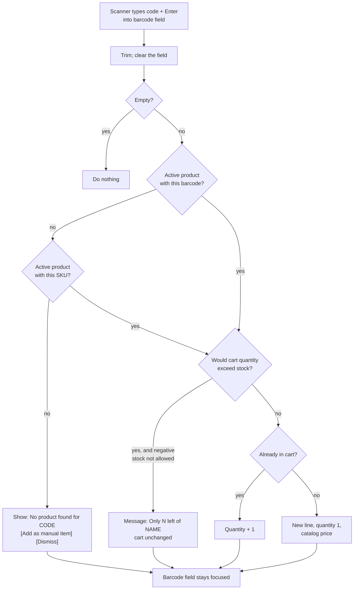
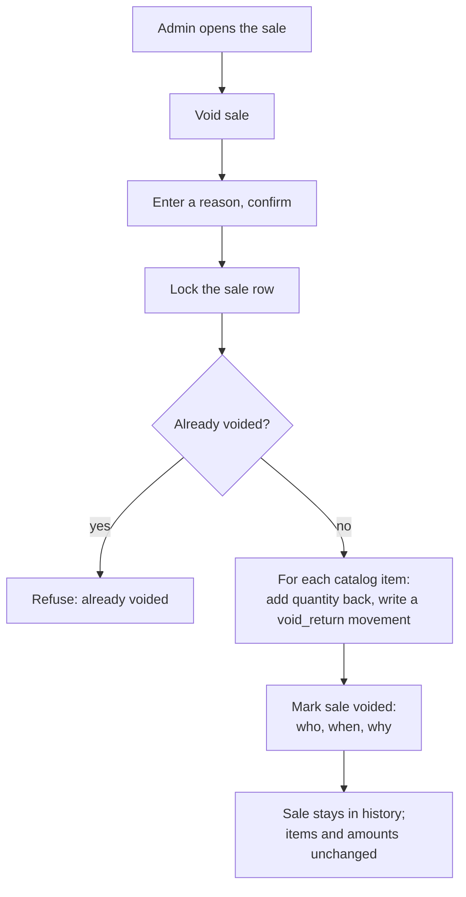

# K6 Tindahan — POS Workflow

How the cashier screen (`/pos`) behaves, step by step. This is the behavioural specification for Phases 6 and 7 of [implementation-plan.md](implementation-plan.md). Where this document and the code in the plan disagree, fix the code.

---

## 1. Who uses it and what they need

The cashier is often a family member or helper with little computer experience, serving a queue at a small counter. They need to:

- sell an item in one action (scan it, or tap it);
- always see the total and the change;
- never be stopped by the system for something they cannot fix themselves.

Design consequences: one screen, no navigation during a sale, large text and buttons, the scanner always "live", plain-language messages that say what to do next.

---

## 2. Screen layout

Desktop and touchscreen (1024 px and wider): two columns. Below 1024 px the cart drops under the product area.

```
┌─────────────────────────────────────────────────────────────────────────────────────┐
│ Aling Nena Store                         Ana   [Sales history] [Admin*] [Log out]   │
├───────────────────────────────────────────────────────┬─────────────────────────────┤
│ [ Scan barcode            ] [ Search name, SKU…     ] │ Cart (5)       [Clear cart] │
│                                                       │─────────────────────────────│
│ ⚠ No product found for 4800… [Add as manual] [Dismiss]│ Coke Mismo 295ml         ×  │
│                                                       │ [−] [ 2 ] [+]   ₱20.00 each │
│ (All) (Drinks) (Snacks) (Household)   [+ Manual item] │                      ₱40.00 │
│                                                       │─────────────────────────────│
│ ┌────────┐ ┌────────┐ ┌────────┐ ┌────────┐           │ Ice (plastic)  [Manual]  ×  │
│ │ image  │ │ image  │ │   S    │ │ image  │           │ [−] [ 3 ] [+]    ₱5.00 each │
│ │ Coke   │ │ Royal  │ │ Sky-   │ │ Piattos│           │                      ₱15.00 │
│ │ ₱20.00 │ │ ₱20.00 │ │ flakes │ │ ₱20.00 │           │                             │
│ │ 48 left│ │ 24 left│ │ ₱8.00  │ │ 3 left │           ├─────────────────────────────┤
│ └────────┘ └────────┘ └────────┘ └────────┘           │ Subtotal             ₱55.00 │
│ ┌────────┐ ┌────────┐ ┌────────┐ ┌────────┐           │ Discount (₱)*      [      ] │
│ │  ...   │ │  ...   │ │  ...   │ │  ...   │           │ TOTAL                ₱55.00 │
│ └────────┘ └────────┘ └────────┘ └────────┘           │ Cash received (₱) [   100 ] │
│                                                       │ [Exact][₱50][₱100][₱200]    │
│                                                       │ [₱500][₱1,000]              │
│                                                       │ CHANGE               ₱45.00 │
│                                                       │ [      COMPLETE SALE      ] │
└───────────────────────────────────────────────────────┴─────────────────────────────┘
  * Admin link: admins only.   * Discount row: users with the discount permission only.
```

| Element | Size and style |
|---------|----------------|
| Base text | 18 px |
| Inputs | 56 px high, 20 px text |
| Buttons and tap targets | at least 48 × 48 px |
| Total and change | 36 px, bold, tabular figures |
| Complete Sale | 64 px high, full width, green; grey when disabled |
| Payment panel | dark background, white text (the high-contrast area) |
| Theme | light only; no animation except colour change on hover |

Product card: image (or the product's first letter on grey), name (two lines maximum), price, stock left. The stock badge turns red at or below the low-stock threshold. A card with no stock is dimmed and cannot be tapped, unless the store allows negative stock.

---

## 3. The scanner

USB barcode scanners in HID mode behave like a keyboard: they type the code very fast and press **Enter**. No driver or SDK is used.

**Scanner setup (once):** keyboard (HID) mode, suffix = Enter (CR). Most scanners ship this way.

### 3.1 Focus rules

The barcode field must be ready whenever the cashier is not typing somewhere else.

| Event | Result |
|-------|--------|
| POS opens | Barcode field focused |
| Any click or tap that is not inside an input or a modal | Barcode field focused |
| A printable key is pressed while focus is not in an input | Barcode field focused first, so the character lands there |
| A modal closes | Barcode field focused |
| "New sale" after a completed sale | Barcode field focused |
| A modal is open | Focus stays in the modal; scanner rules are suspended |
| Cashier clicks into Search, Quantity, Discount or Cash | Focus stays there until they click elsewhere |

The third rule is what makes the scanner safe after tapping a product card: without it, the scanner's Enter would "press" the card that was last tapped.

### 3.2 Scan flow



Notes:

- Inactive and deleted products are treated as not found.
- The "not found" notice stays until dismissed, until the next successful scan, or until the manual-item form opens.
- A scan that lands in the **Search** field also works: pressing Enter there adds an exact barcode or SKU match, or the only search result.

---

## 4. Finding products without a scanner

| Action | Result |
|--------|--------|
| Type in Search | Grid filters by name, SKU or barcode (contains), 0.3 s after typing stops |
| Press Enter in Search | Exact barcode/SKU match, or the only result, is added to the cart and the search clears |
| Tap a category chip | Grid shows only that category; "All" clears it |
| Tap a product card | Product is added (same stock rule as scanning) |

The grid shows active products only, ordered by name, 60 at most. Search and category narrow it.

---

## 5. The cart

| Control | Behaviour |
|---------|-----------|
| **+** | Quantity + 1 (blocked beyond available stock for catalog items) |
| **−** | Quantity − 1; at 0 the line is removed |
| Quantity box | Type a number and leave the field to set it; 0 removes the line; capped at 9,999 |
| **×** | Removes the line |
| **Clear cart** | Asks "Clear the whole cart?"; then empties the cart and starts a new sale |
| Price (underlined) | Shown as a button only to users who may override prices; opens the price form |

Catalog items appear once; scanning again increases the quantity. Manual items are never merged, even with the same name.

The cart is kept on the server (in the session), so reloading the page or a brief network drop does not lose it. The browser cannot write the cart directly.

### 5.1 Changing a price for this sale

1. Tap the item's price in the cart. (Not visible without the permission; the server also refuses.)
2. A small form opens with the current price selected. Type the new price, press **Save** or Enter.
3. The cart shows the regular price struck through next to the new price.
4. **Use regular price** puts it back.

The product's regular price is never changed. The sale records the regular price, the price charged, and who changed it.

### 5.2 Manual item

For something that is not in the product list (or a barcode that was not found).

1. Tap **+ Manual item**, or **Add as manual item** on the not-found notice.
2. Enter item name, quantity (default 1) and unit price. **Add to cart**.
3. The line appears with a yellow **Manual** tag.

Manual items do not create a product and do not affect stock. They are marked as manual on the sale and in reports.

---

## 6. Payment

| Field | Rule |
|-------|------|
| Subtotal | Sum of line totals |
| Discount (₱) | Only shown to users with the discount permission. A peso amount off the whole sale, never more than the subtotal. |
| Total | Subtotal − discount |
| Cash received | Typed, or set with **Exact** / bill buttons |
| Change | Cash − total (shown as ₱0.00 until cash covers the total) |
| Complete Sale | Enabled only when the cart has items and cash ≥ total. Enter in the cash field does the same. |

### 6.1 Completing a sale

```mermaid
sequenceDiagram
    actor C as Cashier
    participant P as POS (Livewire)
    participant S as CheckoutService
    participant DB as MySQL

    C->>P: Complete Sale
    Note over P: Button disabled while saving
    P->>S: checkout(user, cart, discount, cash, token)
    S->>DB: Sale with this token exists?
    alt already saved (double click / retry)
        DB-->>S: existing sale
        S-->>P: existing sale
    else new sale
        S->>S: Check permissions (discount, price override)
        S->>DB: BEGIN
        S->>DB: Lock product rows (ascending id)
        S->>S: Re-check: active? price unchanged? enough stock?
        S->>S: Totals; cash ≥ total?
        alt any check fails
            S->>DB: ROLLBACK
            S-->>P: Refused, with reason
            P-->>C: Message; cart kept
        else all pass
            S->>DB: Insert transaction, set reference number
            S->>DB: Insert items (snapshots)
            S->>DB: Deduct stock + write movements
            S->>DB: COMMIT
            S-->>P: Sale
        end
    end
    P-->>C: "Sale complete" — change due, [Print receipt] [New sale]
    Note over P: Cart cleared, new token issued
```

Stock is deducted only inside the same database transaction that saves the sale. If anything fails, nothing is saved and nothing is deducted.

### 6.2 After the sale

A full-screen panel shows the transaction number, total, cash and the **change in very large type**. **New sale** is focused, so Enter starts the next customer. **Print receipt** opens the receipt in a small window with the print dialog.

---

## 7. Messages

Every message says what happened and what to do. Messages appear as a red banner at the top for 4.5 seconds (tap to dismiss); the cart is never cleared by an error.

| Situation | Message | What the cashier does |
|-----------|---------|-----------------------|
| Unknown barcode | No product found for **CODE**. | Add as manual item, or dismiss and search |
| Adding beyond stock | Only N left of NAME. | Sell fewer, or ask the owner to adjust stock |
| Stock ran out before payment (another till sold it) | Not enough stock: NAME (only N left). | Reduce the quantity and complete again |
| Price changed before payment | Some prices have changed. The cart was updated — please check the total and try again. | Tell the customer the new total; complete again |
| Product removed or deactivated before payment | No longer available: NAME. Remove it from the cart. | Remove the line |
| Cash below total | Cash received is less than the total (₱X). | Take more cash |
| Discount above subtotal | Discount cannot be more than the subtotal. | Lower the discount |
| No permission (tampered request) | You are not allowed to change prices. / …apply discounts. | — |
| Product no longer available when tapped | That product is no longer available. | Pick another |
| Session expired | Livewire's "page expired" prompt | Reload and log in |

---

## 8. Voiding a sale (back office)

Voids are done by an admin in **Sales → Transactions**, not at the POS.



Manual items have no stock to restore. If the goods are not actually going back on the shelf, the admin follows the void with a "Lost" or "Damaged" stock adjustment.

---

## 9. Receipt

Opened from the sale-complete panel, the transaction list or the transaction detail page. It is a plain page sized to the roll:

| Paper | Page width | Printable width | Font |
|-------|-----------|-----------------|------|
| 58 mm | 58 mm | 48 mm | 10 px monospace |
| 80 mm | 80 mm | 72 mm | 12 px monospace |

Contents, top to bottom: store name, address, phone · VOIDED mark if voided · transaction number, date and time, cashier · each item (name; quantity × unit price; line total) · subtotal, discount if any, total, cash, change · footer message · "This is not an official receipt."

**Printer setup (once, in the browser's print dialog):** choose the thermal printer, paper size = the roll width, margins = none, headers and footers = off. Save as the default.

---

## 10. Manual test script

Run this with a real scanner and printer before the store goes live. Log in as the cashier.

| # | Do this | Expect |
|---|---------|--------|
| 1 | Open `/pos` | Cursor is in the barcode field |
| 2 | Scan a known item | It appears in the cart, quantity 1; cursor back in the barcode field |
| 3 | Scan it again | Quantity 2, still one line |
| 4 | Tap a product card, then scan a different item without clicking anywhere | The scanned item is added; the tapped card is not added a second time |
| 5 | Scan an unknown barcode | "No product found" notice with **Add as manual item** |
| 6 | Add it as a manual item, ₱5 × 2 | Line with a Manual tag, ₱10.00 |
| 7 | Type part of a name in Search, press Enter with one result | That item is added, search clears |
| 8 | Tap a category chip | Grid shows that category only |
| 9 | Press **+**, **−**, type a quantity, press **×** | Quantity and totals follow each action |
| 10 | Add an item until it exceeds its stock | "Only N left" and the quantity stays |
| 11 | As a cashier without the permission, look at a cart price | It is plain text, not a button |
| 12 | As a permitted user, tap the price and change it | Old price struck through, new price used |
| 13 | Enter less cash than the total | Complete Sale stays grey |
| 14 | Tap a bill button that covers the total | Change appears; Complete Sale turns green |
| 15 | Double-tap Complete Sale quickly | One sale only (check Sales history) |
| 16 | On the sale-complete panel, press Enter | Panel closes; cursor in the barcode field; cart empty |
| 17 | Add items, reload the browser | Cart is still there |
| 18 | Complete a sale, **Print receipt** | Receipt prints at full width with nothing cut off |
| 19 | On a second device, sell the last unit of an item at the same moment | One till succeeds; the other shows "Not enough stock" |
| 20 | As admin, void the sale from step 18 | Marked voided; stock is back; receipt reprint shows VOIDED |
